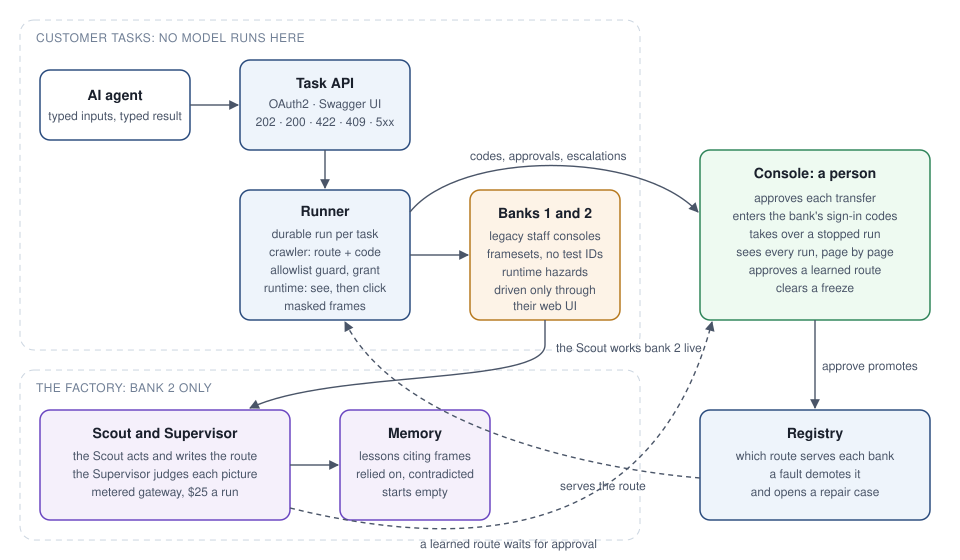

# Generic Bank

Banks run a lot of back-office screens with no API at all. This gives an AI agent one: it calls with typed inputs to check a balance or move money, and gets a typed result back. Behind it, a crawler works the bank's staff console the way a teller does, looking at each page before it clicks. A person approves every transfer. Anything the system can't finish safely goes to a person, with the pictures of what happened.

The target app is two local banks, both deliberately unfriendly: 2003-style consoles, server-rendered, framesets, nested tables, no test IDs. Bank 1's crawler was written by hand, from evidence. Bank 2's is learned by a software factory. Two agents, a Scout and a Supervisor, work it out on the live site, and a person approves what they wrote before it's used.

## Run it

You need macOS 14 or newer, [Docker Desktop](https://www.docker.com/products/docker-desktop/) and git. An 8 GB Mac is enough.

```sh
infra/scripts/bootstrap.sh      # installs just, checksum verified
just setup                      # once: checks the Mac, creates every secret, builds the images
just up                         # both banks, the API, the Console, the runner, memory, the factory
just open                       # Swagger UI, the Console and the staff inbox
just try promo                  # a balance through the API, with a forced interstitial
```

`just up` writes ACCESS.md, the one place with every page, login and member, and the demo in short; `just open` opens the pages. The factory needs one key you bring: `just secret-set factory OPENROUTER_API_KEY`.

## How it fits together



- **The API** ([`apps/api`](apps/api/src/server.ts)): OAuth2, then `POST /tasks/check-balance` and `POST /tasks/transfer` with typed inputs. A run answers 202 while working, 200 with its result, 422 for the bank's own answer ("no such member"), 409 when a person has it, and 502 or 503 for a failure, with `retryable` set. `GET /banks` lists what each bank serves, and `GET /tools` gives the agent its tool definitions. Swagger UI documents every call.
- **The run** ([`apps/runner`](apps/runner/src/execute.ts)): a durable workflow per task. It holds one browser, runs the bank's crawler, records every page as a masked frame, asks a person through the Console when only a person can answer, and settles exactly one result.
- **The runtime** ([`packages/runtime`](packages/runtime/README.md)): Playwright and Chrome, seeing first. A page is ready when its picture holds still and nothing says loading. A field is found by its drawn label, and a button by its drawn name, whatever the page built it from. Masking paints every personal value out of the picture before anything is kept.
- **The crawler** ([`packages/crawler`](packages/crawler/src/crawl.ts)): a table and a loop. The table is data: each page of the bank, the words that show it, and what a teller does there. One loop runs any table: look at the page, return the bank's answer if it gave one, start again from home on trouble, otherwise do the row the page shows. [Bank 1's table](packages/crawler/src/bank1.ts) cites a frame of [its evidence](docs/evidence/bank-1/README.md) on every row.
- **The Console** ([`apps/console`](apps/console/src/main.ts)): where a person works. The inbox holds codes the bank sends, transfers to approve, and runs that stopped. Each run is shown page by page, with its pictures. Learned tables wait there for approval.
- **The factory** ([`apps/factory`](apps/factory/src/run.ts)) and **memory** ([`apps/memory`](apps/memory/src)): they learn bank 2 and repair it when its site changes. See [the factory's walkthrough](docs/factory.md).

## How it meets the brief

- **Driving a messy legacy UI.** The runtime sees the rendered page (picture, visible text, controls by role and position) and never the bank's source. Labels in cells of their own, buttons that are styled text, two links with one name: each is found the way a person finds it. Walking bank 1 for real turned up seven problems the synthetic tests never had; each became a runtime rule with a test, listed in [the evidence walkthrough](docs/evidence/bank-1/README.md#what-the-walk-changed).
- **Outcomes kept apart.** The bank's answers ("insufficient funds", "member closed") are business outcomes, matched by its own words and returned as 422. Trouble (an outage, an error page, a balance that didn't load) is handled inside the run: start again from home, a bounded number of times, never after Submit. Past that, it's a failure, 503 when retrying may help. The [outcome tests](tests/outcomes/outcomes.test.ts) prove one of each.
- **Escalation.** A page no row knows, the same page three times, or an unclear result after Submit stops the run as 409 with its frames. A person sees it in the Console, then resumes it, finishes it by hand or cancels. The [escalation test](tests/escalation/escalations.test.ts) goes 409, then resume, then 200, through the API.
- **Safety.** Every action passes the job's [allowlist](packages/guardrails/allowlists) first; a refusal trips the guard and freezes the bank. Submit needs a single-use grant, which only a person's approval issues, and it's pressed once. A run that resumes afterwards reads the account's history for its memo token and never presses again. Masking covers the picture, the page text and the address before anything is stored, and the [PII suite](tests/pii/pii.test.ts) searches every row, object and log line for every seeded value.
- **Across tenants.** A bank is just data: its table. Everything else (the loop, the runtime, the guard, the API) is shared. Another bank on the same vendor product gets its table from the factory, and a person approves it before it serves anyone.

## Cut lines

- **Transfers over a bank's manager threshold.** Bank 1 asks a supervisor for an approval code above $2,500. Its table doesn't know that page, so the run escalates and a person finishes it.
- **The factory serves bank 2 only.** Bank 1's table is written by hand from evidence, and its author fixes it when the bank changes.
- **Desktop apps.** The runtime is a browser. The table-and-loop design doesn't depend on it, but nothing here drives a desktop window.
- **Scale.** One runner, two runs at a time, on a laptop. The run is durable and the abstractions are per bank, but there's no cluster.

[From 80% to 100%](docs/80-to-100.md) says what AI wrote, what changed, what was thrown away, and what unattended use still needs. [The architecture](docs/architecture.md) covers the data and where the risky parts live.
