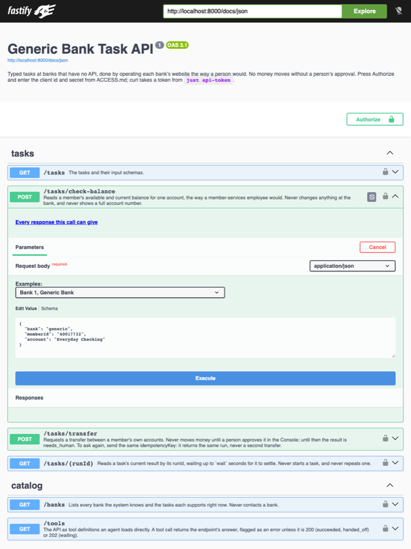
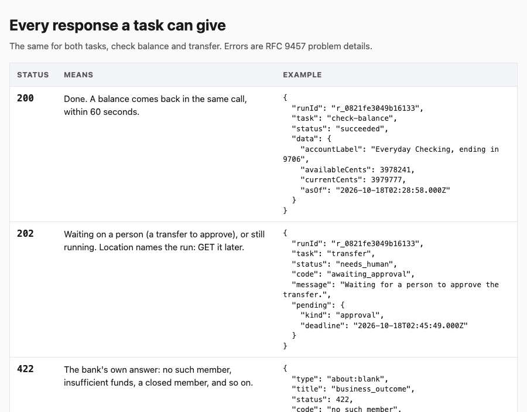
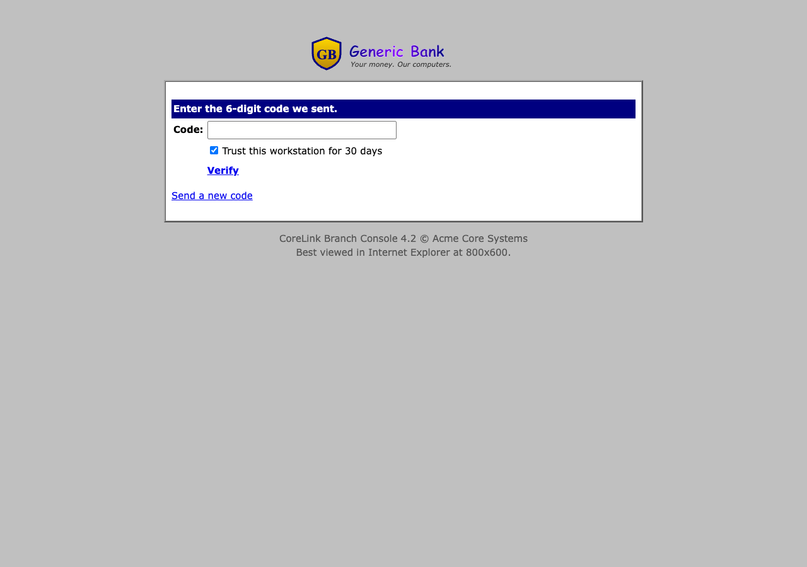
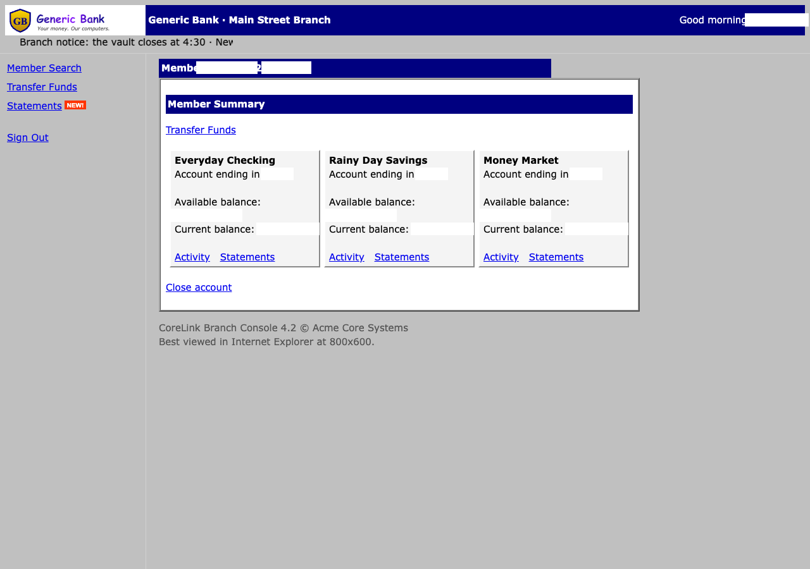
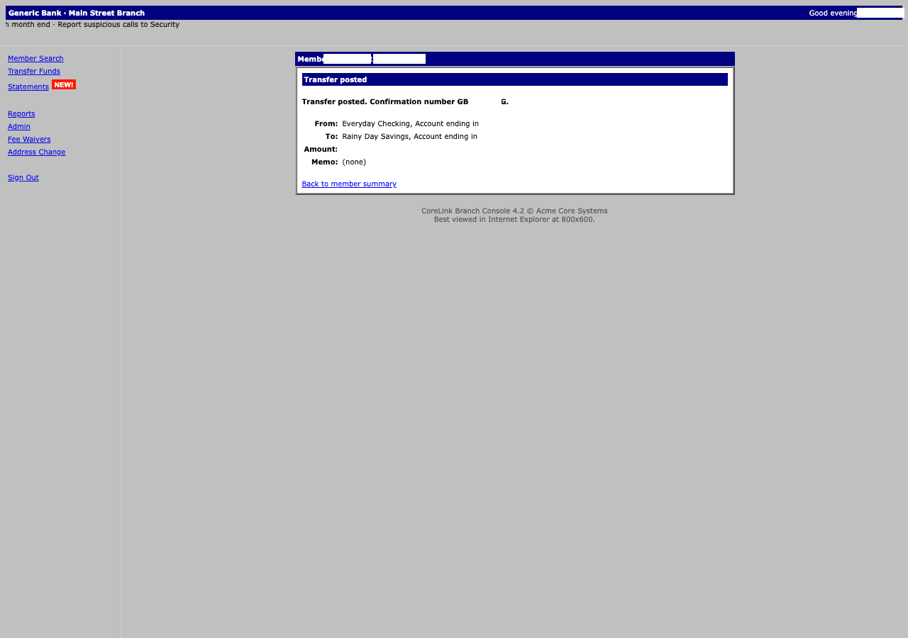
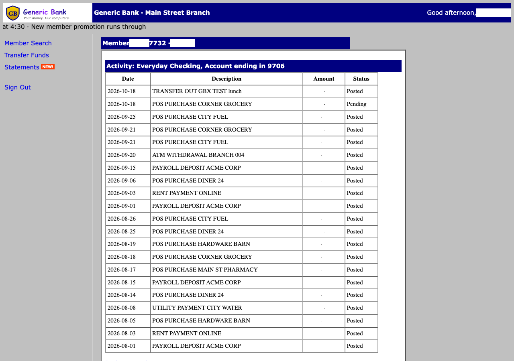
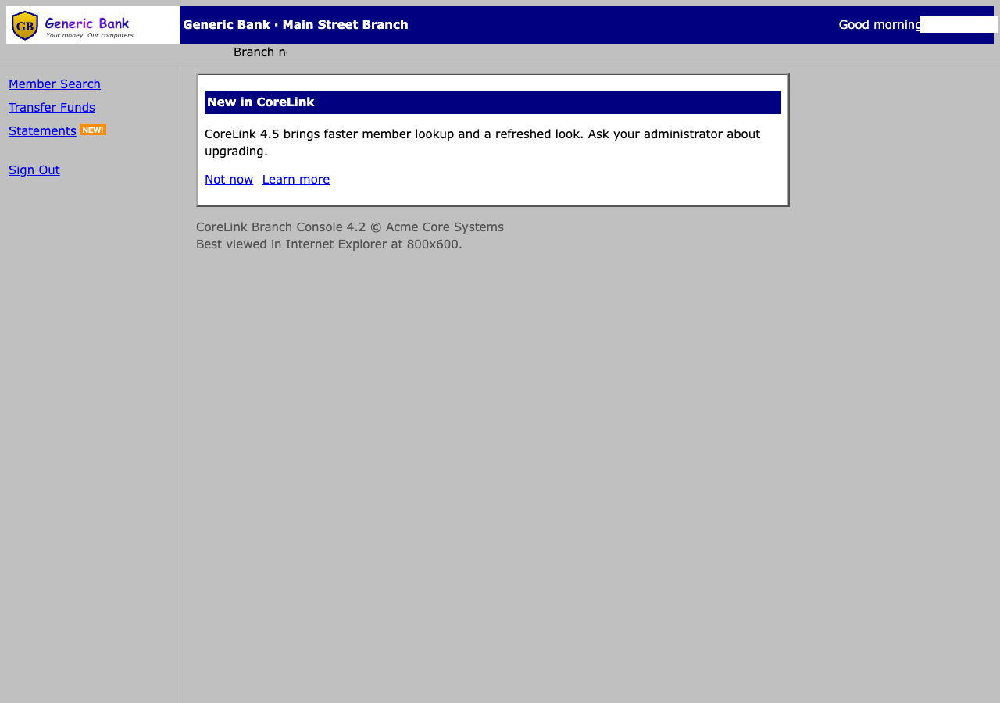
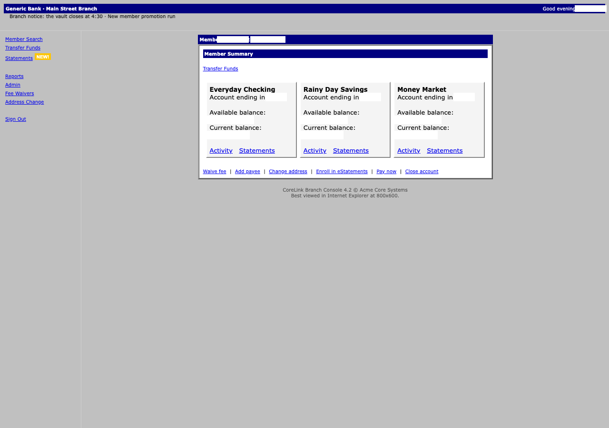

# Demo 1: Bank 1, a crawler built ahead of time

Bank 1's crawler was built before any task ran. Its route, the data the crawler replays, was written from a recorded walk through the bank's pages, and a person reviewed it. Nothing improvises while a task runs. This demo shows an agent's two tasks working through the API, a person approving a transfer, the crawler surviving three kinds of trouble, and the guard refusing an action it isn't allowed.

## Before you start

Run `just up`, then `just show`. That opens ACCESS.html, [Swagger UI](http://localhost:8000/docs), the [Console](http://localhost:8080), both banks and the [simulated inbox](http://localhost:8089), where the banks' sign-in codes arrive. Every login and member number is on the ACCESS page.

## 1. Authorize

In [Swagger UI](http://localhost:8000/docs), press **Authorize** and enter the client id and secret from ACCESS, under Logins. Swagger UI gets the token itself.

Each section is a short list. A call opens when you click it, and after you run it, it shows only the answer it really gave. Each task call also has a link, **Every response this call can give**, which opens a page with every status and a real example of each.

 

## 2. Get a balance

Open `POST /tasks/check-balance`, press **Try it out**, keep the example (John Doe, `40017732`, Everyday Checking), and press **Execute**.

The first time, the bank asks for a sign-in code, so the call answers 202 with `awaiting_staff_code` and a `runId`. Copy the code from the [simulated inbox](http://localhost:8089) with **Copy code**, and enter it in the Console's [**Inbox**](http://localhost:8080/inbox). Then open `GET /tasks/{runId}`, give it the `runId`, and run it: it answers 200 with the balance.

The bank remembers the workstation for 30 days. Run the balance again and there's no code to enter: the same call answers 200 with the balance.

 

## 3. Make a transfer, with a person's approval

Open `POST /tasks/transfer`, keep the example, and press **Execute**. It answers 202 with `awaiting_approval`. The crawler has stopped on the bank's review page, and no money moves until a person approves.

In the Console's [**Inbox**](http://localhost:8080/inbox), the approval shows From, To, Amount and Memo as the crawler read them off the review page, next to a masked picture of that page. Approve it with a reason of at least ten characters. Then run `GET /tasks/{runId}`: it answers 200 with the bank's confirmation number.

To see what happened, open the run in the Console's [**Runs**](http://localhost:8080/runs). Each step reads as "what it did, then the page it got", and **Frames** shows every page the crawler saw, masked.

Sending the same `idempotencyKey` again returns the same run, never a second transfer. While a transfer is still open, the same member, accounts and amount under a new key answers 409 `duplicate_transfer`, pointing to the open one. To make another transfer once the first is done, change the key.

 

## 4. Throw three kinds of trouble at bank 1

Open the Console's [**Hazard lab**](http://localhost:8080/lab). Generic Bank (bank 1) and Check Balance are already chosen. Keep the healthy member, tick one hazard, and press **Start the run**. If the bank asks for a code, enter it in the Inbox as before. Each run ends with the result printed beside its hazard, and its frames show what the crawler saw.

To see a hazard in your own browser instead, press its **Copy arguments** button and paste the arguments onto the end of [a bank 1 address](http://localhost:8081/corelink/).

| Hazard | What the bank does | What the crawler does |
|---|---|---|
| `promo` | Shows a promotion where the home page should be | Treats it as the home page and carries on |
| `confirm-dialog` | Pops up "This member has 2 unread alerts. View them now?" | Dismisses the dialog and records that it did |
| `swallowed-click` | Ignores the first click on Search | Sees the same page come back, and does that page's steps again |

 

## 5. Watch the guard refuse "Close account"

The member summary has a **Close account** button. The crawler never presses it. Every action is checked against the task's allowlist before it happens, and anything that changes an account is refused on every page. If the guard ever refuses an action, it freezes the bank until an admin clears it.

This test shows the refusal for every task, on every page. It runs on your Mac, so it needs Node and the project's dependencies; `just dev` sets them up once.

```sh
npx vitest run packages/guardrails -t "refuses every trap"
```

Bank 2, where the factory builds the crawler, is [Demo 2](demo-2.md).
