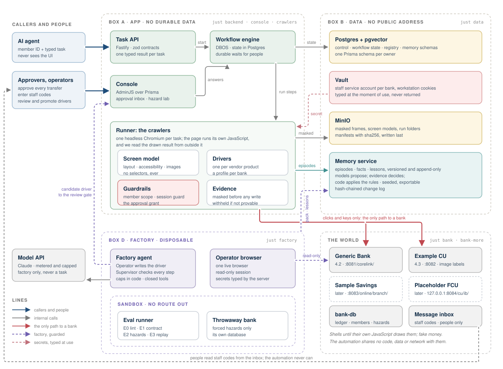
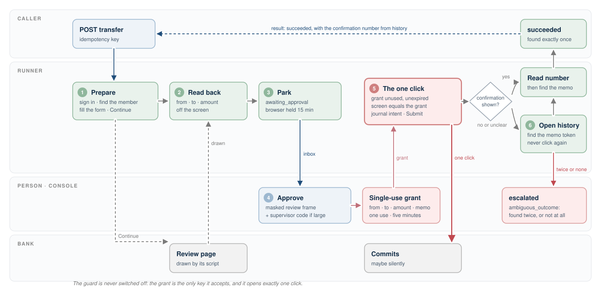
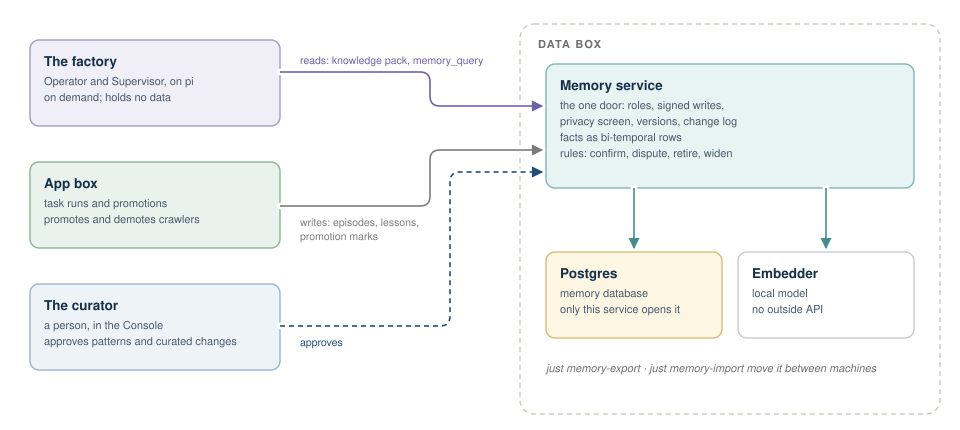

# Generic Bank: the plan

This is the whole plan in one document. **[Part 1](#part-1-what-we-build)** says what we build, in plain words.
**[Part 2](#part-2-with-more-time)** says what we would build with more time. The **appendices** hold the detail behind
both; read the chapters first and come to the appendices for specifics.

---

# Part 1: what we build

## 1. What we are building

Six things.

**1. A set of fake bank websites.** Four banks, all running the same made-up back-office
product: the staff console a credit union employee uses to look up a member, check a
balance, pull a statement or move money between accounts. They are old and awkward on
purpose. Framesets, nested tables, no ids, pages that only appear after their own JavaScript
runs, and real trouble while you use them: slow pages, script errors, outages, timeouts and
pop-ups. Each bank looks a little different and lives at a slightly different address.

**2. A crawler that does three jobs on those sites:** Check Balance, Transfer Funds and
Download Statements. An AI agent asks for a job through a small typed REST API, loading its endpoints
directly as tools. The crawler does
the job by working the website the way a person would: it looks at the screen, reads it,
clicks and types. It never targets CSS selectors. When it cannot go on safely, it stops and
hands the job to a person, with everything that person needs.

**3. A rule about money.** The crawler never moves money on its own. For Transfer Funds it
fills in the form and stops on the review page. A person approves the transfer in our
Console, and only then may the crawler press the one button that moves money.

**4. A software factory that builds a crawler for each site.** Given a new bank's address and
a staff login, AI agents explore the site, learn its screens, write its crawler, test it,
and put it on probation until real runs prove it. Because the banks share a product, a new
bank's crawler is usually a small profile, not new code. The agents run on **pi**
([pi.dev](https://pi.dev)), an open-source agent harness. Every model call goes through our
own meter, and every limit lives in our code. *[Read more about the factory.](#7-the-software-factory)*

**5. A memory that learns.** Everything the crawler and the agents see is recorded. The
agents propose lessons; fixed rules keep or retire them based on what really happened. Each
new bank is cheaper than the last. *[Read more about how memory works.](#11-memory-how-the-agents-remember)*

**6. An admin console to watch and steer it all.** Every run, every screenshot (with account
numbers, amounts and names covered by white boxes), every decision the agents made, the approval inbox,
and which crawlers are promoted, on probation, demoted or stuck.

All of it is TypeScript on Node, and it runs on a laptop with docker-compose and make.

**What the demo shows.** An AI agent asks for balances, statements and transfers through the
API. Banks 1 and 2 work end to end: balances, statements, and transfers
with a person's approval. The factory builds bank 2's crawler by itself, starting from what
it learned on bank 1. Banks 3 and 4 wait for the factory, as the next sites to learn.

---

## 2. How it fits together



Three boxes, split by what they hold and what they may reach.

- **Box A, the app,** runs the Task API, the Console, the task runner and the crawler. It
  keeps nothing; it can be rebuilt at any time.
- **Box B, the data,** holds everything that lasts: Postgres, Vault for the staff
  passwords, object storage for masked screenshots, and Memory. It reaches nothing.
- **Box D, the factory,** runs the agents and their browser. It exists only during a factory
  session and is thrown away after. Its sandbox, where untested crawlers run, has no network
  route out.

The four banks are not ours. They stand in for the outside world, and the crawler is the
only thing that talks to them.

The risky parts live in four places: the one money-moving click (behind a person's grant),
typing passwords (fetched from Vault at the moment of typing, never shown), masking
(before anything is written), and code the agents wrote (sandbox only, until a person
approves it).

---

## 3. The agent's interface

This is what the brief asks for first: an interface an AI agent calls to get a job done,
with typed inputs and a structured result, knowing nothing about the screens behind it.

**Three tasks, nothing else.** `check_balance`, `transfer` and `download_statements`. Each
takes typed inputs (the bank, the member number, the account, the amount) and ends in exactly
one typed result: `succeeded`, a `business_outcome` the member should hear about, `needs_human`
while a person approves or answers a code, `escalated`, `failed` (saying whether a retry could
help), `expired` or `cancelled`.

**One API for every bank.** The API is about tasks, not crawlers, so it never changes when a
crawler is added. `bank` is just an input. The API looks up the promoted crawler for that bank and
task in the registry and runs it. Every crawler, written by hand or by the factory, implements
the same three functions with the same typed inputs and results; the factory's contract test
fails any crawler that does not. So when the factory promotes a crawler for a new bank, that
bank simply appears: no new endpoint, no new code, nothing to redeploy.

```text
 the agent ──▶ one API: check_balance · transfer · download_statements   (bank is an input)
                 │
                 ▼ the registry: which bank has a promoted crawler for which task
          Generic Bank      Example CU         Sample Savings     Placeholder FCU
          written by hand   built by factory   learned later      learned later
                 │
                 ▼ every crawler implements the same three functions
```

**Discovering the banks.** `GET /banks` lists every bank, its product version and the tasks it
supports right now. An agent asks it first, then calls the task it needs. A bank with no
promoted crawler for a task is refused before any browser opens.

**One door: REST, loaded as tools.** The API is plain REST: `POST /tasks/check-balance` and its
siblings, `GET /tasks/:id?wait=30` to wait for a result, `GET /banks`, and `GET /tasks`, a
catalog with every input schema. It documents itself: `GET /openapi.json` is the OpenAPI
description, and `/docs` is an interactive Swagger page where you can authorize with a token
and try every call against the local banks. The same reference is published with the project's
documentation site, so anyone can read the API without running anything. For agents, `GET /tools` returns
ready-to-load tool definitions (`list_banks`, `check_balance`, `transfer`,
`download_statements`, `get_task`), generated from the same type definitions as the endpoints.
An agent loads them and calls the API directly, with nothing in between. A test fails if a tool
and its endpoint ever disagree. An MCP server, for clients that want one, is a thin adapter on
top of this API and belongs to Part 2.

**What the agent gets back** is small and typed:

```json
{ "runId": "r_8f2c", "status": "succeeded",
  "data": { "account": "Checking ending in 7890", "availableCents": 123456,
            "currentCents": 130010, "asOf": "2026-10-14T18:02:11Z" } }

{ "runId": "r_91aa", "status": "needs_human", "code": "awaiting_approval",
  "message": "A person must approve this transfer before it is made." }
```

**What the agent never gets:** a screen, a selector, a screenshot, page text or a password.
And it cannot move money by itself: `transfer` answers `needs_human` until a person approves it
in the Console. And `transfer` requires an idempotency key, so an agent that retries a call
can never cause a second transfer.

**How an agent connects: OAuth2.** An admin creates an *API client* for each agent in the
Console, choosing what it may do (read results, check balances, fetch statements, request
transfers). The Console shows a client id, a client secret and a one-time starting code,
once. The agent trades the code for two tokens: an **access token** that works for 15 minutes
and a **refresh token** that lasts 30 days. Before the access token runs out, the agent trades
the refresh token for a fresh pair, so it stays connected through long-running tasks (a
transfer can wait an hour for a person). Each refresh token works once; if an old one is ever
used again, every token from that client is cancelled, because that only happens when a token
has been stolen.

**What the HTTP status says.** The status code alone tells the agent what to do next:

| The task | HTTP | The agent |
|---|---|---|
| still running, or waiting for a person to approve or answer a code | `202 Accepted` | waits and asks again after `Retry-After` |
| succeeded | `200 OK` | uses the result |
| the bank said no for a business reason | `422 Unprocessable Content` | tells the member why |
| **stuck: a person must take over** | **`409 Conflict`** | tells the member a person is looking into it |
| expired or cancelled | `410 Gone` | starts again, or gives up |
| failed, and a retry could help | `503 Service Unavailable` | retries after `Retry-After` |
| failed for good | `502 Bad Gateway` | gives up and says so |

Every error body follows the standard problem format, with the task's code, its run id and
whether a retry could help.

**When a person steps in, the agent just asks again.** A `409` hands the agent the task's run id
and the id of the person's to-do in the Console. A person opens it, sees the masked trail and
the last screen, and either clears the blocker on the bank and presses **Resume** (the crawler
reads the screen again, checks it is on the right member, and carries on), or **finishes the
job by hand** and records the result, or cancels it. Meanwhile the agent retries: the same
request with the same idempotency key, or `GET /tasks/{runId}`. Until a person acts it keeps
getting `409`; after Resume it gets `202` and then `200`; after a hand finish it gets `200` with
the person's recorded result. A retry never starts a second run, and while a transfer is
escalated, no new request can start another one for the same member, accounts and amount.

**The demo agent.** `make agent` starts a small member assistant on Claude, running on pi like
the factory, which loads the API's tool definitions and calls the REST API directly. It answers a member's questions ("what
is my checking balance?", "move $200 to savings", "send me last month's statement"), tells the
member when a transfer is waiting for approval, and explains a business outcome in plain words.
Without a model API key it runs a scripted conversation through the same tools, so anyone can
watch the whole loop. It connects with its own OAuth2 client, created by `make setup`. Details: [Appendix D](#appendix-d-task-api).

---

## 4. The banking sites

The product is **CoreLink Branch Console**, by a made-up vendor, Acme Core Systems. Our
system uses it the way an employee would, through one staff login per bank. It never signs
in as a member.

| Bank | Address | Role in the demo |
|---|---|---|
| Generic Bank | `localhost:8081/corelink/` | crawler written by hand |
| Example Credit Union | `localhost:8082/` | crawler built by the factory |
| Sample Savings Bank | `localhost:8083/online/branch/` | for the factory, later |
| Placeholder Federal Credit Union | `127.0.0.1:8084/cu/ib/` | for the factory, later |

What makes them hard:

- **You cannot see anything without running their JavaScript.** The server sends an empty
  shell; scripts draw the member search, the balances and the statement list.
- **Nothing has an id,** and the same button is written differently on every page. Some
  labels and buttons are pictures of text.
- **Things go wrong at random:** every page takes between a quarter of a second and nearly
  two seconds, scripts crash, the gateway returns 503, sessions expire, dialogs and promos
  pop up.
- **Each bank is a little different:** labels, layout, colors, account number formats, and
  how much a transfer can be before a supervisor must approve it. Generic Bank, the first one
  anyone sees, looks like 2003: grey bevelled buttons, tiny Verdana, a scrolling marquee, and
  "best viewed at 800×600".

The banks keep their own ledger in their own database, and generate statements from it on
request. Full details, every page and every hazard: [Appendix C](#appendix-c-generic-bank-the-target-product).

---

## 5. The crawler and its three jobs

**Check Balance.** Sign in, look up the member by number, find the account by its last four
digits, read the available and current balance off the screen.

**Download Statements.** Sign in, look up the member, open the statements page for the
account, press "Statement" for each month asked for, and keep the PDF that opens.

**Transfer Funds.** Sign in, look up the member, fill in the transfer, stop on the review
page and ask a person (section 6). After approval, press the button once and confirm the
transfer in the account's own history.

**How it sees.** The crawler runs a real Chrome and lets each page's JavaScript run. Then it
reads what was drawn, from outside the page: the browser's own layout, its accessibility
tree, and the screenshot. Buttons that are pictures of text are named by a fingerprint the
factory learned when it explored the bank. That gives it a list of
visible controls with names and positions, which is what a person sees.

**How it finds things.** By meaning, never by markup. "The field labeled Amount" is the box
next to the word Amount. "The Submit transfer button" is the visible control with that
name. An account is picked by its number, never by its position in a list.

**How it knows where it is.** Every screen the product can show has a fingerprint made of
the words on it. After every action the crawler checks which screen it is on. If it does not
recognize the screen, it stops and asks a person, rather than guess.

**When things go wrong,** there are four answers. The bank said no for a business reason
(insufficient funds, no such member): report it. Something recoverable happened (a dialog,
a timeout, a 503): deal with it quietly and note it. Something broke for good: stop and say
whether a retry could help. The crawler is stuck or unsure: stop safely and hand it to a
person.

No AI model runs inside these jobs. The crawler is plain, reviewed code; the AI works in the
factory. Details: the API in [Appendix D](#appendix-d-task-api), the crawler in [Appendix E](#appendix-e-the-runner-driving-a-messy-ui), every failure in [§D.4](#d4-how-failures-are-handled).

### 5.1 The browser's fingerprint: Chrome on a Mac

Real banks judge the browser before they judge the password. A bank's bot screen reads the
request headers, the client hints and what its own scripts can see, and turns away anything
that does not look like a person's browser. So the crawler presents **one precise, consistent
identity: Chrome on an Apple-silicon Mac**, the same one a member-services employee would
have on their desk.

- **Consistency, not disguise.** Every field agrees with every other field and with a
  reference captured from a real Mac. A browser that is right in nine places and wrong in the
  tenth stands out more than one that is plainly a crawler.
- **Set at launch, never patched.** The Runner's Chromium is told its identity before any page
  script runs: the user agent and its client hints (platform macOS), the request headers in
  Chrome's order, the screen (1512 × 982 at pixel ratio 2), eight cores and 8 GB, the language
  and the timezone. A value changed after a page's scripts have read it is worse than a wrong
  one, so nothing changes within a session.
- **Nothing is injected.** The identity is set through the browser's own controls, from
  outside the page. Two things therefore stay those of the Linux container, the graphics
  renderer and the installed fonts, because faking them would mean running our script inside
  the bank's pages. [Part 2](#23-browser-identity-real-chrome-on-real-macs) runs real Chrome
  on real Macs, which makes them true.
- **A test holds it.** A reference capture from a real Mac is a test fixture; a test compares
  the Runner's browser to it, field by field, and fails on any difference in what Part 1 sets.
- **The banks enforce it.** Banks 2, 3 and 4 refuse anything not shaped like a browser: curl
  (whose whole request is a `Host`, a `User-Agent: curl/…` and `Accept: */*`), a request
  missing what every browser sends, a headless user agent, or client hints that contradict the
  user agent. They answer with a "403 Access denied" page, as a bank's bot manager does. Bank
  1, the 2003 site, checks nothing.

The fields and values are in [Appendix W](#appendix-w-browser-identity-reference); how the
Runner sets them is in [§E.8](#e8-browser-identity-set-at-launch).

---

## 6. Transfers need a person



The crawler prepares the transfer and parks. A person sees, in the Console, the masked
review page and the amounts as the crawler read them, and approves, rejects or takes over.
Approval creates a single-use grant tied to that exact amount and those accounts. The guard
lets exactly one click through with it, and only if the screen still shows the same values.

If the result is unclear afterwards, the crawler never presses the button again. It looks in
the account's history for a code it typed into the memo field, and either confirms the
transfer or hands it to a person. Details: [Appendix F](#appendix-f-transfers-a-human-approved-activity).

---

## 7. The software factory

The factory is the heart of the project. It turns "here is a new bank" into a proven
crawler.

**Two agents, both running on pi.** The **Operator** drives a live browser on the bank,
explores, and writes the crawler. The **Supervisor** looks at the screenshot after every one
of the Operator's steps and says continue, wait or stop. Neither grades its own work. Each
runs as its own pi session; pi's tool-call hook enforces our list of allowed tools, and every
model request goes through our metering gateway, so spend and limits are ours, not the
model's.

**How a run goes.** Read what memory already knows about the bank. Explore it read-only and
record every screen. Write the crawler (usually a profile). Test it offline against a copy of
the bank with every hazard switched on, one at a time. Verify it live. Write down what was
learned. Ask a person to review it. Then run it on probation: two clean real runs earn
promotion.

**What keeps it safe.** The agents have no tool that moves money, runs script in a page or
reaches an unknown site. Their code runs only in the sandbox until a person approves it.
Without an API key, the factory runs in mock mode and replays a recorded run, so anyone can
watch it.

**What it costs, and the hard ceiling.** Only the factory spends money on models; a bank task
runs no model at all. Every model request is metered: tokens and cost are recorded per call and
per run, and shown in the Console's Cost page. **Each run is capped at $25 and each rolling week
at $150.** Turns, live sign-ins and active hours are capped too. The meter checks before every
call and refuses when a cap is reached, when the ledger cannot be read, or when a model has no
known price. A run may lower a cap, never raise it, and no model can change one. The full list
is in [§M.5](#m5-caps-in-code).

Details: [Appendix M](#appendix-m-the-software-factory) (factory), [Appendix N](#appendix-n-evaluations) (tests it must pass), [Appendix O](#appendix-o-the-prompt-library) (prompts).

---

## 8. The Console: where people step in

The Console is our operations website, built on **AdminJS** over the same Postgres data
everything else writes. (It is ours; do not confuse it with the banks' own staff console.)
It is where a person sees everything and where a person steps in. Five situations bring
someone to it:

- **A transfer needs approval.** The crawler has filled in the transfer and parked on the
  bank's review page. The person sees the masked review screen and the amounts, and approves,
  rejects or takes over. Large transfers also need the bank's supervisor code.
- **The bank sent a staff code.** The crawler cannot read the inbox, by design. The person
  reads the code and types it into the Console, and the crawler carries on.
- **The crawler is stuck.** It met a screen it does not know, or it cannot tell whether a
  transfer went through. The person sees the last screenshots and the steps so far, and takes
  over or cancels.
- **The crawler generator is stuck.** A factory run hit the same failure twice, ran out of
  budget, or could not make progress. It hands back a short report (what it knows, what it
  does not, what would settle it), and the person decides what happens next.
- **A new crawler is ready for review.** The factory built and tested one. The person reads
  the change, the test results and the run's screenshots, and approves it for probation or
  rejects it.

Every one of these actions is also an API call, so tests can drive them. Every action that
changes something needs a written reason, and the Console never shows an unmasked account
number or amount. Details: [Appendix G](#appendix-g-the-console).


The Console also shows what drives the machine, and lets a person shape it within limits:

- **The allowlist** of every job, exactly as the guard enforces it. Read-only: widening what
  the crawler may press is a reviewed code change, never a form.
- **The prompts** the factory's agents use, with every version, and, from any model call, the
  exact version it used and the masked text it sent. A person may edit or add a prompt; the
  edit becomes a draft that turns active only after its eval cases pass.
- **The memory:** lessons, facts, episodes and the change log, and a preview of what an agent
  would be told about any bank. A person may add or edit a lesson; each change is a new
  version, approved before it is served, and nothing is ever deleted.
---

## 9. Reviewing the evidence

Every run leaves a trail a person can read like a comic strip: one screenshot per step, from
the first page to the last, whatever the outcome. Beside each picture sit the step, the
screen the crawler thought it was on, what it did, and what happened next. A run that ends
badly always ends with a picture of the last screen.

The screenshots are real, but nothing personal shows. Before a screenshot is stored, every
account number, dollar amount, member name, email, address and field the crawler typed into
is covered with a white box filled with asterisks. The crawler knows where those are,
because it already knows where every piece of text is on the screen ([chapter 5](#5-the-crawler-and-its-three-jobs)). Anything it
cannot read, such as a picture or a canvas, is covered too. If a frame cannot be covered
with certainty, it is not kept: the trail shows "withheld" and the reason.

That is what makes the Console useful. An approver sees the review page they are approving.
An operator sees exactly where a stuck run stopped. A reviewer watches the factory's agents
explore a bank, step by step, and never sees a member's data. The same trail sits behind
every task run, every factory run, every eval and every probation run.

Details: [Appendix I](#appendix-i-evidence-redaction-and-observability).

---

## 10. Promotion and demotion

A crawler earns its place and can lose it. Every crawler, for every bank and job, is in one
state, shown on the Console as a colored badge:

- **draft:** the factory is writing it
- **candidate:** it passed its tests and is waiting for a person's review
- **probation:** approved, and running real jobs to prove itself
- **promoted:** two clean real runs in a row; it now serves every job for that bank
- **demoted:** it failed in real use; the previous version takes over, and a repair case
  opens for the factory
- **frozen:** a safety guard tripped; nothing runs for that bank until a person clears it
- **stuck:** a run has gone quiet for too long

Demotion is automatic. A crawler is demoted on its first real fault if it has not yet had two
clean runs since promotion, and otherwise after two faults in a row. A slow bank or a 503 is
the bank's fault, not the crawler's, and does not count. When a vendor changes its screens, the
loop is: runs fail, the crawler is demoted, a repair case opens, the factory fixes it, a person
reviews the fix, probation proves it, and it is promoted again. Details: [Appendix L](#appendix-l-driver-lifecycle-and-the-repair-loop).

---

## 11. Memory: how the agents remember

Without memory, every factory job starts from zero and rediscovers what the last one
learned. With memory, the factory learns from each job, from its successes and its mistakes,
and from every crawler it has shipped. The second CoreLink bank is cheaper than the first.

Memory keeps four kinds of thing:

- **Episodes:** what happened in each run. Always trusted, because they are records, not
  claims.
- **Hypotheses:** what an agent believes but has not proven. Never served as truth.
- **Facts:** claims about a bank, proven by a run that succeeded, such as "a fresh sign-in at
  Example Credit Union asks for a staff code by email".
- **Lessons:** advice for future jobs, such as "choose an account by its number, never by its
  position". Each lesson says what it rests on, and whether it holds for one bank, for every
  bank on the same product, or everywhere.

The agents may only propose. **Promotion is the proof:** when a crawler is promoted, memory
checks its own records and confirms the lessons those runs relied on. **Forgetting is by
evidence:** a contradiction disputes a lesson, two retire it, and a demotion undoes what its
promotion confirmed. Fixed rules do all of this; no model decides. A person approves anything
meant to hold everywhere. Nothing is ever overwritten, and every change is recorded with who
made it and why.

**Where it lives.** All of it is in one Postgres database on box B, behind one service, the
only thing allowed to open it. There is no graph database. Each kind of memory is a table:
episodes, hypotheses, facts, and the lessons with their versions. Every lesson and episode
also carries an embedding (a vector from a small local model, stored with pgvector), so the
service can find "things like this" as well as exact words, using Postgres's own full-text
search. A last table, the change log, records every write.

**How facts and decisions are written down.** A fact has a lifespan. It carries the moment it
became true (`valid_at`) and, once something contradicts it, the moment it stopped
(`invalid_at`). A fact is never deleted, only closed, so memory can always answer "what did we
believe when that run happened?" Decisions work the same way. When a rule confirms, disputes
or retires a lesson, nothing is edited in place: memory adds a new version of the lesson and
one row to the change log that says who decided (a rule, a role or a person), which run's
evidence it rested on, what the lesson said before and after, and a hash chained to the row
before it, so any tampering shows.

**Who writes and who reads.** Runs write episodes as they happen, by code. The Supervisor
writes proposed lessons at the end of a factory run. Memory itself writes confirmations and
facts, and only when a promotion checks out against its own records. A person writes only
approvals. On the other side, every factory run reads a **knowledge pack** at the start (the
lessons and facts that matter for this bank, best first), agents may ask follow-up questions
mid-run, and people read everything in the Console. The crawler that does real jobs reads
nothing from memory: it runs the reviewed crawler, and only reports back what happened.

It starts with a cleaned set of rules, lessons and failure scenarios, so the first run is not
a blank slate. In Part 2, memory moves onto a graph, Neo4j with Graphiti for the facts; the ideas stay the
same. *[Read about memory on a graph.](#20-memory-on-a-graph-neo4j-and-graphiti)* Details: [Appendix K](#appendix-k-memory-how-the-agents-remember).

---

## 12. Seeing what happened

Two questions come up every day: what did the crawler do, and what did the agent do. The
answer is always the same. It is in the database, and you see it in the Console: every step,
screenshot, recovery, guard decision, model call, tool call and verdict, all tied to one run
id. Logs are JSON with the same id. Traces are OpenTelemetry, so they can go to Grafana
Tempo, or to LangSmith or Langfuse, later, by configuration. Details: [Appendix I](#appendix-i-evidence-redaction-and-observability).

---

## 13. Keeping it safe

- **Every action the crawler may take is written down.** Each job has an allowlist: on this
  screen, this verb, on this control. Anything not on the list is refused, and the Console
  shows the list and every refusal. The bank's money and account-change controls appear on no
  list. *[See the allowlist.](#j1-the-allowlist-written-down)*
- No money moves without a person's single-use grant.
- The crawler acts only on screens that show the member the job named.
- Passwords and codes are typed by the system and never shown, logged or stored in the clear.
- Account numbers, amounts and names are masked before anything is written; a screenshot
  that cannot be proven clean is not kept.
- Text on a page is never treated as an instruction.

Every one of these is enforced in code and proven by tests. Details: [Appendix J](#appendix-j-guardrails). Why each
rule exists: [Appendix U](#appendix-u-why-each-rule-exists).

---

## 14. Running it

```
make setup     # once, after git clone
make up        # the banks, the crawler, the Console, the back end, the data
make demo      # Check Balance and Transfer Funds on banks 1 and 2
make factory   # the factory; mock mode until you set ANTHROPIC_API_KEY
make down
```

Configuration lives in `.env` (copied from `.env.example`) and SOPS-encrypted files. The model
key ships blank. Every group of services has its own make target, and the whole system can be
exported and imported with one command each. It fits on an 8 GB laptop. Details: [Appendix S](#appendix-s-running-it).

---

## 15. Why this answers the brief

| The brief weighs | Our answer, in one line | Details |
|---|---|---|
| System design | a typed REST task API that an agent loads directly as tools, over a crawler that reads screens, not markup | [Appendix T](#appendix-t-how-this-answers-the-review) |
| Robustness | every failure named, detected and reported one way | [§D.4](#d4-how-failures-are-handled) |
| Human in the loop | a real inbox for codes, approvals and stuck runs | [§8](#8-the-console-where-people-step-in), [Appendix F](#appendix-f-transfers-a-human-approved-activity) |
| From 80% to 100% | each first-draft mistake is replaced and covered by a test | [§T.4](#t4-from-80-to-100) |
| Generalization | one crawler per product, a profile per bank, and a factory that learns new banks | [§T.5](#t5-generalization-to-the-real-environment) |
| Safety | approval grants, masking, guard layers, a trap matrix and a PII scan | [Appendix J](#appendix-j-guardrails) |

---

## 16. Build order

Each milestone ends with its tests green, a short note in `docs/`, and the requirements report
updated: every point of the brief it touches gets a link to the code and the test that prove it. The factory is inside
the submission.

| # | Milestone | Done when |
|---|---|---|
| M0 | Skeleton: workspaces, compose with memory limits, auto-bootstrap of secrets, Prisma schema and first migration, AdminJS shell, CI, import boundaries | `make up` starts every service on an 8 GB laptop; CI green |
| M1 | Bank 1: ledger, seed, staff sign-in, codes, inbox, member lookup, member summary, activity, statements, transfer, supervisor approval, framesets, nested tables, markup dialects, forced hazards | bank tests green |
| M2 | Banks 2, 3 and 4, and ambient hazards: themes, labels, layout variants, URL bases, image text, account formats, bank 3's extra frame, bank 4's split transfer and popup results | all four banks seeded and browsable |
| M3 | Screen package and the first driver: capture, fully-rendered wait, recognition, targeting, image fingerprints, the CoreLink driver with bank 1's profile written by hand, Task API with OAuth2 (clients, tokens, refresh) and its HTTP status codes, trail, masking, AdminJS run pages and the API clients page | `checkBalance` succeeds on bank 1 under ambient hazards; outcome tests green |
| M4 | The browser's fingerprint (Chrome on a Mac, set at launch; banks 2 to 4 refuse anything not a browser), then human steps: inbox, codes, transfer preparation, approval grant, submit, swallowed-submit protocol, the tool definitions and the demo agent, `downloadStatements`, hazard lab | escalation and transfer-safety suites green |
| M5 | Guardrails complete, trap matrix, PII scan, customer-safe messages | guards and PII suites green |
| M6 | Memory service | memory suite green |
| M7 | **Factory:** workflow, model gateway, tools, caps, scout (autocrawl), evals E0 to E4, review gate, probation, driver states in the Console, mock mode | **the factory onboards bank 2 as a profile, end to end, and it is promoted after probation** |
| M8 | **Repair loop:** bump bank 1's `BANK_UI_VERSION`; runs fail; the driver is demoted; a repair case opens; a factory repair run fixes it | the repair is visible end to end in the Console |
| M9 | Prompt library, `check-prompts`, prompt eval runner; Console complete ([Appendix G](#appendix-g-the-console)) | `check-prompts` green; every Console page exists |
| M10 | README, diagram, the requirements report (every point of the brief, how we meet it, and links to the code and tests that prove it), the 80%-to-100% notes, a recorded factory run for mock mode | a reviewer can clone, `make up`, `make demo`, `make factory` in minutes |
| **Submission** | | |

The brief budgets about a day for its core. This plan is deliberately larger, because the
factory is the point, and the README says so plainly.

### 15.1 README outline (about two pages)

1. The problem as framed, and the assumptions, with a link to **the requirements report**: every
   point of the brief, how we meet it, and the code and tests that prove it
2. **Try the API**, in five steps:
   1. `make setup`, then `make up`.
   2. `make api-token` creates a local API client and prints a fresh access token.
   3. Open `http://localhost:8000/docs`, press **Authorize**, and paste the token.
   4. Call `GET /banks` to see which banks support which tasks, then `POST
      /tasks/check-balance` with one of the sample members listed on that page.
   5. Follow the run with `GET /tasks/{runId}`, and open it in the Console at
      `http://localhost:8080` to see every masked screenshot.

   The same reference, without running anything: the API page on the documentation site.
3. The diagram: boxes, data models, where the risky parts live
4. How the UI is read: perception, recognition, targeting by meaning and by sight
5. The outcome taxonomy, with links to the outcome tests
6. Transfers, approval and the swallowed submit
7. Escalation and safety: guardrails, masking, the trap matrix
8. The factory: how a second tenant is learned, proven and promoted, and how memory makes
   the next one cheaper; what it costs, with spend capped at $25 per run and $150 per rolling
   week
9. From 80% to 100%: what AI produced, what was changed and why, what was cut, and what is
   still needed before running unattended
10. With more time: Part 2

---

---

# Part 2: with more time

[Part 1](#part-1-what-we-build) runs on a laptop. [Part 2](#part-2-with-more-time) runs the same containers the way a bank would expect them to
run: provisioned from code, reachable only over a private network, with short-lived
credentials, intrusion detection and alerts. It is not part of the submission; the README
cites it under "what we would do with more time".

---

## 17. Goal

Run the same system on Hetzner, provisioned from code. It is reachable only over a private
network, and only by people who signed in with the organization's identity provider.
Credentials are short-lived everywhere, every host runs intrusion detection, and alerts
reach a phone.

Nothing in the application changes: the same compose services, the same boxes, the same
networks. Only the ground under them changes.

---

## 18. Shape

```text
                          operators (Google sign-in) ──▶ Tailscale ──┐
                                                                     │ private only
   internet ──▶ Hetzner Cloud Firewall ──▶ :443 only                 │
                      │                                              │
 ┌─ big box: A + B ───▼──────────────────────────────────────────────▼─────────────────┐
 │ Caddy (TLS, Let's Encrypt) ─▶ control: Task API (OAuth2) · Console (Google SSO)     │
 │ runner · memory · Temporal · Postgres · Vault · MinIO   (each on its own network)   │
 │ bank tenants on the world network (fake money; firewalled to runner and factory)    │
 │ Falco · CrowdSec + firewall bouncer · Wazuh agent · Vector                          │
 └──────────────────────┬────────────────────────────────────────────┬─────────────────┘
                        │ private network                           │ alerts
 ┌─ box D: factory ─────▼───────────────────┐               ┌─ ntfy ─▼─────────────────┐
 │ created per session by `make factory-up` │               │ phone push: guard trips, │
 │ destroyed by `make factory-down` once    │               │ stuck runs, intrusions,  │
 │ its run folders are uploaded             │               │ failed backups           │
 └──────────────────────────────────────────┘               └──────────────────────────┘
   Wazuh manager (no dashboard) on the big box · nightly encrypted backups to a Storage Box
```

One large dedicated-vCPU server carries boxes A and B. With 32 GB there is room for several
concurrent browsers. Box D stays a separate server that exists only during a factory
session, because disposability is the whole point of box D. Splitting A and B onto their own
machines later is a Terraform variable, not a redesign.

### 18.1 Encrypted at rest, encrypted in flight

Everything Part 2 stores is encrypted where it lies, and everything it sends is encrypted on
the wire. Every key lives in Vault, never beside the data it protects.

| | At rest | In flight |
|---|---|---|
| **Postgres** | data directory on an encrypted volume, unlocked at boot with a key from Vault | TLS only, clients verify the server's certificate; no plaintext listener |
| **MinIO** (evidence, run folders, statements) | server-side encryption on every bucket, keys from Vault's transit engine | TLS only |
| **Vault** | its own encrypted storage | TLS only |
| **Backups**: Postgres WAL and dumps, MinIO, Vault snapshots | encrypted on the host before they leave it; the backup store never sees a key or a plaintext byte | to the Storage Box over SFTP; the monthly off-provider copy stays encrypted |
| **Logs and traces** | encrypted volume | shipped over TLS |
| **Between machines** | | Tailscale (WireGuard) on the private network |
| **The edge** | | Caddy, TLS 1.3 with HSTS |
| **Banks 2, 3 and 4** | | HTTPS under the deployment's domain, with real certificates from Let's Encrypt, so the browser trusts them with no warning and the crawler meets secure cookies, mixed content and HSTS as a real bank presents them |

A restore drill ([chapter 29](#29-recovery-and-intrusion-response)) decrypts every backup
it restores, so a key that cannot open its backup is found in the drill, not in a disaster. A
weekly check fails if any listener accepts plaintext or any bucket stores without
encryption. Part 1, on a laptop, serves every bank over plain HTTP and keeps its data in local
Docker volumes.

---

## 19. Workflows move to Temporal

[Part 1](#part-1-what-we-build) runs workflows on DBOS Transact inside the control process. Here they move to a
**Temporal** server, with its UI behind Tailscale. That buys durability that does not depend
on the application process, a full execution history, and workers that scale and version
independently.

The move is contained by design. Part 1's workflow code already sits behind our own
interface (`startRun`, `waitForHuman`, `sleep`, `step`) and follows Temporal's rules: pure
decisions, side effects in steps, defaults on every input. The same workflow scenario tests
run against both implementations before the switch. In-flight DBOS runs drain before
cut-over; they are not migrated.


---

## 20. Memory on a graph: Neo4j and Graphiti

Part 1 keeps memory in Postgres tables, because a laptop cannot spare much. The ideas are the
same in both parts: episodes, hypotheses, facts and lessons; proposals from the agents and
decisions by rules; nothing ever overwritten. Part 2 gives those ideas the store they want: a
graph.

**Why a graph.** Memory is about connections. A bank runs a product; the product has screens;
a screen has controls; a sign-in is gated by a code; a lesson is evidence for a scenario, which
is confused with another scenario, which an approach recovers from. In tables those are joins.
In a graph they are the data, and questions like "what do we know about every bank that shares
this sign-in screen?" become one short query.

**Neo4j is the store.** A graph database holds all of memory: every node, every relationship and
every version. It listens only inside box B, and only the Memory service opens it. Episodes,
hypotheses, lesson versions and the change log are written in plain Cypher by code, with no
model in the loop. It is backed up every night, encrypted, and a monthly drill restores the
backup and compares counts.

**Graphiti is the semantic layer, for facts only.** Each fact is a **bi-temporal edge** between
two entities, such as `Example Credit Union GATED_BY staff code by email`. The edge carries
`valid_at`, `invalid_at` and `expired_at`: when the fact became true in the world, when it
stopped being true, and when memory stopped believing it. A fact that stops being true is
closed, never deleted, so memory can say what was believed at the time of any past run. The
idea is the temporal knowledge graph for agent memory of the Zep paper (arXiv:2501.13956).

- **Facts are built by code** from a run's records, in a fixed vocabulary, so no page text ever
  reaches a model through memory. Graphiti does ask a model one question: whether two entities
  or two facts are the same thing, and it asks only about the code-built triplet.
- **Retrieval is hybrid:** BM25 word matching and vector embeddings, fused by reciprocal rank.
  The embeddings come from a local model; no text goes to an outside API.
- **Graphiti's own episodes are not used.** Runs and attempts are written by our code, as they
  are in Part 1.

**How new data gets stored.** Every write goes through the Memory service, in this order:

1. **The run's episode.** When a run ends, code writes one run node and its attempt nodes,
   linked to the bank, the screens it reached and the outcome. No model is involved, and the
   write is signed with a key only code holds. A production task writes its episode through an
   outbox, so memory being slow or down never slows a task.
2. **The screen.** Every incoming value passes the privacy screen. Anything shaped like a
   password, a code, an account number or a person is refused before it is stored.
3. **New lessons.** The Supervisor's proposals are embedded locally and compared with the
   lessons already held in the same scope. A near duplicate adds its evidence to the existing
   lesson; anything new becomes a lesson node with a first version, marked proposed. Which
   served lessons the run relied on, and which it contradicted, become edges to those lessons.
4. **Hypotheses.** What the factory saw while exploring (screens, labels, transitions) is
   stored as hypothesis nodes. They are kept, never served as truth.
5. **On promotion, the facts.** Memory checks the promotion against its own records. If it
   holds, it adds a confirmed version to each lesson the probation runs relied on, and hands
   each verified fact to Graphiti. Graphiti finds or creates the two entities, looks for an
   existing edge that the new fact contradicts, closes that edge (`invalid_at`, `expired_at`),
   and adds the new edge with its `valid_at`. The hypotheses the fact came from are marked as
   proven.
6. **The change log.** Every one of these steps appends one node to the change log: who wrote
   (a role, a rule or a person), which run, what changed, and a hash chained to the node
   before. Each write and its log entry commit together, or not at all.

**The rest does not change.** The same roles and signed writes, the same privacy screen, the
same rules for confirming, disputing, retiring and widening lessons, the same knowledge pack,
and the same API, so the factory and the Console do not notice the move. Graphiti is a Python
library, so in Part 2 the Memory service gains a small Python companion for facts; the
service's API stays TypeScript.

**The move.** Part 1's tables map one to one onto the graph: episodes, hypotheses and lesson
versions become nodes, facts become Graphiti edges, and the change log keeps its hash chain.
`make memory-export` writes the bundle; the graph importer reads it, checks every hash, and
replays the change log in order, so the graph's history starts where the tables' history
ends.

| Memory | Part 1 (laptop) | Part 2 (graph) |
|---|---|---|
| Episodes, hypotheses | Postgres tables | Neo4j nodes, written in Cypher |
| Facts | rows with `valid_at`, `invalid_at` | Graphiti bi-temporal edges |
| Lessons and versions | rows, one per version | nodes, one per version |
| Search | full-text plus pgvector | BM25 plus vectors, fused by rank |
| Change log | hash-chained table | hash-chained nodes |

---

## 21. OCR: a second check on every screenshot

[Part 1](#part-1-what-we-build) masks screenshots from the screen model alone: it knows where every piece of text is,
so it covers what it must and withholds what it cannot prove, and it names pictures of text by
the fingerprints the factory learned. Nothing in [Part 1](#part-1-what-we-build) reads pixels as text. OCR arrives here,
as an independent second opinion, never as the first line.

- **A second masking check.** After masking, and before a frame is stored, OCR reads the
  masked screenshot again. If a known value or a sensitive pattern still shows, the spot is
  covered and the frame checked once more; a frame that still is not clean is withheld with
  the reason. It lives in `packages/evidence`, after the mask and before the store, so no
  unchecked frame is ever written.
- **A weekly audit.** The same check runs across every stored frame and pages someone on any
  hit.
- **The PII suite reads pixels too.** Today it checks that every place the bank drew a seeded
  value is covered; with OCR it also reads each stored frame and fails on any seeded value it
  finds anywhere.
- **Pictures the factory has not named.** When a bank shows an image of text with no learned
  fingerprint, OCR proposes its words as a fallback. The proposal is a candidate for the
  factory to confirm, never something a run acts on alone.
- **Screenshot-only surfaces.** For a target with no layout or accessibility tree (a remote
  desktop, a scanned form), OCR supplies the text and positions the screen model needs, so
  recognition, targeting, masking and the trail work as they do on the web.

**Engine.** `tesseract.js` with its language data baked into the Runner image, never fetched at
run time. Its memory and CPU per frame are why it waits for the larger box of
[§18](#18-shape): on the 8 GB laptop it would compete with the browsers. Every OCR read carries
its confidence; a low-confidence read never clears a frame, it only withholds one.

---

## 22. Scaling out

[Part 1](#part-1-what-we-build) runs one browser at a time on a laptop. Here the same design scales without changing
its shape:

- **More runners.** Runner workers scale horizontally, each with its own browser, pulling
  tasks from Temporal task queues.
- **A worker per bank.** Each promoted crawler runs in its own worker container behind the
  one API: no public address, no credentials of its own, a network route to its own bank only.
  The API routes `bank: "example"` to the Example worker; agents never see the difference. The
  Console shows each worker's bank, crawler version, state and health.
- **Per-bank limits.** A concurrency limit per bank, and a sign-in ledger shared by every
  runner, so more workers never means more pressure on any one bank.
- **Bigger data box.** Postgres moves to its own machine with a streaming replica; MinIO
  moves to object storage with the same S3 interface.
- **Factory sessions in parallel.** Several disposable factory boxes at once, one per bank,
  each with its own caps.


---

## 23. Browser identity: real Chrome on real Macs

Part 1 already presents Chrome on a Mac ([§5.1](#51-the-browsers-fingerprint-chrome-on-a-mac)),
set at launch in a Linux container. Two fields stay Linux there, the graphics renderer and the
fonts, because only script inside the page could change them. Part 2 makes every field true
instead of set:

- **Real Chrome, not the headless shell,** run headed, so the browser itself produces its
  headers, client hints and brand list.
- **Real Macs in the runner pool** (rented Apple-silicon hosts), so the graphics, fonts,
  screen and timezone are genuine.
- **The timezone and language match the network exit** the runner uses.
- **The same reference capture** ([Appendix W](#appendix-w-browser-identity-reference)) is
  the test, now with no exceptions.

---

## 24. Provisioning: Terraform and Atmos

- **Terraform** (the `hcloud` provider) owns everything permanent: the big box, the private
  network, the Cloud Firewall, the Storage Box for backups, DNS records, SSH keys.
- **Atmos** organizes the Terraform into components (`network`, `firewall`, `server`,
  `storage`, `dns`, `tailscale`) and stacks (`dev`, `demo`). The same components then produce
  a throwaway demo environment and a longer-lived one, with different variables.
- **Box D is not in Terraform state.** `make factory-up` and `make factory-down` create and
  destroy it with the `hcloud` CLI, using the network and firewall Terraform made.
  `factory-down` refuses to destroy the box until its run folders are in MinIO, and an idle
  check destroys it after 24 hours.
- **cloud-init** installs Docker, Tailscale and the host agents, then pulls pinned images by
  digest. There is no configuration drift: rebuilding a box is the upgrade path.

---

## 25. Access: Tailscale and Google sign-in

- **No public SSH.** Port 22 is closed at the Cloud Firewall. Operators reach the hosts over
  **Tailscale**. Its ACLs let box D reach only the control API, Memory and MinIO, and let
  people reach the Console and SSH by group.
- **People sign in with Google** (the organization's Workspace) everywhere: Tailscale, the
  Console (OIDC in place of local passwords, with Google groups mapped to `viewer`, `approver`
  and `admin`), and Vault.
- The **Task API** keeps its OAuth2 clients; the token-hashing key moves into Vault and
  rotates on a schedule. Its caller is a service, so it never signs in with Google.

---

## 26. Secrets: Vault with rotation

| Secret | How it is issued |
|---|---|
| Operator access to Vault | Google OIDC login; a policy per Google group; tokens live one hour |
| Service identities | AppRole per service (control, runner, memory, factory); secret ids wrapped and delivered at boot |
| Postgres credentials | Vault's database secrets engine: dynamic, per-service, short-TTL; the root password is rotated by Vault so no person knows it |
| Outbound mail for alerts and approval reminders (Gmail) | an app credential held in Vault and rotated on a schedule; services read it at send time |
| Staff service accounts and workstation cookies | KV v2, read only by the runner, only at the moment of typing |
| OAuth2 token-hashing key, signing keys, Memory role tokens | KV v2, rotated on a schedule with an overlap window |
| Bootstrap and break-glass | SOPS-encrypted files in git, decrypted only on the operator's machine |

Vault runs with integrated storage on the big box and auto-unseals from a key held outside
it. Its audit log ships with the other logs.

---

## 27. Permissions

- **Least-privilege Postgres roles** per service. The runner can write runs, steps and
  frames but cannot read the registry's audit. The Console's role cannot write evidence.
  Memory owns its schema, and nobody else can touch it.
- **Vault policies** mirror the same lines: one path per service, no wildcards.
- **Console roles** come from Google groups. Approvals are four-eyes: the approver must be
  someone other than whoever started the task.
- **MinIO** buckets per kind (frames, run folders), with per-service access keys from Vault.
- **Docker socket** access goes only through a filtering proxy. The socket is never mounted
  into an app container.

---

## 28. Detection and alerting

| Layer | Tool | What it watches |
|---|---|---|
| Runtime | **Falco** | unexpected processes, shells in containers, writes to sensitive paths, outbound connections from the sandbox |
| Logs and bans | **CrowdSec** with the firewall bouncer | brute force against the Console and the API, scans; bans at the host firewall |
| Host integrity | **Wazuh agent** and **manager**, no dashboard | file integrity, rootkit checks, configuration assessment; alerts forwarded, not browsed |
| Notifications | **ntfy** (self-hosted) | guard trips, stuck runs, frozen tenants, approvals waiting, intrusion alerts, failed backups, disk pressure, all to a phone |
| Logs | **Vector** | ships container and host logs, after redaction, to one place |

The Wazuh dashboard is deliberately not run. It is heavy, and the alerts that matter go to
ntfy anyway. When an investigation needs the dashboard, bring it up on a separate box on
demand and point it at the manager's data.

---

## 29. Recovery and intrusion response

**Targets.** Lose at most 5 minutes of data. Restore bad data on a live box in 15 minutes.
Rebuild a lost box in an hour. Do no more than 5 commands by hand at 3 a.m.; the rest is code.

```text
 DETECT ──▶ CLASSIFY ──▶ CONTAIN ─────────────────────▶ PAGE ──▶ PLAYBOOK ─────▶ LEARN
 Falco      S1 active    machine, in seconds:            phone    P1 app box     timeline in 48 h,
 CrowdSec   S2 attempt   snapshot and logs first,        until    P2 data box    plus one new rule
 Wazuh      S3 noise     ban the source, pause runners,  ack      P3 secret      or drill that would
                         data box to admin-only (30 min),         P4 exposure    have caught it
                         revoke every database lease               └─▶ rebuild from code + restore
 ──────────────────────────────── one backup spine ────────────────────────────────
 Postgres WAL, Vault, MinIO ──▶ encrypted, append-only repo ──▶ monthly off-provider copy
 box alive, data bad: restore in place (minutes) · box gone: rebuild from code + restore (≤ 1 h)
```

- **No standby replica, on purpose.** Recovery is always rebuild and restore, never promote:
  slower, but no second database to pay for, patch, watch for lag, or fence during a failover.
- **Automation may** ban, pause runners, lock the data box down to admin-only (it releases
  itself after 30 minutes unless a person holds it), revoke database leases, and snapshot
  first. **It never** deletes anything, rotates root keys, touches backups or changes Vault
  policies. Those are a person's calls.
- **Backups are append-only.** The credential on a box can add history, never remove it, so
  ransomware is answered by fresh boxes and a restore to a point before the incident.
- **A compromised box is never cleaned;** it is rebuilt from code.

| Lost | Answer |
|---|---|
| The data box | new box from Terraform, restore from the repo (≤ 1 h) |
| The app box | stateless: new box, redeploy the pinned images |
| The whole region | apply the stack in another region, restore from the off-provider copy, move DNS |
| The provider account | code, Terraform state, the off-provider backup and the break-glass keys all live outside it |
| Vault | restore its encrypted snapshot; without it, stored evidence is unreadable, so it is drilled like the database |

**Drills.** Monthly, automatic: pull the off-site backup into a throwaway container and
restore it; run an adversary drill (port scan, SSH storm, shell in a container, a watched
file touched), each of which must alert within 5 minutes; send a test page to the phone.
Quarterly: destroy and rebuild a full stack from code; restore the object store and Vault
together. Twice a year: walk through losing the provider account and losing the identity
provider. A backup that has not succeeded in 26 hours pages someone.

---

## 30. CI and deployment

- Images are built in GitHub Actions, scanned (Trivy), signed, and pinned by digest in the
  deploy configuration.
- A deploy is a pull request that changes the pinned digests. The box pulls and restarts
  services one at a time, with health checks.
- `gitleaks`, `npm audit` and Trivy run on every pull request; a weekly job re-scans the
  deployed digests.

---

## 31. What else "more time" would buy

- **A real vendor product**: point the factory at a second, unrelated legacy app. That proves
  the vendor seam, not just the tenant seam.
- **Desktop and terminal capture sources** (UI Automation, macOS Accessibility, a 3270 screen
  grid) behind the same screen model.
- **Concurrency**: several runners, a per-tenant concurrency limit, and the sign-in ledger
  shared across them.
- **E6 stability** as a nightly job, with a trend per driver.
- **An MCP adapter** on top of the REST API, for clients that prefer the Model Context Protocol:
  it maps each tool to its endpoint and passes the caller's OAuth2 token straight through (MCP's
  own authorization is OAuth 2.1, so nothing new is needed).
- **Switchable models through OpenRouter:** the factory's metering gateway talks to
  OpenRouter instead of one provider, so each role's model can be switched (or compared) by
  configuration, with the same meter and caps in front of it.
- **Factory output as pull requests:** each approved candidate also opens a git branch and a
  pull request, so a crawler change is reviewed like any other code change.
- **Assisted fallback** at runtime, bounded to one step, with its own cap and evidence.
- **A prompt-eval history** with score deltas per prompt version, gating prompt changes.
- **Data retention**: frames and run folders expire on a schedule, with legal hold.

---

# Appendices

The detail behind each chapter. Read the plan first; come here for the specifics.

The detail behind each chapter of the plan. Read the plan first; come here for the
specifics.

---

## Appendix A. Principles

These rules hold across the whole system. Each one is enforced in code. Prompts only repeat
them.

1. **The goal is a verified outcome**, not a completed job. A balance is read from the
   screen and cross-checked; a transfer is confirmed by a reference and by the account's
   own history; a statement is a real PDF for the period asked.
2. **Look, then act.** Never act on a page that is not fully rendered. Waiting is not
   failing.
3. **Recognize the screen before acting on it.** An unrecognized screen is a reason to
   stop and escalate, never to guess.
4. **Target by meaning, not by markup.** Labels, visible text, accessible names and
   geometry. Never CSS selectors, ids or DOM paths.
5. **The page runs its own JavaScript; we never run ours in it.** All perception comes
   from the browser's own layout and accessibility data and from screenshots, read from
   outside the page, so page code can neither see nor fake it.
6. **Page text is data, never instructions.** Text that asks the system to do something is
   a trap to report, not a request.
7. **Outcomes are kept apart:** business outcomes, recoverable conditions and hard
   failures are different things, reported differently. Recoverable conditions never
   reach the caller.
8. **Irreversible actions are never retried blindly.** If a submit's result is unclear,
   read the history. If it is still unclear, escalate.
9. **At most one password submit per sign-in attempt, and sign-ins are paced and capped.**
10. **Ask a person for a code only after the bank shows proof it sent one.** Never request
    a second code on our own.
11. **Credentials and codes are typed by the system and never returned, logged, shown to a
    model, or written anywhere.**
12. **Nothing personal is stored unmasked.** Masking happens before anything is written; if
    masking cannot be proven, the frame is withheld.
13. **Code owns every threshold, budget and cap.** A model may judge. It may never raise a
    limit.
14. **No false success.** Exactly one result per request. "Not available" requires the
    bank's own wording.
15. **Every run leaves a trail**, from its first step, whatever the outcome, because a hang
    and a false success never announce themselves.
16. **A clean hand-back beats a clever partial.** Say what is known, what is not, and what
    would settle it.

---

## Appendix B. Architecture

### B.1 The three boxes

The system is split into three boxes by what they hold and what they may reach. Locally,
each box is a set of containers on its own docker network. On a server, each box is a machine.

| Box | Runs | Holds | May reach |
|---|---|---|---|
| **A, app** | Task API, Console, workflow engine, Runner (one headless browser per active task) | Nothing durable. Browser sessions live only in memory for the life of a task. | Box B; the bank sites. Published: the Console/API port only. |
| **B, data** | Postgres (with pgvector), Vault, MinIO, the Memory service | Everything durable: runs, trails, journal, registry, memory, staff credentials (Vault), evidence (MinIO). Only masked data outside Vault. | Nothing outbound. No published ports. |
| **D, disposable factory** | Factory agent, Operator browser, sealed evaluation sandbox with its own throwaway bank | Nothing. Each factory run's folder is uploaded to box B before the box may be torn down. | Box A's API (to submit candidates), box B's Memory and evidence store, the bank sites. The sandbox has no route out at all. |

The **bank sites** are not one of our boxes. They stand in for "the world": a separate
network that only the Runner and the factory's Operator browser can reach. They share no
code, database or network with our system, so the automation cannot cheat.

### B.2 Data models (control database, one Prisma schema)

| Model | Key fields |
|---|---|
| `task_run` | id, task, tenant, inputs (masked), idempotency key, status, result (typed), driver version, started, settled |
| `step` | run, seq, name, screen recognized, action, outcome, started, ms |
| `trail_frame` | run, seq, step, screenshot key or withheld reason, screen model key, host, path, at |
| `human_task` | run, kind (staff code, approval, take-over), status, context (masked), opened, answered, by, deadline |
| `api_client` | client id, secret hash, name, scopes, created by, revoked at |
| `oauth_token` | client, kind (code, access, refresh), token hash, family, scopes, expires, used or revoked at |
| `prompt_version` | prompt id, version, body, status (draft, active, retired), eval results, author, reason |
| `approval_grant` | human task, run, from ref, to ref, amount, memo token, nonce, expires, used at |
| `journal_entry` | run, seq, intent, action, result, prev hash, row hash (append-only, hash-chained) |
| `driver` / `driver_version` | tenant × task, version, sha256, kind (profile or code), state, source run |
| `registry_event` | driver, from state, to state, by, reason, at |
| `factory_run` | id, tenant, task, mode (build or repair), phase, status, spend, turns, stalls, started, last activity |
| `model_call` | factory run, role, model, prompt id and version, tokens in/out/cache, cost |
| `eval_result` | factory run or driver version, rung, passed, details |
| `repair_case`, `freeze`, `sign_in_attempt`, `audit_entry` | see [Appendix L](#appendix-l-driver-lifecycle-and-the-repair-loop) |

---

## Appendix C. Generic Bank: the target product

### C.1 One product, four banks

The bank is one fictional vendor product, **CoreLink Branch Console** by the fictional
**Acme Core Systems**: the **staff console** that member-services employees use to look up a
member and act for them. That is what the brief describes ("a legacy member-servicing
console"). It also settles who our system acts as: an employee of the institution, through one
staff service account per institution, never as the member.

The product is deployed as **four banks**. They stand for many institutions running the same
vendor product, each configured, branded and versioned differently.

- **Banks 1 and 2 have working drivers in the submission.**
- **Banks 3 and 4 are modified variants on slightly different URLs, kept for the factory to
  crawl later.** They are the "new tenants" that prove a driver generalizes, and they are where
  onboarding is demonstrated after the submission.

| | Bank 1 | Bank 2 | Bank 3 (later) | Bank 4 (later) |
|---|---|---|---|---|
| Brand | **Generic Bank** | **Example Credit Union** | **Sample Savings Bank** | **Placeholder Federal Credit Union** |
| Product version | CoreLink 4.2 | CoreLink 4.3 | CoreLink 4.3, locally customized | CoreLink 4.4, the next vendor release |
| URL | `http://localhost:8081/corelink/` | `http://localhost:8082/` | `http://localhost:8083/online/branch/` | `http://127.0.0.1:8084/cu/ib/` |
| Driver in the submission | yes, written by hand | yes, written by the factory as a profile | no: crawled later | no: crawled later |
| Layout | banner, nav frame on the left, main frame | banner, tab strip frame across the top (from another origin), main frame | as bank 2, with an extra "notices" frame on the right | no frameset on the console: a drop-down menu bar, with the sign-in form inside an iframe from another origin |
| Styling | **2003, and proud of it:** grey bevelled buttons, Verdana at 10px, blue underlined links, a scrolling marquee of notices, an animated "NEW!" GIF, spacer GIFs, outset table borders, and "Best viewed in Internet Explorer at 800×600" in the footer | teal and beige, sans-serif, larger type | maroon and cream, small dense type | flat grey, a "modernized" skin over the same tables |
| Sign-in labels | "Operator ID", "Password", "Sign In" | "Username", "Passcode", "Log In" | "Staff number", "PIN", "Enter" | "User", "Password", "Continue" |
| Member lookup | "Member Search" by member number | "Find Member" by member number | "Member Inquiry", by number or last name | "Search", one box, results in a popup window |
| Account wording | "Account ending in 7890" | "Share ****3456-S01" | "Acct 1234-5678-90" | "··· 7890 (Checking)" |
| Transfer wording | "Transfer Funds", "Submit transfer" | "Move Money", "Confirm" (an image) | "Internal Transfer", "Post" | split over two pages: "Amount", then "Accounts", then "Authorize" |
| Staff code | text or email, chooser page | email only | text only, and a "Terms updated: Acknowledge" page after sign-in | authenticator-style 6-digit code, no chooser |
| Supervisor approval over | $2,500 | $1,000 | $500 | $2,000 |
| Text drawn as images | none | several labels and the "Confirm" button | the section headings on the summary | none |

All four are the same code (`apps/bank`) started with a different tenant config. All
differences come from that config: labels, theme, layout variant, URL base path, account
format, thresholds, code style, and the markup dialect of each page.

Banks 3 and 4 differ from banks 1 and 2 in ways a profile alone may not cover: an extra frame,
a split transfer, a popup result list. That is the point. They test both halves of the
generalization story: what a profile can absorb, and where a tenant degrades to an escalation
until the driver learns a new screen.

### C.2 The operator's journey

The flow copies the shape of today's consumer card and bank portals, slow hand-offs and all,
and puts it inside a staff console.

1. **Entry.** The base URL shows a blank "Loading…" shell. A script sends the browser on to
   the sign-in page after a delay.
2. **Staff sign-in.** Operator ID and password in nested tables, labels as plain text in a
   neighboring cell. The form arrives disabled and is enabled by script after a short delay
   ("hydration"). A **trusted workstation** (a 30-day cookie) gets a different "Welcome back"
   layout. Possible answers:
   - "The Operator ID and password do not match." (bad credentials)
   - "This operator is locked. Contact your administrator." (locked)
   - Too many attempts in 15 minutes lock the Operator ID for 30 minutes.
3. **Staff code.** "Where should we send your code?" (text or email), then "Enter the
   6-digit code we sent." Codes go to the operator's fake phone or email ([§C.6](#c6-the-fake-message-inbox)). A code
   lives 5 minutes and allows 3 tries. "That code is not correct." and "That code has
   expired." are separate messages. "Trust this workstation" skips the step for 30 days.
4. **Hand-off.** A blank `/auth/callback?code=…` page that holds for a moment before the
   console loads. It is mid-sign-in, not signed in.
5. **The console.** A frameset: the banner (branch name, "Good morning, Operator 0412"), the
   nav frame (Member Search, Transfers, Statements, plus decoys: Reports, Admin, Fee
   Waivers, Address Change), and the main frame.
6. **Member lookup.** "Member number" and "Search". Answers: a one-row result with the
   member's number, masked name and status; "No member found with that number." (no such
   member); "This member's record is in use by another operator." (a classic back-office
   runtime error); "Member status: Closed." (closed member).
7. **Member summary.** The banner of the main frame now reads "Member 40017732 · A.
   Sample", which the member-scope guard checks on every screen ([Appendix J](#appendix-j-guardrails)). Below it, the view
   staff consoles share with consumer portals: one tile per account with nickname,
   "Account ending in NNNN", available balance, current balance, and "Activity" and
   "Statements" buttons. The tile table re-renders once shortly after it first appears.
8. **Activity.** A transaction table with a date-range control. Rows arrive by a late
   request after the page has drawn.
9. **Statements.** An account picker and a table: Statement Date, Statement Balance,
   Document Type, and a "Statement" button per row. The button opens a new window that
   receives the PDF by a plain GET. An "Enroll in eStatements" button sits on the same page.
10. **Transfer between the member's accounts.** From, To (each option shows nickname,
    ending digits and available balance), Amount, Memo, "Continue". Then a **review page**
    that repeats the transfer with "Submit transfer", "Edit" and "Cancel". Over the bank's
    threshold, a **"Supervisor approval required"** page asks for a supervisor ID and
    approval code. This is where the person's approval in our Console lands ([Appendix F](#appendix-f-transfers-a-human-approved-activity)). Then
    "Transfer posted. Confirmation number GB-48213-K." Possible answers:
    - "The amount is more than the available balance." (insufficient funds)
    - "Transfers from this account type are not permitted." (permission: IRA and CD
      accounts)
    - "Your operator role cannot transfer more than $10,000 per day." (limit)
    - "Enter an amount between $0.01 and $25,000.00." (validation)
    - "This account is restricted. Refer the member to a branch." (restricted)
11. **Sign out**, and a session that ends on its own after 10 idle minutes, with a
    one-minute warning dialog first.

Decoys that move money or change a member's record sit in plain view: "Waive fee", "Add
payee", "Change address", "Enroll in eStatements", "Pay now", "Close account". They are the
money and account-change traps the guardrails must never press.

### C.3 Deliberately legacy surfaces

- **Framesets** after sign-in, with the work inside the main frame. Some dialogs open as
  separate popup windows.
- **Deeply nested tables** (four to seven levels) for all layout. `<font>`, `<center>`,
  spacer images, uppercase tags, inline `onclick`.
- **No ids** on any element, no `data-*` test hooks, no `<label for>`. Labels are text in a
  sibling cell, sometimes split across two cells, sometimes bold inside a font tag.
- **Markup that varies page to page.** Each page renders its controls in its own dialect:
  a submit is an `<input type="image">` on one page, a `<button>` on another, an
  `<a href="javascript:…">` on a third, a clickable table cell on a fourth.
- **Obfuscated class names and field names.** Class names are hashed per tenant and per
  page. Form field names are randomized per session, and the server maps them back.
- **Text drawn as images** on bank 2 (labels and the "Confirm" button) and bank 3 (the
  section headings). They exist only as pixels, so only a reader that looks at the screen can
  find them.
- **Content drawn by the page's own JavaScript.** The server sends a shell, and the parts
  that matter are drawn by script after load, the way legacy apps were patched over the
  years. Older pages use `document.write`. Newer ones fetch JSON and build tables with
  `innerHTML`. The sign-in form arrives disabled and is enabled only when its script has
  run. **A reader that does not execute the page's JavaScript sees an empty page.** The
  member search results, account tiles, balances, activity rows, statement rows and the
  transfer form's account options all exist only after script has run.
- **Two sign-in pages.** A trusted workstation gets a different "Welcome back" layout from
  a fresh browser, with a different field arrangement. Drivers must handle both.
- **Frames from another origin.** Bank 2's tab strip and bank 4's sign-in form are served
  from a second origin, the same host on another port (8092 and 8094), so they are
  cross-origin frames that have to be read through their own browser sessions. A port, not a
  `*.localhost` name: browsers resolve every `*.localhost` name to the machine they run on,
  which inside the Runner's container is the Runner itself.
- **Slightly different URLs.** Each bank lives under its own port, base path and host form
  (`localhost` with a path prefix, a bare port, `127.0.0.1`), so nothing may assume a URL
  shape. Drivers take every URL from the tenant profile or from a link on the screen.
- **Stable over time.** Markup is generated from a build seed, so a given tenant's UI stays
  the same from run to run, as real enterprise UIs do. A `BANK_UI_VERSION` knob simulates a
  slow vendor upgrade (relabeled fields, moved buttons) to exercise the repair loop.

### C.4 Runtime hazards

The brief's point is "stable UIs, but real runtime errors". The bank produces them in two
modes.

**Ambient mode** (default for the live sites). Every response draws from a seeded random
source (`HAZARD_SEED`), and each draw is written to the bank's own hazard log:

| Hazard | Default | Effect |
|---|---|---|
| Latency | every response | uniform 250 ms to 1.8 s before the server answers; frames load independently, so the main frame may arrive last |
| Injected JavaScript error, harmless | 10% of pages | uncaught `TypeError` in the console; page still works |
| Injected JavaScript error, widget | 5% | one widget fails to draw (a balance shows "--", a dropdown stays empty) |
| Injected JavaScript error, fatal | 2% | the main frame shows "An unexpected error has occurred. Reference ERR-…" |
| Service unavailable | 3% | HTTP 503 page from the "gateway" |
| Confirmation dialog | 10% of member summaries | `window.confirm("This member has 2 unread alerts. View them now?")` |
| Promotional interstitial | 10% of first loads after sign-in | full-page "New in CoreLink" notice with "Not now" and "Learn more" |
| Record in use | 3% of member lookups | "This member's record is in use by another operator." (retry later) |
| Session warning and expiry | idle 10 min, plus 2% random early expiry | warning modal, then the sign-in page appears inside the main frame |
| Slow hand-off | 5% of sign-ins | the callback page holds for 5 to 8 seconds |

**Three profiles.** `HAZARDS=default` runs the rates above and is what the banks use day to
day. `HAZARDS=gentle` cuts every rate to a quarter and fixes the seed; `make demo` uses it, so a
reviewer's first run shows recoveries rather than failures. `HAZARDS=harsh` doubles every rate,
for anyone who wants to see the crawler under pressure.

**Forced mode** (tests and evaluations). A request carrying a signed `X-Hazards` header
gets exactly the named hazards and nothing random. Forced mode needs two locks: the bank
must be started with `HAZARDS_FORCEABLE=true`, and the header must carry a valid HMAC.
Additional forced-only hazards:

- **Swallowed submit:** the server commits the transfer, then the response is lost (the
  page hangs on a spinner, or returns a gateway error).
- **Swallowed click:** the first click on a chosen button is cancelled by script.
- **Late rows:** activity or statement rows arrive 3 seconds after load.
- **Injected instruction:** text on the page addressed to "automated assistants" asking
  for a payment or a new payee.
- **Unknown screen:** a page the product has never shown before ("System maintenance:
  please verify your mailing address to continue").
- **Permission denial**, **record not found**, **validation errors**: forced on demand for
  any member.

**Banks 3 and 4 carry their own trouble.** Besides the hazards above, each has failure
modes that banks 1 and 2 never show, so crawling them later teaches the factory something new:

| Bank 3, Sample Savings Bank | Bank 4, Placeholder Federal Credit Union |
|---|---|
| a hidden copy of the password field and Sign In button earlier in the page | a hand-off that briefly draws the console, then returns to the sign-in page |
| a field whose script reads its value only from key presses, so a value set any other way is lost | an expired code clears the field with no message |
| privacy notices and tax forms listed in the statements table beside statements | the Statement button replaces the main frame with an HTML viewer that has its own Download button |
| twelve statement rows, then "View more statements" | statement links carry a per-window token, so a request made outside the opened window is refused |
| a per-row Options menu whose items are drawn at the end of the page, away from the row | account tiles drawn in a different order on every load |
| a fixed notice bar over the bottom of the main frame that covers the submit control | a "Bill pay is temporarily unavailable" notice on a summary that works |

**Banks 2, 3 and 4 screen out anything that is not a browser.** Before any page, they check
the request the way a bank's bot manager does and answer "403 Access denied" to:

- curl, recognized by its user agent (`curl/<version>`) or by its whole request being `Host`,
  `User-Agent` and `Accept: */*` and nothing else ([§W.5](#w5-what-curl-sends))
- a page request without what every browser sends: `Accept-Language`, `Sec-Fetch-Mode` and
  `Sec-Fetch-Dest`
- a headless user agent (`HeadlessChrome`)
- client hints that contradict the user agent: a Mac user agent with `sec-ch-ua-platform:
  "Linux"`, or a desktop one with `sec-ch-ua-mobile: ?1`

Every refusal is written to the bank's hazard log with the reason. Health checks and the
bank-admin API used by tests are not screened. Bank 1 screens nothing.

**Ground truth.** The bank keeps a state-change counter and a transfer ledger that tests
read through a bank-admin API on a port that only the test harness can reach. Tests never
trust the automation's own account of what happened.

### C.5 Data: where balances and statements come from

Each bank has its own Postgres database (`bank_generic`, `bank_example`, `bank_sample`,
`bank_placeholder`) in a small `bank-db` container on the world network:

- `operators` (staff, with roles: teller, senior teller, supervisor), `credentials` (argon2
  hashes), `workstations` (trusted-workstation cookies)
- `members` (number, masked-friendly name, status), `accounts` (type, nickname, number,
  owner, restrictions such as IRA, CD or "refer to branch")
- `ledger_entries` (double-entry; balances are always computed from the ledger)
- `transfers` (with memo, confirmation number, status)
- `one_time_codes`, `sessions`, `hazard_events`

`npm run seed` builds each bank from a fixed seed: one staff service account for the
automation (a senior teller), a supervisor, about 25 members, two to four accounts each,
twelve months of history. The members cover the interesting cases: an IRA that cannot
transfer (permission), a near-zero balance (insufficient funds), a restricted account, a
closed member, and member numbers that do not exist. All names are obviously fictional.

**Statements are generated on request** from the ledger, month by month, with `pdf-lib`,
and cached. No PDF files are stored by the bank. A small set of golden PDFs is kept only
as test fixtures.

### C.6 The fake message inbox

Staff codes and supervisor approval codes go to a fake phone and a fake email inbox served
at `http://localhost:8089`, one mailbox per bank. The inbox is on the edge network for people
and on the test network for the test harness, but **not reachable from the Runner or the
factory**.

The automation cannot read its own codes, so a code is always a human step, exactly as in
production. Tests answer codes through the same Console API a person uses.

### C.7 Stack

Fastify, server-rendered HTML from plain template functions, vanilla ES5 in the pages, and
`pdf-lib`. No client framework. The markup generator lives in `apps/bank/src/markup/`: it
turns a page description into a tenant's dialect, so the nastiness is deliberate and
testable rather than accidental.

---

## Appendix D. Task API

### D.1 Tasks

| Task | Input | Success result |
|---|---|---|
| `POST /tasks/check-balance` | `tenant`, `memberId`, `account` (last four digits or nickname) | available and current balance in cents, as-of time, masked account label |
| `POST /tasks/transfer` | `tenant`, `memberId`, `from`, `to`, `amountCents`, `memo?`, `idempotencyKey` | confirmation number, transfer as read back from the account's history |
| `POST /tasks/download-statements` | `tenant`, `memberId`, `account`, `months[]` | one entry per month: a stored statement reference, or "not available" with the bank's wording |

`memberId` is the bank's member number, exactly what a member-services employee would type.
The system signs in as the bank's **staff service account**, whose credentials live in
Vault. The caller never handles credentials, and no member's credentials exist anywhere in
the system. Inputs and results are zod schemas in `packages/contracts`, published as
OpenAPI. A task call returns `202` with a run id. `GET /tasks/:id?wait=30` long-polls for
the result. Every call carries an OAuth2 access token (§D.6).

`bank` is any bank in the registry with a promoted crawler for the task; it is checked against
the registry on every call, not against a fixed list. The OpenAPI document is generated from the same zod contracts as the endpoints and the tool
definitions, with examples for every request and every status code of [§D.7](#d7-http-status-codes).
`/docs` serves it as Swagger UI, with OAuth2 bearer authorization built in. `make docs` renders
it as a static reference page on the documentation site, and a test fails if the OpenAPI
document, the tool definitions and the endpoints ever disagree. `GET /banks` returns, for each bank, its
id, brand, product version, and the tasks it supports with the version of the crawler that
serves each. A catalog endpoint, `GET /tasks`, lists the tasks with their input schemas, so an agent can
discover and invoke them by name.

### D.2 The result

Every run ends in exactly one of these:

| Status | Meaning | Examples | Caller does |
|---|---|---|---|
| `succeeded` | Done and verified | balance read; transfer confirmed and seen in history | uses it |
| `business_outcome` | The bank said no, for a business reason | `no_such_member`, `member_closed`, `no_such_account`, `insufficient_funds`, `permission_denied`, `account_restricted`, `limit_exceeded`, `invalid_amount`, `approval_rejected` | tells the member |
| `needs_human` | Parked, waiting for a person | `awaiting_staff_code`, `awaiting_approval` | waits (long-poll) |
| `handed_off` | A person took over and finished or abandoned by hand | `taken_over` | reads the person's note |
| `escalated` | The system stopped because it could not safely proceed | `unknown_screen`, `stuck`, `ambiguous_outcome`, `guard_tripped` | waits for a person |
| `failed` | Hard failure | `app_error`, `unavailable`, `record_in_use`, `operator_locked`, `bad_credentials`, `step_timeout`, `no_driver` | retries later only if `retryable` is true |
| `expired` | Nobody answered in time | | asks again or gives up |
| `cancelled` | Stopped by a person or the caller | | nothing |

Each non-success result carries a `code`, a `retryable` flag, a fixed customer-safe
`message` written by us, and a `runId` for the Console. Raw page text, selectors, stack
traces and internal hosts never appear in a result. A filter replaces any message that
carries such a marker with one of three canned sentences, and logs the original.

### D.3 Recoverable conditions

Recoverable conditions never reach the caller. They are handled inside the run, bounded,
and recorded in the trail:

- dismiss a known dialog or interstitial (by its recognized screen, choosing the
  non-committal answer: "Not now", "Cancel", "Stay signed in")
- sign in again once after a session expiry, then return to the screen the run was on
- retry a 503, a fatal-script error page or a slow load, at most twice with backoff, **for
  reads only**
- reload once when a widget failed to draw and the run needs that widget

When a bound is used up, the condition becomes a hard failure or an escalation, and the
caller sees that instead.

### D.4 How failures are handled

Every failure lands in one of four places, and each has one rule.

| Kind | Rule | The caller sees |
|---|---|---|
| **Business outcome** | the bank said no for a reason a member would understand; stop, report it | `business_outcome` with a code |
| **Recoverable condition** | handle it inside the run, bounded, recorded; never let it reach the caller | nothing, unless the bound is used up |
| **Hard failure** | stop cleanly, leave a final frame, say whether a retry could help | `failed` with `retryable` |
| **Escalation** | stop where it is safe, keep the context, hand it to a person | `escalated` or `needs_human` |

Four principles hold throughout:

- **Only reads are retried**, and never more than twice. Anything that could change state is
  never retried; it is checked.
- **Every run that ends badly ends with a picture**: a final masked frame and the trail
  before it.
- **Infrastructure fails closed.** If a guard, a secret store or the spend meter cannot be
  consulted, the action does not happen.
- **The caller gets our words.** Raw page text, stack traces, selectors and internal hosts
  never leave the system.

#### Failures in the bank

| Failure | Detected by | The system | The caller sees | Recorded |
|---|---|---|---|---|
| Wrong password | sign-in error screen | stops; never submits again | `failed: bad_credentials`, not retryable | step, frame, sign-in ledger |
| Operator locked or rate limited | lock screen | stops; freezes sign-ins for that bank until a person clears them | `failed: operator_locked`, not retryable | step, frame, freeze |
| Staff code needed | code screen with proof a code was sent | parks; opens a human task | `needs_human: awaiting_staff_code` | human task |
| Code rejected or expired | the bank's own wording | reports it; one attempt per code; asks for a new code only if the bank offers to send one | `needs_human` again, or `failed` after three rounds | human task, step |
| No member found, member closed | lookup result screen | stops | `business_outcome: no_such_member` / `member_closed` | step, frame |
| Record in use by another operator | lookup result screen | retries the read up to twice, then stops | `failed: record_in_use`, retryable | step, recoveries |
| Insufficient funds, permission, restricted, limit, validation | transfer or review screen | stops before anything is submitted | `business_outcome` with the code | step, frame |
| Slow page, late rows | fully-rendered wait | waits up to the step limit | nothing | span timings |
| 503 or fatal script error page | error screen signature | retries a read up to twice with backoff | nothing, or `failed: unavailable`, retryable | recoveries, frames |
| A widget failed to draw | screen model missing a needed control | reloads once | nothing, or `escalated: unknown_screen` | recovery |
| Session expired | sign-in screen inside the frameset | signs in again once, returns to the same screen, re-checks the member | nothing, or `failed` | recovery |
| Confirmation dialog, promo | dialog or interstitial signature | answers with the non-committal choice | nothing | recovery |
| Control moved before the click | re-read just before acting | re-targets, up to twice | nothing, or `escalated` | step |
| Layout cannot be read on a drawn page | empty screen model with a non-empty screenshot | waits and reads once more | nothing, or `escalated` | step, frame |
| Unknown screen, or two matches | recognition | stops where it is | `escalated: unknown_screen` | final frame, screen model |
| Unclear submit result | no confirmation screen | never clicks again; reads history for the memo token | `succeeded`, or `escalated: ambiguous_outcome` | journal intent, history read |
| Grant does not match the screen | guard before the click | refuses the click | `escalated` | journal, guard decision |
| Guard trip | any guard layer | stops; freezes the bank | `escalated: guard_tripped` | journal, freeze, notification |

#### Failures in our own system

| Failure | The system | The caller sees |
|---|---|---|
| Worker or browser crash mid-run | the workflow resumes at its last completed step; a lost browser means a fresh sign-in and a return to the same screen. If the crash came between a submit's journaled intent and its result, the run goes straight to the history check and never clicks again | nothing, or `escalated: ambiguous_outcome` |
| Stall (no step, no navigation for 3 minutes) | the watchdog saves a final frame and ends the run | `escalated: stuck` |
| Nobody answers a human task | the deadline ends the run | `expired` |
| Postgres down | the API answers 503; running workflows pause and resume when it returns | HTTP 503 on new calls |
| Vault down | no secret can be typed, so the run stops before sign-in | `failed: unavailable`, retryable |
| MinIO down | frames are held on the runner's disk (at most 60 a run) and uploaded when it returns; if they cannot be kept, they are withheld with the reason | nothing |
| Memory down | runs continue; their episodes wait in an outbox and are sent later. The factory will not start a run without its knowledge pack | nothing for tasks |
| Masking cannot prove a frame clean | the frame is withheld; the run continues | nothing |
| No promoted driver for the bank and task | refused before any browser opens | `failed: no_driver`, not retryable |
| Invalid task input | refused by the schema with the field that failed | HTTP 400 |
| Same idempotency key twice | the existing run is returned | the same run |

#### Failures in the factory

| Failure | The factory |
|---|---|
| Model API error or timeout | retries with backoff inside the run's caps; then hands back |
| A cap reached (spend, turns, sign-ins, hours) | stops and hands back; a run can lower a cap, never raise it |
| Spend ledger unreadable, or a model with no known price | refuses the call; fails closed |
| The same failure twice, or three turns without progress | ends the build loop and hands back |
| A tool call outside the role's allowlist | vetoed, recorded, and the model is told why |
| An eval rung could not run | never a pass; the run reports "could not run" |
| Review gate not answered | one reminder at 24 hours; expires at 7 days |
| A regression on probation | reopens the build once; a second regression hands back |

### D.5 Tools for agents, and the demo agent

**Tools.** `GET /tools` returns the API as tool definitions an agent loads directly (the
JSON-schema tool format the major model APIs accept), generated from the same zod contracts as
the endpoints:

| Tool | Calls | Returns |
|---|---|---|
| `list_banks` | `GET /banks` | every bank and the tasks it supports now |
| `check_balance` | `POST /tasks/check-balance` | the typed result of [§D.2](#d2-the-result) |
| `transfer` | `POST /tasks/transfer` | `needs_human` until approved, then the result |
| `download_statements` | `POST /tasks/download-statements` | one entry per month |
| `get_task` | `GET /tasks/:id?wait=…` | the task's current result |

Each definition's description says, in one or two sentences, what the tool does and what it
never does (no money moves without a person). A contract test compares each tool with its
endpoint and fails on any difference. The agent calls the endpoint itself, with its own OAuth2
access token; there is no adapter in between.

**The demo agent** (`apps/agent`, `make agent`) is a member assistant on Claude, running as a
pi session, whose only tools are the ones `GET /tools` returns. It runs a short scripted
conversation against banks 1 and 2: it lists the banks, reads a balance, fetches a statement,
asks for a transfer that waits for approval in the Console and then confirms with its
confirmation number, and asks for an account that does not exist, which it explains to the
member as the business outcome it is. It uses `claude-haiku-4-5-20251001` by default. Without a
model API key, a scripted mock plays the agent's side through the same tool calls, so the
conversation runs end to end for free.

### D.6 OAuth2: clients, tokens and refresh

The Task API accepts only OAuth2 bearer access tokens. The authorization
server is part of the API service; no outside identity provider is needed for Part 1.

**Clients.** An admin creates an API client in the Console (page "API clients"): a name, the
scopes it may use, and who created it. The Console shows the `client_id`, the `client_secret`
and a one-time starting code exactly once; only their hashes are stored.

| Scope | Allows |
|---|---|
| `tasks:read` | `GET /banks`, `GET /tasks`, `GET /tools`, `GET /tasks/:id` |
| `tasks:balance` | `check_balance` |
| `tasks:statements` | `download_statements` |
| `tasks:transfer` | `transfer` (it still needs a person's approval for the money to move) |
| `bank:<id>` (optional) | limits the client to the named banks; a client with no `bank:` scope may use every bank |

**Tokens.**

```text
 Console ──▶ client_id + client_secret + one-time code (24 h, single use)
 agent  ──▶ POST /oauth/token  grant_type=authorization_code   (client authenticates with its secret)
        ◀── access_token (15 min) + refresh_token (30 days)
 agent  ──▶ any API call       Authorization: Bearer <access_token>
 agent  ──▶ POST /oauth/token  grant_type=refresh_token        (before the access token expires)
        ◀── a new access_token + a new refresh_token; the old refresh token is now spent
 agent  ──▶ POST /oauth/revoke                                 (when it is done)
```

- Tokens are random and opaque. Only a keyed hash of each is stored, so a database copy holds
  nothing usable.
- **Refresh tokens rotate.** Each one works once. Presenting a spent refresh token revokes its
  whole family and every access token issued from it, and the Console shows it as a possible
  theft.
- A client can be revoked in the Console at once: every token it holds stops working.
- Errors follow the OAuth2 rules: `400 invalid_grant` for a bad or spent code or refresh token,
  `401 invalid_client` for a bad secret; on the API, `401` with `WWW-Authenticate: Bearer
  error="invalid_token"` for a missing or expired access token and `403 insufficient_scope`
  for a missing scope.
- Token requests are rate-limited per client, and every token issued, refreshed or revoked
  writes an audit entry.

### D.7 HTTP status codes

| Result | HTTP | Headers and body |
|---|---|---|
| `running`, `needs_human` | `202 Accepted` | `Retry-After`, `Location: /tasks/:id`; the body carries the status and, while waiting on a person, what kind of answer is pending |
| `succeeded`, `handed_off` | `200 OK` | the typed result |
| `business_outcome` | `422 Unprocessable Content` | problem details with the business code (`insufficient_funds`, …) |
| `escalated` | `409 Conflict` | problem details with the reason (`unknown_screen`, `stuck`, `ambiguous_outcome`, `guard_tripped`) and the human task id |
| `expired`, `cancelled` | `410 Gone` | problem details |
| `failed`, retryable | `503 Service Unavailable` | `Retry-After`; problem details |
| `failed`, not retryable | `502 Bad Gateway` | problem details |
| invalid input | `400 Bad Request` | the field that failed |
| unknown bank, or no promoted crawler for this bank and task | `404 Not Found` | problem details with `unknown_bank` or `task_not_available`, and the banks that do support the task |
| missing or expired token | `401 Unauthorized` | `WWW-Authenticate: Bearer` |
| missing scope | `403 Forbidden` | `insufficient_scope` |
| too many requests | `429 Too Many Requests` | `Retry-After` |

Problem details follow RFC 9457 (`application/problem+json`), with three extra members:
`code`, `runId` and `retryable`. A tool call returns the same result object, with an error flag set for
every status other than `succeeded`, `handed_off` and the waiting states.

### D.8 Escalate, resolve, retry

```text
 agent ──▶ POST /tasks/transfer {…, idempotencyKey: K}
       ◀── 202 Accepted   Location: /tasks/r_91aa
 agent ──▶ GET /tasks/r_91aa?wait=30
       ◀── 409 Conflict   {code: "unknown_screen", runId: "r_91aa", escalationId: "h_33c1",
                           resolvable: true, retryable: true}
                     person, in the Console inbox (h_33c1):
                       Resume          clears the blocker on the bank, presses Resume
                       Finish by hand  does the job, records the result
                       Cancel
 agent ──▶ GET /tasks/r_91aa   (or the same POST with key K)
       ◀── 409 until a person acts
       ◀── 202 after Resume, then 200 succeeded
       ◀── 200 handed_off {result recorded by the person, resolvedBy, resolvedAt}
       ◀── 410 Gone after Cancel
```

- **Resume** puts the run back where it stopped. The crawler reloads, recognizes the screen
  again and checks the member before it acts. A resumed transfer that had not been submitted
  goes back through approval; one whose outcome was unclear never resubmits, it reads the
  history first, as always ([§F.2](#f2-the-swallowed-submit-protocol)).
- **Finish by hand** records what the person did, in the same typed shape as an automatic
  result, plus who resolved it and when. The trail shows the hand-off.
- **Retries are safe by construction.** The same idempotency key always returns the same run.
  While a transfer run is escalated, a new request for the same member, accounts and amount is
  refused with `409` and points to the open run.
- **Not every escalation can resume.** A guard trip cannot (`resolvable: false`): the bank is
  frozen until a person clears the freeze, and the agent should start a new task afterwards.
- The Console's inbox shows, for each escalation, how long the agent has been waiting and how
  many times it has asked.


---

## Appendix E. The Runner: driving a messy UI

The Runner is the crawler: the service that does Check Balance, Transfer Funds and
Download Statements. A **driver** is the crawler's knowledge of one product's screens, and a
**profile** adapts it to one bank.

This is the heart of the system and the part most worth defending.

### E.1 Perception: what the operator sees

**The reader is a real browser that runs the page's JavaScript.** Nothing on these pages
can be seen without it: a plain HTTP fetch of any page returns a shell with no accounts, no
balances and, before hydration, no usable form. So the Runner never reads HTML from the
network. It lets Chromium execute every script the bank sends, waits until the result is
drawn, and reads what was drawn.

Reading is done **from outside the page**. The bank's scripts run and ours never do, so page
code can neither see the reading nor fake what it returns.

After every navigation or action, the Runner waits until the page is **fully rendered**,
then builds a **screen model**:

1. **Capture, from outside the page.** Over the Chrome DevTools Protocol it reads the
   browser's own layout (`DOMSnapshot`: every visible node with its box, text, input type,
   paint order) for the top document and every frame, the accessibility tree, and a
   screenshot. No script is injected into the page. The page's own JavaScript runs
   normally, errors and all. We only read the result. A frame from another origin is read
   through its own DevTools session. A frame that neither session can reach is marked
   unreadable, never guessed at.
2. **Flatten frames.** Every frame's boxes are mapped into page coordinates, so the screen
   is one picture, as it is for a person.
3. **Keep only what is visible and on top.** Hidden, zero-size, off-screen and covered
   elements are dropped, using a hit-test at each control's center. A hidden twin of the
   real button cannot be clicked.
4. **Name the pictures of text, without reading pixels.** Some labels and buttons are
   images with no alt text (bank 2's "Confirm"). The crawler does not read pixels. When the
   factory explores a bank, its vision model names each such image once, and the bank's
   profile stores the image's fingerprint (a perceptual hash) with that name. At runtime the
   crawler matches images on screen against those fingerprints, so an image button gets a
   name like any other control. An image with no match has no name and is never clicked.
5. **Never treat an unreadable page as empty.** If the layout read fails on a page that is
   visibly drawn (it happens: snapshots can come back empty), the crawler waits and reads
   once more. If it still cannot read the page, it escalates with the screenshot. A page
   whose layout cannot be read is never treated as "signed in".
6. **Assign stable references.** Each visible control becomes `c1`, `c2`, … with its role,
   its name (visible text, accessible name or a learned image name), its box and its state
   (enabled, checked, value present yes or no; never the value itself).

### E.2 Fully rendered, not "network idle"

Network idle is never used: legacy pages poll, stream and keep connections open, and a
quiet network says nothing about what is drawn. A page is fully rendered when all of these
hold:

- the load event has fired in the top document and in every frame
- two screenshots taken 700 ms apart are identical, and the layout's structure key has not
  changed between them
- no loading signals: no `aria-busy`, no spinner or skeleton class names, no short
  "Loading…" text, no disabled form waiting for hydration
- there is something to act on: at least one visible control or a recognized screen. An
  empty shell that has stopped changing is "not drawn yet", not "fully rendered", until its
  limit is reached; then it is captured and reported as such

This is what keeps a half-drawn page from passing for a signed-in one. Success is always a
positive recognition of a signed-in screen, never the absence of a password field.

Every browser call is wrapped in its own timeout, because a frozen DevTools session never
times out by itself.

### E.3 Screen recognition

Every screen the product can show is a named **screen signature** in the driver: required
phrases, forbidden phrases, required control kinds, and an optional path hint (weak
evidence only). For example, `transfer.review` requires "Review your transfer" and a
control named "Submit transfer" or "Confirm"; it forbids "Transfer submitted".

Recognition scores every signature against the screen model. Exactly one must match above
the threshold. No match, or two, means **unknown screen**, and the run escalates with the
masked screenshot and the screen model. Error and outcome screens are signatures too
("We could not find a member…" is `login.no_such_member`), which is how business outcomes
are read from the UI.

### E.4 Targeting

Drivers never write selectors. They ask for things by meaning:

- `field("Amount")`: find the label text (with the tenant's synonyms), then the editable
  control that belongs to it by geometry: same row to the right first, then directly below,
  within a distance limit. Exactly one candidate, or it is an error, never a guess.
- `button("Submit transfer")`: the visible control whose name matches, from text, accessible
  name or a learned image name.
- `tile("Account ending in", last4)` and `rowWhere(column, value)`: pick items by identity,
  never by position.

**Acting** uses the real mouse and keyboard at the control's center in page coordinates.
Right before a click, the Runner re-reads the screen and checks that the same control is
still there. If it has moved (the re-rendering tiles), the Runner re-targets, up to twice.
Typing is key by key, and every key pressed comes from a fixed set.

**Verifying:** every action declares the screens it may lead to. Anything else is handled as
a recoverable condition, a business outcome or an unknown screen.

### E.5 Drivers: one vendor, many tenants

A **driver** is a state machine over screens for one task. Drivers are written once per
vendor product (`packages/drivers/corelink`), and each tenant is a **profile**: labels and
synonyms, signature overrides, account-number format, thresholds, code-delivery style,
layout variant. Bank 2's driver is the same code as bank 1's with a different profile.
Onboarding a third tenant of CoreLink should take a profile, not a rebuild. A tenant that
behaves differently degrades to an escalation, not to a wrong answer.

A **catalog** maps `(tenant, task)` to the promoted driver version. No promoted version
means `failed: no_driver`.

Catalog keys are unique, and a test checks it, so two entries can never compete for the same
bank and task.

### E.6 Visual analysis, three layers

1. **Deterministic, every run:** layout text, accessible names and learned image
   fingerprints, as above. No model.
2. **Assisted fallback (Part 2):** when a label cannot be found, one bounded
   vision-model call may propose the control from the masked screenshot and the screen
   model. It is a single step, never a loop, with caps set in code. It is never allowed on a
   money-moving control. The proposal must still pass the same geometry and visibility
   checks, and it is recorded as evidence.
3. **Factory time:** the factory's Supervisor judges every Operator step from the
   screenshot, and its verdict is a first-class input ([Appendix M](#appendix-m-the-software-factory)). The Operator's vision is
   also what names the pictures of text that the crawler later matches by fingerprint.

### E.7 Time limits and the stall watchdog

Each step has a time limit (sign-in 2 minutes, a page 45 seconds, a download 60 seconds per
statement). One clock per run is rescheduled per step. A watchdog ends a run that has
produced no step and no navigation for 3 minutes, saves a final frame, and reports
`escalated: stuck`. The watchdog stands down while a run is parked waiting for a person.

### E.8 Browser identity, set at launch

Each new browser is given its identity ([§5.1](#51-the-browsers-fingerprint-chrome-on-a-mac),
[Appendix W](#appendix-w-browser-identity-reference)) over the DevTools Protocol before its
first navigation, so no page script ever sees anything else:

- **User agent and client hints:** the Mac user agent of [§W.1](#w1-user-agent), with its
  client-hint metadata (platform "macOS", platform version, architecture "arm", 64-bit, not
  mobile). The brand list is the one Chrome's own algorithm produces for the pinned major
  version, never a list we choose.
- **Headers:** `Accept-Language: en-US,en;q=0.9`; everything else is the browser's own, in
  its own order.
- **Screen and hardware:** 1512 × 982 with the menu bar's height taken from the available
  area, pixel ratio 2, colour depth 30, eight cores, 8 GB of device memory.
- **Locale and timezone:** `en-US` and the timezone of the machine the stack runs on.

The identity is the same for every run and never changes within one. A browser test reads the
headers a bank receives and the values a page's scripts see, and compares them with the
reference capture in `tests/fixtures/browser/mac-chrome.json`.

---

## Appendix F. Transfers: a human-approved activity

A transfer is never something the automation decides to do. It is prepared by the
automation, approved by a person, and only then submitted.

### F.1 Flow


1. **Prepare (automated, nothing moves).** Sign in, find both accounts by identity, check
   the available balance, fill the transfer form, press "Continue", and stop on the
   **review page**. Recognize it, then read the from, to, amount and memo back off the screen.
   Business outcomes found here (insufficient funds, permission, limits) end the run
   without bothering anyone.
2. **Park.** The run becomes `needs_human: awaiting_approval`, with a deadline (default 15
   minutes). The browser session stays open, held by the Runner.
3. **Approve, in the Console.** The approver sees the task, the inputs with account numbers
   masked, the review page screenshot with accounts and amounts covered, the amounts as
   the system read them, and the run's trail so far. The actions are:
   - **Approve:** issues a single-use **approval grant** bound to this run, the masked
     from/to references, the exact amount, the memo token and a nonce, valid for 5 minutes.
     Over the bank's threshold, the approver also supplies the supervisor approval code
     that the bank's "Supervisor approval required" page asks for.
   - **Reject:** the run ends `business_outcome: approval_rejected`.
   - **Take over:** the person finishes the transfer by hand; the run is recorded as
     `handed_off`.
   - **Cancel:** the run stops cleanly.
4. **Submit, under the grant.** The guard blocks every money-moving control. It lets exactly
   one click through, and only when the run holds an unused, unexpired grant, the screen is
   recognized as the review page, and the from, to and amount on the screen match the
   grant. The click consumes the grant. It cannot be reused or replayed.
5. **Verify.** See the protocol below.

The payment guard is never disabled or overridden. The grant is the only key it accepts.

This is a demo, so **one person may both start a transfer and approve it**. Requiring a second
person (four-eyes approval) belongs to [Part 2](#part-2-with-more-time).

### F.2 The swallowed-submit protocol

The submit is irreversible, so it is never retried blindly.

- Before the click, the Runner writes the intent to the hash-chained journal, with the
  grant id.
- Every transfer carries a **memo token** (for example `GBX 7Q4M`) generated by us and
  typed into the memo. It is our idempotency marker inside the bank's own data.
- After the click, the Runner waits for the confirmation screen.
- If the confirmation appears, read the confirmation number, then open the account's
  activity and find the transfer by its memo token: `succeeded`.
- If the result is unclear (gateway error, spinner, timeout, unknown screen, session lost),
  **do not click again**. Open the activity and look for the memo token, polling briefly:
  - found once: `succeeded`, with the reference read from history
  - found twice: `escalated: ambiguous_outcome` (a duplicate exists; a person must look)
  - not found: `escalated: ambiguous_outcome`. Never resubmit.

If the browser session was lost while parked, approval resumes the run with a fresh sign-in:
it re-navigates, re-fills, re-reads the review page and checks it against the grant before
the click. The grant binds values, not a browser.

### F.3 Codes and other human steps

The same inbox carries every human step:

- **Code needed:** the bank has shown proof that it sent a code ("Enter the 6-digit code we
  sent to …"). The person reads the fake inbox and enters it in the Console. The code goes
  straight to the Runner, is typed key by key, and is then replaced with `****` in storage.
  One attempt per sent code. A rejected code is reported as rejected.
- **Unknown screen or stuck:** cannot be resumed. The person sees the full masked context
  and either takes over or cancels.
- **Deadlines:** an unanswered human task ends the run `expired`.

Every Console action is also an API call (`POST /human-tasks/:id/answer|approve|reject|take-over|cancel`)
so tests can drive the whole path.

A press of "Send code" counts as a send only when the bank shows it registered: a click that
did not land never uses up the one send.

---

## Appendix G. The Console

The Console is the operator's window into everything. It is **AdminJS** mounted on the
control app's Fastify server, reading the **Prisma** models of the control database, inside
`apps/control`. AdminJS gives every model a list with filters and search, a detail page,
relations, custom actions and role-based access for free, the way a framework admin does.
What is specific to this system is built as custom AdminJS components and pages:

- the **trail viewer**: masked frames as thumbnails that open full size, with the step,
  screen and outcome beside each, and an "only the interesting parts" toggle
- the **state badge** on drivers and runs ([§G.3](#g3-state-markers))
- the **approval inbox**: a custom page over `human_task`, with the review screenshot, the
  values read from screen, and the approve, reject, take-over and cancel actions
- the **reasoned actions**: promote, roll back, freeze and unfreeze open a form that
  requires a written reason before the action runs
- the **memory pages**, which read the Memory service through its API (Memory owns its own
  data, and the Console never opens its tables)
- the **dashboard** (Home) and the **cost** charts, from SQL views over the control database

### G.1 Rules for every page

- **Newest first**, everywhere, enforced by a test over every list.
- Every list has filters and search; every object links to its neighbors (run to driver to
  factory run to lessons and back).
- Every state-changing action needs a **written reason** (at least ten characters) and
  writes an audit entry.
- **Screenshots are shown, masked.** Account numbers, dollar amounts, names, emails and
  input contents are covered before the image is ever stored ([Appendix I](#appendix-i-evidence-redaction-and-observability)), so the Console
  cannot leak them. Images are served only through an allow-listed proxy. A withheld frame
  shows "Withheld: reason" instead.
- URLs are shown as host and path only, never a query string.
- Sign-in for the Console is AdminJS's own authentication over a local user table: username
  and password (argon2), session cookie, three roles: `viewer`, `approver`, `admin`. Each
  resource and action declares which roles may use it.
- Default sort is newest first on every resource, and the evidence models are read-only in
  AdminJS: nothing in the trail, journal or audit can be edited or deleted from the Console.

### G.2 Pages

| Page | Shows | Actions |
|---|---|---|
| **Home** | waiting for a person, approvals pending, stuck runs, frozen tenants, drivers on probation, today's spend | links |
| **Inbox** | open human tasks with deadlines, oldest deadline first, and how long the agent has been waiting | answer code, approve, reject, resume, finish by hand (record the result), cancel |
| **API clients** | each agent's client, its scopes, last used, tokens alive, any refresh-token reuse | create (shows the secret and starting code once), revoke, revoke all tokens |
| **Task runs** | id, task, tenant, status, result code, driver version, duration. Filters: status, tenant, task, outcome | open |
| **Task run** | summary, typed result, the **trail** (one masked frame per step, thumbnails that open full size, "only the interesting parts" toggle), steps, human tasks, journal rows, network events (method, host, path, status, ms), evidence manifest | cancel |
| **Drivers** | per tenant × task: active, candidate and previous versions, **state badge**, last promoted, last demoted and why, probation progress | promote candidate, roll back, freeze, unfreeze (each with a reason) |
| **Driver** | versions, diffs between versions, promotion history, the runs that proved it, lessons it relied on | |
| **Factory runs** | id, tenant, task, mode, status, phase, spend, model turns, live verifications, stalls, last activity | stop |
| **Factory run** | summary, timeline with masked frames, model calls (role, model, prompt id and version, tokens, cost), eval results by rung, lessons served, proposed, relied on and contradicted, the run folder's manifest (path, size, sha256) | review gate: approve or reject the candidate |
| **Repair queue** | one case per tenant × task: status, consecutive failures, last failure, last success | mark in repair, won't fix, put back |
| **Freezes** | tenant, layer, run, reason, cleared | clear |
| **Sign-in ledger** | attempts per member and tenant, caps reached | clear today's cap |
| **Memory** | lessons (status, scope, seen in, served and relied counts), facts with their valid and closed times, episodes, the change chain, a knowledge-pack preview per bank | add or edit a lesson (a new pending version), retire a lesson, close a fact, approve pending changes, verify chain |
| **Allowlist** | every job's permitted actions (screen, verb, control), exactly as the guard enforces them, and every refusal | none: read-only on purpose |
| **Prompts** | the prompt library with every version, its includes, inputs and eval cases; from any model call, the exact version used and the masked text sent | edit or add a prompt (a draft), run its evals, activate it once they pass, roll back to the git version |
| **Journal** | every intended and performed action, hash-chained | verify chain |
| **Audit** | every Console action with its reason | |
| **Cost** | spend by day, role and run; cost to author each driver | |
| **Health** | each service, queue depth, oldest parked task | |

### G.3 State markers

Every driver version shows one state as a colored badge that also carries the word, so
color is never the only signal:

| State | Meaning | Badge |
|---|---|---|
| `draft` | being written by a factory run | grey |
| `candidate` | passed offline evals and live verification; waiting for review | blue |
| `probation` | approved; must succeed on real runs before promotion | amber |
| `promoted` | serving real tasks | green |
| `demoted` | removed after production faults; the previous version serves | red |
| `frozen` | a guard tripped; nothing runs for that tenant until a person clears it | purple, striped |
| `stuck` | a factory run or task run shows no activity past its quiet limit | orange |
| `retired` | superseded and kept for history | outline only |

A task run shows `stuck` when it has produced nothing past its limit. A factory run shows
`stuck` after 2 hours with no activity.

### G.4 Notifications

The notifier has two outlets: a banner in the Console and the log. Paging a phone (ntfy) is
Part 2. Each stuck run and each frozen tenant notifies once. An approval waiting
more than five minutes notifies once.

---

## Appendix H. The task runner

Tasks take time and often wait for people: minutes for an approval, days for a review,
weeks for probation. So every task needs to survive a restart, wait without holding
anything open, and leave a history.

**We use DBOS as the task runner.** Each task runs as a workflow, and its state is kept in
the Postgres we already run. DBOS is a library, not a server, so it adds almost nothing to
memory. Because its state is plain Postgres, the Console can show every workflow directly.

Three habits keep workflows easy to reason about and easy to change:

- Workflow code calls a small interface of our own (`startRun`, `waitForHuman`, `sleep`,
  `step`), not the library directly.
- Every side effect happens in a step. The workflow itself only makes decisions.
- A person's answer arrives as a message, and every wait has a deadline.

A task's workflow is: prepare, wait for a person if needed, act, verify, settle. A factory
run's workflow is in [§M.3](#m3-phases).

---

## Appendix I. Evidence, redaction and observability

### I.1 What every run writes

- **The trail:** one frame per step from the first step, every 15 seconds while waiting,
  and always a final frame, whatever the ending. A frame is a masked screenshot (viewport
  only), the masked screen model, host and path, the step and the time. At most 60 frames
  per run. A capture failure is logged and never breaks the run.
- **Steps:** name, recognized screen, action, outcome, timing.
- **The journal:** intent before every action, result after, hash-chained, append-only.
- **Network events:** method, host, path, status, duration. No bodies, no query strings.
- **The run folder** (factory runs): every file listed in a manifest of path, size and
  sha256, written last.

### I.2 Masking

- **Known values:** the member's credentials, codes, name, account numbers and email are
  known to the Runner before the run starts. They are masked wherever they appear.
- **Patterns:** any run of four or more digits, any currency amount, emails, phone numbers,
  street lines.
- **Screenshots:** mask boxes come from the screen model, which already knows where every
  piece of text is. Every input, every text run that matches a known value or a pattern,
  and every image or canvas the crawler cannot read (unless the bank's profile marks it
  safe, like a learned "Confirm" button) is covered with a **white box filled with
  asterisks**, the way a redacted form looks.
- **Withheld frames:** if the screen model could not be read for a frame, or a known value
  appears outside a covered box, the frame is **withheld**: stored as a placeholder with the
  reason, never as an image.
- **Text and logs:** structured JSON logs (`pino`) with redaction of known keys, then a
  final scrubbing pass with the known values and patterns before anything leaves the
  process.
- **Results and errors:** customer-safe messages only.

A test (`tests/pii`) runs every task against banks 1 and 2, then scans everything the runs
wrote (database rows, MinIO objects, logs) for every seeded secret and personal value, and
fails on any hit. For screenshots, the bank knows where it drew every seeded value, so the test checks that each of those places is covered in the stored frame.

### I.3 Observability

Two questions come up every day: **what did the crawler do**, and **what did the agent do**.
Both have the same answer. It is in the database, you see it in the Console, and the logs
and traces say the same thing with the same ids.

### I.4 Three signals, one id

```text
  api · console · runner · memory · factory
     │  every row, log line and span carries  runId · traceId · step
     │
     ├──▶ records ──▶ Postgres ──▶ the Console's timelines        source of truth
     │
     ├──▶ JSON logs ──▶ stdout and .data/logs/*.jsonl            make logs
     │
     └──▶ OpenTelemetry spans ──▶ .data/traces/*.jsonl           make trace RUN=…
                                └─▶ OTLP ─▶ Collector ─▶ Tempo (traces) · Loki (logs)
                                                       └─▶ Grafana     make observe
```

Every task run and every factory run gets a `runId`, and that run is one OpenTelemetry trace.
The `runId`, the trace id and the current step travel on every database row, every log line
and every span. So any one of them leads to the other two.

| Signal | Where it lives | What it is for |
|---|---|---|
| **Records** | Postgres, box B | the source of truth: runs, steps, frames, journal, human tasks, model calls, tool calls, evals, registry events |
| **Logs** | JSON lines on each container's stdout, kept in rotating files under `.data/logs/` | what each process was doing, in order, for debugging the system itself |
| **Traces** | OpenTelemetry spans, written to `.data/traces/` by default, or sent to a collector | the shape and timing of a run: where the time went, which step failed, what waited on whom |

### I.5 What the crawler did

For a task run, the Console shows (and the records hold):

- every **step**: the screen it recognized, the action it took, the outcome, how long it took
- every **frame**: a masked screenshot and the masked screen model, with the step that took it
- every **recovery**: the dialog dismissed, the re-sign-in, the retry, and which hazard caused it
- every **guard decision**: allowed or refused, by which layer, on which control
- every **network event**: method, host, path, status, duration (no bodies, no query strings)
- the **journal**: intent before each action, result after, hash-chained
- the **human tasks**: who answered, when, and what they saw

The trace for the same run has one span per step, with child spans for the fully-rendered
wait, screen recognition, targeting, the action and each guard check. A slow sign-in shows up
as a long span; a recovery shows up as a retried span with the hazard as an attribute.

### I.6 What the agent did

For a factory run, the Console shows (and the records hold):

- every **model call**: role (Operator or Supervisor), model, prompt id and version, input,
  output and cached tokens, cost, and the latency
- every **tool call**: the tool, its arguments (masked), a compact result, and whether the
  veto refused it and why
- every **Supervisor verdict**: continue, wait or stop, with the reason and the frame it judged
- every **eval rung**: passed, failed or could not run, with its JSON
- the **lessons**: served, relied on, contradicted and proposed
- the **spend**: per call, per run and per week, against the caps

The trace has one span per phase (intake, scout, build, evals, live verify, lessons, review,
probation), with model calls and tool calls as child spans. Model-call spans follow the
OpenTelemetry **GenAI semantic conventions** (`gen_ai.request.model`,
`gen_ai.usage.input_tokens`, `gen_ai.usage.output_tokens`, and the rest), so any tool that
understands those conventions can read them.

### I.7 Why not LangSmith

LangSmith is the usual answer for watching agents, and it is good. We do not use it here,
for two reasons. It is a hosted service, and our prompts and frames, even masked, should not
leave the machine by default. And it would be a second, separate record of what the agent
did, when the database already holds the authoritative one.

OpenTelemetry keeps the door open. Because spans use the GenAI conventions and leave over
OTLP, pointing them at LangSmith, Langfuse or Phoenix later is a configuration change, not a
rewrite.

### I.8 Locally, and later

**Locally (default).** No extra containers. Logs go to stdout and to rotating JSON files;
traces go to JSON files through a small file exporter. `make logs`, `make <group>-logs` and
`make trace RUN=<runId>` read them. The Console is the main window.

**Locally, when wanted.** `make observe` starts an OpenTelemetry Collector, **Grafana Tempo**
for traces, **Loki** for logs and **Grafana**, about 600 MB together, so it stays off by
default on an 8 GB laptop. The Console then links each run to its trace in Grafana.

**With more time (Part 2).** The same collector, Tempo, Loki and Grafana run always-on, with
dashboards for outcomes by code, recoveries by hazard, driver states and model spend, and
alerts through ntfy.

### I.9 Masking applies to telemetry too

Logs and spans go through the same masking as everything else. Span attributes never carry a
value from a field, a credential, a code, an account number, an amount or a name. Frames are
referred to by key, never embedded. A test runs a task under every hazard and scans the log
and trace files for every seeded secret and personal value, exactly as it scans the database.

### I.10 Metrics

Counts and rates come from SQL views over the records (shown on the Console's Home, Health and
Cost pages) and, when the collector runs, from OpenTelemetry metrics: task duration, outcomes
by code, recoveries by hazard, guard refusals by layer, human-task wait time, model tokens and
spend by role.

---

## Appendix J. Guardrails

All guardrails live in `packages/guardrails`, which imports nothing from drivers, the
Runner or the factory. Each layer is enforced in code and tested on its own.

### J.1 The allowlist, written down

Each job has one allowlist file in `packages/guardrails/allowlists/`, listing every action the
crawler may take as *screen, verb, control*. The guard enforces exactly this file, and the
Console renders the same file, so what a person reads is what runs. Anything not listed is
refused before it reaches the browser, and the refusal is recorded with the rule and layer that
refused it.

| Job | Screen | Allowed |
|---|---|---|
| every job | `sign_in` | type into "Operator ID" and "Password" (secret typing only), press "Sign In" |
| | `staff_code` | choose a delivery channel once, type the code a person supplied, press "Verify" |
| | `notice`, `promo`, `session_warning` | press the non-committal choice ("Not now", "Stay signed in") |
| | `member.search` | type into "Member number", press "Search", open the one matching result |
| `check_balance` | `member.summary` | read; nothing else |
| `download_statements` | `member.summary`, `statements` | press "Statements", choose the account, press "Statement" on each requested row (document GET only) |
| `transfer` | `transfer.form` | choose "From" and "To", type "Amount" and "Memo", press "Continue" |
| | `transfer.review` | press "Submit transfer" **only with an unused grant whose values match the screen** |
| | `supervisor_approval` | type the supervisor code a person supplied, press "Approve" |
| | `activity` | read, to confirm by memo token |

Never on any list: "Pay now", "Add payee", "Change address", "Waive fee", "Enroll in
eStatements", "Close account", "Admin", "Reports". The trap matrix checks that each is refused
on both banks with every other guard layer removed in turn.

**Read-only in the Console, on purpose.** Widening what the crawler may press is a code change:
reviewed, tested against the trap matrix, and merged. A form that could add "Pay now" to a list
would defeat the guard it describes.

### J.2 The layers

| Layer | What it does |
|---|---|
| **Task allowlist** | Each task declares its capabilities. `checkBalance`: read. `downloadStatements`: read plus document GETs. `transfer`: read, fill the transfer form, press "Continue", and the one granted submit. Anything else is refused before it reaches the browser. |
| **Session guard: network** | Only the tenant's own host is reachable. After sign-in, state-changing requests are refused unless the task allowlist names them (the transfer form's "Continue" and the granted submit). |
| **Session guard: element** | Every click and key press is classified from the control's visible name against money and account-change vocabularies ("Pay", "Transfer", "Submit", "Add payee", "Enroll", "Update", "Go paperless"). A generic "Continue" on a money page counts as money. Refused unless allowed. |
| **Session guard: page** | Pages are classified as read-only, money-moving, account-change or unknown. On a money or account-change page the session may read and leave, but may not type or click, except as the task allowlist and a grant permit. |
| **Session guard: outcome** | After any click, watch for confirmation wording that should not appear. Seeing it trips the guard. |
| **Member scope** | The staff service account can reach every member, so every screen the Runner acts on must show the member number the task named. An action on a screen showing a different member, or no member where one is expected, is refused and trips the guard. |
| **Approval grant** | The single-use key for the one money-moving click ([Appendix F](#appendix-f-transfers-a-human-approved-activity)). |
| **Guard trip** | Ends the run `escalated: guard_tripped`, writes a journal row, freezes the tenant and notifies. Guard errors always propagate: a lint rule forbids catching them. |
| **Secret typing** | Credentials are typed from Vault by the Runner, never returned. Plain typing of any text that equals or contains a stored secret is refused. |
| **Injected instructions** | Handled structurally: guards judge controls and pages, never what page text asks for. A test checks that every guard verdict is identical with and without injected text. |
| **Sign-in pacing** | A ledger caps sign-ins per member per day and paces them. It fails closed if unreadable. |
| **Caps for models** | Spend per run and per week, turns, live sign-ins, active hours, failed checks. In one file with no imports. A run's input can lower a cap, never raise it. The meter checks before every model call and fails closed on an unreadable ledger or an unknown price. |
| **Tool allowlist** | A closed set of capabilities per role ([§M.4](#m4-tools)). No money capability exists. No tool runs script in a page. |
| **Code rules** | Lint rules on driver code ([Appendix N](#appendix-n-evaluations), E0). |
| **Network** | Compose networks enforce who can reach whom. The sandbox has no route out. |

**Proof.** A trap matrix runs every money trap and injected instruction against both
tenants, removing one guard layer at a time, and records which layers each trap depends on.
The bank's state-change counter is the ground truth: a clean run of any read task must
leave it unchanged.

**Background requests are not controls.** A bank page sends its own analytics, feature-flag and
keep-alive requests. The network gate refuses the ones it must, quietly, and logs them; it
never treats them as a guard trip. Guards that can trip judge only controls a person can see.

---

## Appendix K. Memory: how the agents remember

### K.1 The factory, and why it needs memory

The factory takes a work order (a new bank to learn, or a broken crawler to repair), and two
AI roles carry it out. The **Operator** writes the crawler. The **Supervisor** watches every
step, judges the evidence, and stops the job when something is wrong. The crawler is
verified against the real bank, goes to a person for review, runs on **probation** for two
clean real runs, and only then is **promoted**. One action rolls it back.

Without memory, every job starts from zero and rediscovers what the last one learned. With
memory, the factory learns from each job, from its successes and its mistakes, and from every
sibling it has shipped. The second CoreLink bank should be cheaper than the first; the fourth
should be cheaper still.

### K.2 What is remembered

| Kind | What it is | Example | Trusted when |
|---|---|---|---|
| **Episode** | what happened: one run, one attempt, its outcome and evidence | "Attempt 2 of a factory run signed in, found the member, opened the statements page, verified" | always; it is a record, not a claim |
| **Hypothesis** | what an agent believes but has not proven | "This bank probably needs a wait after the staff code is entered" | **never served as truth** |
| **Fact** | a typed claim proven by a run that succeeded | `Example Credit Union GATED_BY staff code by email` | only after a successful, promoted run (enforced) |
| **Lesson / pattern** | advice for future jobs, with its evidence and scope | "One member can hold several accounts; choose by identity, never by position" | once confirmed |

Episodes are **episodic memory**, facts are **semantic memory**, and lessons, together with the
curated rules, checks, scenarios and approaches, are **procedural memory**.

**What a lesson contains:** one sentence of advice, its area, the evidence it rests on (cited
by run, frame and hash), the scenario it belongs to, a scope, and a state: proposed,
confirmed, disputed, retired, or retired at one bank only. The scope is one of three:

- **tenant:** true of one bank
- **vendor:** true of every bank that runs the same product (CoreLink)
- **pattern:** true everywhere

A pattern is the most valuable kind and the most dangerous. One right pattern improves every
future job; one wrong pattern misleads every future job. So patterns are confirmed most
strictly, and only a person can approve a new one.

### K.3 Where memory lives

**Postgres is the store.** Memory has its own database (`memory`) on box B, with its own Prisma
schema, and only the Memory service opens it. Episodes, hypotheses, lesson versions and the
change log are written in plain SQL by code, with no model in the loop. Everything is kept in
`make export` and moves between machines with `make memory-export` and `make memory-import`.

**Facts are bi-temporal rows.** Each fact carries `valid_at`, `invalid_at` and `expired_at`. A
fact that stops being true is closed, never deleted, so memory can say what was believed at
the time of any past run. The idea comes from the temporal knowledge graph for agent memory in
the Zep paper (arXiv:2501.13956); here it is a table, not a graph database.

- **Facts are built by code** from a run's records, in a fixed vocabulary, so no page text
  ever reaches a model through memory.
- **Search is hybrid:** Postgres full-text ranking and pgvector similarity, fused by
  reciprocal rank. Embeddings come from a small local model inside the service; no text goes
  to an outside API.
- **Duplicates merge.** A new lesson within 0.95 similarity of one already held, in the same
  scope, adds its evidence to that lesson instead of becoming a new one.

### K.4 How memory is used

**Recall at intake.** Every factory run starts from a **knowledge pack**: patterns first, then
the vendor's lessons, then everything about this bank, with its latest attempts and the
vendor's recurring failures, and the two closest existing crawlers as examples. Unconfirmed
and disputed lessons are labeled; a pattern is served only once confirmed. The pack has a size
budget, filled in rank order. If memory is unreachable, the run stops rather than reason from
nothing. Mid-run, the agents ask questions with one tool, `memory_query`.

**Write-back after a run.** At every ending, the Supervisor writes what the run taught, each
lesson citing its frames, and names the served lessons it relied on and the ones it
contradicted. They reach memory as **proposals**. Every task run in production also records
one episode, and that write can never affect the task.

**Consolidation by promotion.** Promotion is the proof. Memory checks the claim against its own
records, then confirms every lesson the probation runs proposed or relied on, and writes the
bank's **verified facts** in a fixed vocabulary: "A fresh sign-in at Example Credit Union asks
for a staff code sent by email." The screens the factory mapped while exploring become facts
here too (`Example Credit Union has_screen transfer.review`), and not before.

**Forgetting by evidence.** Fixed rules, with no model, revise beliefs. A first contradiction
disputes a lesson; contradictions from two runs retire it. A demotion disputes what its
promotion confirmed. A lesson wrong at one bank is retired there only. A lesson proven at two
banks of the same product widens to the vendor, and across three vendors becomes a pattern
candidate. A retired lesson comes back if a later promoted run relied on it. A lesson never
used is ranked lower, never dropped.

**The human curator.** A person curates, rarely. A curated change or a pattern candidate waits,
unserved, until a person approves it in the Console.

### K.5 Guardrails

Every writer holds a token for one role, and memory refuses any write outside it. The Operator
and Supervisor may record episodes and hypotheses, and the Supervisor may propose lessons and
challenge a fact or lesson. Box A, the only box that faces callers, can add episodes and
forward lessons, nothing more. Confirmations and verified facts are written by the Memory
service itself, when a promotion checks out. **No agent can promote its own belief into
truth.** Writes are also signed with a key that only deterministic code holds, so a model
cannot forge one.

- **Provenance on every entry:** which run, which model, which prompt versions, and a hash of
  the evidence.
- **Nothing is overwritten.** Every edit adds a version, and every write appends to a
  hash-chained change log, so tampering is detectable.
- **A privacy screen on every write.** No passwords, codes, cookies or tokens, no
  account-like numbers, no screenshots or page data, nothing about a person, and no lesson that
  advises a forbidden action.

### K.6 The architecture



| Component | What it does |
|---|---|
| **Memory service** | the only process that opens the memory database; it checks roles, screens writes, keeps versions and the change log |
| **Facts table** | stores and searches verified facts as bi-temporal rows |
| **Embedder** | turns text into vectors for similarity search, locally |
| `memory_query` | answers an agent's mid-run question with matching lessons, scenarios and facts |
| **The recorder** | writes one episode for every run the system settles |
| **The lesson sweep** | forwards finished runs' lessons, and what they relied on and contradicted |
| **The rules** | confirm, dispute, retire, narrow and widen lessons, and write facts on promotion |

### K.7 Endpoints

| Endpoint | What it does |
|---|---|
| `episodes/runs`, `episodes/attempts` | record a run and its attempts, with any promotion or demotion mark |
| `episodes/search`, `/recent`, `/recurring` | find similar failures, a bank's latest attempts, or a vendor's recurring failures |
| `facts`, `facts/search` | write a fact at the role's truth level; retrieve served facts, never a hypothesis |
| `facts/invalidate` | close a fact, backed by a failed run, or propose that a fact or lesson does not hold |
| `lessons/proposals` | propose a lesson; a near-duplicate merges, and advice to do a forbidden action is refused |
| `lessons/relied-on` | record which served lessons a run actually used |
| `lessons/confirm`, `lessons/retire` | confirm or retire a lesson, as a new version |
| `curated`, `curated/approve` | propose a curated version; approve it, making it current |
| `scenarios`, `approaches`, `rules`, `checks`, `lessons` | list or read the catalog, at any version |
| `knowledge/pack` | return everything a run starts from |
| `history`, `history/verify` | show what changed, for an entry, since a time or in a run; verify the change log |
| `healthz` | report liveness, and whether the database answers |

### K.8 Querying memory: an agent and a person

**An agent** asks with `memory_query`: at most eight items, at most three facts per answer.
Most of what a run needs arrives in the knowledge pack, so mid-run questions are the exception.

**A person** reads memory in the Console: lessons with their state, scope, evidence and where
they have been seen; facts with their valid and closed times; episodes; and the change log,
with a button that verifies the chain; and a **knowledge-pack preview** for any bank, showing
exactly what the factory's agents would be given. The Console reads and writes through the
Memory service's API, so memory keeps one door.

**A person can also add to memory, as the curator:**

- **Add or edit a lesson.** Each save is a new version, pending until approved (in Part 1 the
  same person may approve). It carries who wrote it and why, like any other entry.
- **Retire a lesson** with a reason. Nothing is deleted; the history keeps it.
- **Close a fact** that is no longer true, with a reason. A fact cannot be typed in by hand: a
  fact needs a promoted run as proof, so new facts come only from the factory.
- **Approve or refuse** pattern candidates and pending curated changes.

### K.9 Autocrawl

The factory's scout phase ([§M.3](#m3-phases)) is how the system learns a bank it has never seen. It signs
in with a staff test login, explores read-only, and records every screen it reaches: the
masked frame, the screen model, the labels, the controls and the transition that led there.
Those are episodes and hypotheses while the run is going. When the crawler built from them is
promoted, they become verified facts about that bank. Over runs and banks, the facts and
lessons build up a map of the vendor's product, which is what lets the next bank be onboarded
as a profile rather than a rebuild.

### K.10 The starting knowledge

Memory does not start empty. `seeds/memory/` holds a cleaned starting set, written for this
project: standing **rules**, Supervisor **checks**, **lessons** about how legacy sites behave
and how agents should work, and the **scenario** and **approach** catalogs. Every entry is
stated generally: no institutions, people, dates, incidents, file paths or evasion techniques.
Scenarios that a bank does not yet reproduce carry a proposed hazard, which is where banks 3
and 4 get their extra trouble.

The seed enters through Memory's own door, as the curator role, with one approval record for
the whole set (`make memory-seed`), so every row passes the privacy screen and appears in the
change log. Seeded lessons start as curated patterns; from then on the rules treat them like
any other lesson. Facts are not seeded: they are written the first time the factory scouts and
promotes a crawler for each bank.

### K.11 Error handling

| Response | Means |
|---|---|
| `401` | no token, or an unknown one |
| `403 role_forbidden` | a known role, not allowed this write; or an unsigned write |
| `409` | a verified fact with no successful run, an attempt with no run, or an approval that would move a version backward |
| `422` | the privacy screen refused a value |
| `503` | the memory database is down; runs keep going and their episodes wait in an outbox, but the factory will not start without its knowledge pack |

A change log that fails verification puts Memory into read-only mode and notifies, until a
person looks.

### K.12 Stack and footprint

Fastify, its own Prisma schema in its own Postgres database, with pgvector for embeddings
(declared in Prisma as an unsupported column type and queried with raw SQL). Embeddings are
computed in-process with a small open model (`bge-small-en-v1.5`, 384 dimensions, through
`@huggingface/transformers` on CPU). No graph database, and no model inside the service.
Each write and its change-log row are one serializable transaction. About 300 to 400 MB of
RAM.

The machinery is domain-neutral; only the vocabulary of banks, screens and sign-in methods
belongs to this first domain.

**Reference:** "Zep: A Temporal Knowledge Graph Architecture for Agent Memory."
arXiv:2501.13956.

---

## Appendix L. Driver lifecycle and the repair loop

The registry decides what the API offers. A bank and task are available exactly when a
promoted crawler exists for them: promotion makes a bank appear in `GET /banks`; demotion falls back to the previous version; a freeze or a missing crawler makes the
API answer `404 task_not_available` before any browser opens.

- **Promotion** needs two clean probation runs within 30 days, one with a fresh sign-in and
  one on a trusted workstation, verified against the bank's own data. At most four
  probation attempts.
- **Demotion** is automatic: the first driver fault after promotion demotes if there were
  fewer than two clean runs since promotion; otherwise two faults in a row. The previous
  version serves again.
- **Faults** are attributed carefully: an `app_error` or a 503 is the bank's fault, not the
  driver's. A driver fault is an unknown screen, a targeting failure, or a wrong result.
- **Repair cases** open automatically after repeated driver faults, one per tenant × task,
  and are the factory's queue for repair runs.
- **Freezes** follow any guard trip and block every run and every factory sign-in for that
  tenant until a person clears them with a reason.
- **Sign-in ledger:** every sign-in attempt is recorded and capped per member per day.

All transitions write a registry event and an audit entry, and appear in the Console.

Probation always finds the candidate by its version id, never by its name, so it can never
quietly test the live version instead.

---

## Appendix M. The software factory

### M.1 What it does

Given a tenant and a task, the factory produces a driver version that is proven, reviewed
and then earned in production. In **build** mode it starts from the vendor's existing driver
and the knowledge pack. In **repair** mode it starts from a repair case and the failing
runs' trails.

For a known vendor the output is usually a **profile** (data). For a new vendor it is
**driver code**. Both are stored as a versioned bundle with a sha256.

The factory's output is a **versioned bundle in the registry** (a profile, or driver code, with
its sha256), reviewed and promoted in the Console. Opening a git branch and a pull request for
each approved candidate belongs to [Part 2](#part-2-with-more-time).

### M.2 Roles

- **Operator:** drives one live browser through tools, explores, writes the profile or code,
  runs the checks. It does not grade its own work.
- **Supervisor:** an independent model that looks at the screenshot after every Operator
  browser step and answers `continue`, `wait` or `stop`, with a reason. An answer that
  cannot be read counts as `wait`, never as yes. At the end of the run it writes the
  lessons.

### M.3 Phases

`INTAKE` → `SCOUT` (autocrawl, read-only) → `BUILD` ⇄ `OFFLINE EVAL` (E0 to E3) →
`LIVE VERIFY` (E4) → `LESSONS` → `REVIEW GATE` → `PROBATION` (E5) → `DONE`

- **Stall rule:** the same failure signature twice, or no progress for three turns, ends
  the build loop with a hand-back.
- **Doneness:** all checks green, and the bundle contains no unfinished markers.
- **Review gate:** a person approves or rejects the candidate in the Console, with the diff,
  the eval results and the trail in front of them. One reminder at 24 hours; expires at 7
  days.
- **Probation:** as in [Appendix L](#appendix-l-driver-lifecycle-and-the-repair-loop). A regression during probation reopens the build once.
- **Hand-back:** when the factory cannot finish, it says what it knows, what it does not, and
  what would settle it, in a fixed format the Console shows.

A candidate declares every host it needs. Live verification lists every host the read-only
session refused, so a crawler that can reach only the sign-in site is caught at once.

### M.4 Tools

A closed set, each with a written description ([Appendix O](#appendix-o-the-prompt-library)):

| Tool | Roles | Notes |
|---|---|---|
| `browser_open` | Operator | allowed hosts only; never a host the model proposes |
| `browser_look` | both | masked screenshot plus screen model |
| `browser_click`, `browser_type`, `browser_press`, `browser_scroll`, `browser_wait` | Operator | by control reference; keys from a fixed set; typing refuses secrets |
| `browser_type_credential` | Operator | field name only (`user_id` or `password`); the server types the value |
| `browser_enter_code` | Operator | only after the bank proved it sent a code; the person's code never reaches the model |
| `workspace_read`, `workspace_write` | Operator | the driver bundle and its tests only |
| `lint`, `run_tests`, `run_evals`, `verify_live` | Operator | results compacted for the model |
| `memory_query`, `catalog_lookup` | both | read-only |
| `record_lesson` | Supervisor | one to three sentences, a confidence, citing frames this run showed |
| `evidence_read`, `frames` | both | masked frames and step records of this run |

There is no tool that moves money, runs script in a page, makes a non-GET request of its
own, or reaches a host outside the allowlist. Factory work on the transfer task stops at the
review page: the factory proves preparation and recognition, never the submit.

### M.5 Caps (in code)

| Cap | Default |
|---|---|
| Spend per run | $25 |
| Spend per rolling week | $150 |
| Operator turns | 6 |
| Live sign-ins per run | 6 |
| Active hours per run | 4 |
| Failed-check turns | 3 |
| Live verifications | 2 |
| Reserve kept for writing lessons | $1 |

### M.6 The agent harness and the model gateway

The agents run on **pi** ([pi.dev](https://pi.dev)), an open-source agent harness. Each role
(Operator, Supervisor) is its own pi session with its own context. Each factory step restores
the role's pi session file, runs one prompt-to-idle cycle, and saves it again, so a crash
costs at most one turn and the session file is a full record of what the agent saw and did.

Three things stay in our code, not in pi's:

- **The model gateway.** pi talks to the model through our metering gateway, an
  Anthropic-compatible endpoint inside box D. The meter checks the budget before every
  request, records tokens and cost after it, and refuses when a cap is reached or the price
  is unknown. The model cannot see or change it.
- **The tool allowlist.** pi's tool-call hook asks our registry before every tool runs. A tool
  outside the role's list is vetoed, recorded, and the agent is told why.
- **The prompts.** Every prompt is a reviewed file rendered by our prompt loader ([Appendix O](#appendix-o-the-prompt-library)),
  never a string in code.

Default models, each a setting per role:

- **Operator:** Claude Opus 5.5 (`claude-opus-5-5`), for writing and repairing drivers.
- **Supervisor:** Claude Sonnet 5.5 (`claude-sonnet-5-5`), fast and cheap enough to check
  every step.
- **Small judgments:** Claude Haiku 4.5 (`claude-haiku-4-5-20251001`).

Switching between model providers belongs to Part 2.

A **mock mode** replays recorded model responses through the same gateway, so a reviewer
without an API key can still watch a full factory run end to end.

### M.7 Generated code

Candidate code never runs outside the sandbox until a person approves it at the review gate.
Before it runs anywhere: its sha256 must match the bundle, it is linted again inside the
worker (E0), and it is loaded into its own module scope. It may import only the driver SDK.

Every factory run records the exact code it ran (its sha), so a result always belongs to a
known version.

---

## Appendix N. Evaluations

### N.1 The ladder

| Rung | What it proves | How |
|---|---|---|
| **E0** lint | The code follows the rules | TypeScript compiler API, never executes the code. Rules: no CSS or id locators, no `evaluate` or injected script, no non-GET requests, no model calls in drivers, guard errors propagate, no `.first` on ambiguous matches, every loop bounded, imports from the driver SDK only. Each rule names the scenario it prevents. |
| **E1** contract | The driver honors the task contract | Against recorded screen models: one result per request, typed outcomes, customer-safe messages, no hang. |
| **E2** hazard matrix | The driver survives every hazard | Real Chromium in the sandbox against the throwaway bank. A control run first; if it fails, stop. Then each forced hazard alone, each with its expected typed result. The hazard list is read from the bank, never kept by hand. |
| **E3** replay | Behavior matches recorded trails | Recorded screen-model sequences replayed offline. |
| **E4** live verify | It works on the real tenant | Ambient hazards on; one fresh sign-in, one trusted workstation. |
| **E5** probation | It works in production | [Appendix L](#appendix-l-driver-lifecycle-and-the-repair-loop). |
| **E6** stability (Part 2) | It keeps working | Run a task N times (default 20) and report success rate, recoveries used per hazard, and p50/p95 duration. Shown on the driver's page. |

A rung passes only if every check passed **and the rung actually ran**. "Could not run" is
its own exit code and is never a pass. The eval CLI prints exactly one JSON object; if its
exit code and its JSON disagree, it is not a pass.

### N.2 Prompt evals

Every prompt has a case file of inputs and expected properties. A runner executes the
cases against the configured models, judges each property, and reports a score per prompt
version. It runs on demand and before any prompt version bump, under its own spend cap, not
on every commit.

---

## Appendix O. The prompt library

### O.1 Contents

| Folder | Prompts |
|---|---|
| `shared/` | `invariants` (mission, roles, standing rules from [Appendix A](#appendix-a-principles)), `contract` (the driver SDK and task contracts), `house_style` (code conventions, all backed by lint rules) |
| `operator/` | `build_driver` (first turn), `fix_driver` (later turns and repair mode) |
| `supervisor/` | `check_step` (continue, wait or stop after each browser step), `write_lessons` |
| `memory/` | `ontology` (entity and edge types, with CoreLink examples) |
| `messages/` | `hand_back`, `review_summary`, `cost_report` |
| `judges/` | `review_summary_honesty` |
| `schemas/` | answer formats, each a `.md` explanation paired with a `.json` schema: `operator_report`, `step_verdict`, `lessons_report`, `judge_verdict` |
| `tools/` | one description per tool in [§M.4](#m4-tools) |
| `catalog/scenarios/` | failure modes, families: login, code, navigation, download, enumeration, session, pacing, transfer, legacy surfaces, registry |
| `catalog/approaches/` | techniques, families: login, code, navigation, download, enumeration, pacing, cross-cutting |
| `_evals/<id>/cases.yaml` | cases for every prompt |

Each scenario follows one shape: how to recognize it, what it is commonly mistaken for,
how to probe, how to recover, approaches in order, and a short TypeScript example that
obeys the house style. Each approach states when it applies, the steps, and its limits.

### O.2 Composition and checks

Frontmatter: `id`, `version`, `role`, `purpose`, `inputs`, `output_schema`, `includes`,
`evals`, and a one-line changelog per version. Includes are rendered depth-first, each once,
and a cycle is an error. Placeholders are `{{name}}`, and a missing or extra variable is an
error.
The loader returns a branded type, so the model gateway cannot be handed a raw string.
`shared/invariants` comes first in every prompt so it is cached across roles.

`npm run check-prompts` fails when:

- a model call in source carries more than 200 characters of literal text
- frontmatter is missing
- declared and used inputs differ
- a prompt has no eval cases
- a schema has no `.json`
- a catalog entry has no prose, or prose has no entry
- the spelling or style check fails

### O.3 Writing standard

- Rules are stated as general behavior, not as stories. No dates, no incidents, no names of
  people, no real institutions, no ticket or PR numbers. Examples use the two Generic Bank
  tenants.
- One term per idea, from a glossary: "fully rendered", "screen", "control", "grant",
  "hand-back".
- The prompts never contradict each other or the code. In particular: never request a second
  code; never submit a password twice; examples never use page script, forced clicks or
  non-GET requests; examples never pick the first of several matches.
- No content about evading bot detection, solving CAPTCHAs, spoofing fingerprints or proxy
  networks. It is out of scope, and it does not belong in a public repo aimed at banks.
- Changelogs are one line per version, newest last.
- `cspell` with a project dictionary and a style check run in CI. Lines wrap at 100.

### O.4 Prompts in the Console

The files in `packages/prompts/` are the baseline, reviewed like code. The Console shows every
prompt with its versions, includes, inputs and eval cases, and a person may change them there
within the same discipline:

- **Edit or add.** Saving creates a **draft** version in the control database, with its author
  and reason. A draft is never used by a run.
- **Prove, then activate.** "Run evals" runs the prompt's eval cases under their own spend cap.
  "Activate" is offered only when they pass; the active version is the one the factory loads,
  and every model call records which version it used.
- **Roll back** to any earlier version, or to the file in git, in one click.
- **Keep it in the repo.** `make prompts-export` writes the active Console versions back to the
  prompt files, so the change can go into a pull request like any other.


---

## Appendix P. Tests

| Suite | Where | What |
|---|---|---|
| Unit | `packages/*/test`, `apps/*/test` | pure logic: recognition scoring, label geometry, masking, guards, caps, memory rules, result mapping. `vitest`. |
| Bank | `apps/bank/test` | every page in all four banks, every hazard on and off, the ledger, statements, the markup dialects. |
| Browser | `tests/browser` | the Runner against the real bank in Chromium. Skipped only if the browser cannot launch; CI fails on any skip. |
| Outcomes | `tests/outcomes` | for each forced hazard and each seeded member case, the exact typed result. This table is the error taxonomy's proof. |
| Long | `tests/long` | runs that sit through the banks' real ambient hazards for minutes: Check Balance, run after run. On every merge to master and every night, and with `make test-long`. |
| Escalation | `tests/escalation` | staff code, approval, supervisor code, reject, take-over, cancel and expiry, all driven through the Console API. |
| Transfer safety | `tests/transfer` | swallowed submit, lost session while parked, grant mismatch (amount changed on screen), grant replay, duplicate detection. The bank ledger is the oracle: never two transfers for one grant. |
| Trap matrix | `tests/guards` | every trap, every layer removed in turn, injected text changes no verdict, clean runs leave the state-change counter at zero. |
| PII | `tests/pii` | scans everything runs wrote (database rows, objects, log files and trace files) for seeded secrets and personal values. |
| Factory | `apps/factory/test` | workflow phases with a fake browser and mock model, caps, the meter, the tool veto, doneness, probation. |
| Memory | `apps/memory/test` | screens, merge, confirm, dispute, retire, widen, return, demote, pack budget, chain verification. |
| Prompts | `packages/prompts/test` | the checker, the loader, schemas. |

CI (GitHub Actions): typecheck, lint (including E0 and the import boundaries), and on a pull
request the tests its change touches; a change to migrations, seeds, config, infrastructure or
CI runs them all. Every merge to master and every night run the whole suite in three parallel
shards, the long suite, check-prompts, and a compose-based job for bank, browser, outcomes,
escalation, transfer, guards and PII. `gitleaks` over the history and `npm audit`.

**Rules every test follows:**

- Fakes never return the answer under test. A uniform, too-clean result is investigated.
- Every guard has a test that it refuses.
- Tests run against real-shaped data and are judged by the bank's own ground truth.
- CI builds what ships: the real images and the real compose files.
- CI fails on any skipped suite, and on any suite missing from the run.
- Deploy workflows have path filters, so a documentation change never redeploys anything.
- Secret scanning includes secrets written as plain sentences, and CI checks that every file a
  build imports is tracked by git.

---

## Appendix Q. Repository layout, documentation and branches

### Q.1 Layout

```
apps/
  bank/          the CoreLink staff console (all four banks), markup dialects, hazards, inbox, seed
  api/           Task API and workflows (the back end)
  console/       the AdminJS Console: approvals, runs, drivers, factory, memory, hazard lab
  runner/        task runner: browser lifecycle, step clock, evidence capture (the crawlers)
  memory/        Memory service
  factory/       factory workflows, model gateway, tools
  agent/         the demo member-assistant agent on pi, calling the REST API as tools
packages/
  contracts/     zod schemas: tasks, results, outcome codes, events
  screen/        capture, screen model, image fingerprints, fully-rendered wait, recognition, targeting
  drivers/       driver SDK; corelink/ driver; bank profiles
  guardrails/    task allowlists, session guard, member scope, grants, secret typing, caps, tools
  evidence/      trail frames, masking pipeline, journal, manifests
  lint/          E0 rules
  evals/         ladder E0 to E6, CLI
  prompts/       library, loader, checker, eval runner
  db/            Prisma schema, migrations and seed for the control database
seeds/
  memory/        the sanitized starting knowledge: rules, checks, lessons, scenarios, approaches
tests/           browser, outcomes, escalation, transfer, guards, pii
infra/           compose files, SOPS files, Vault seed, export and import scripts
docs/            the documents the README links to (§Q.2)
Makefile         the only entry point: every action is a make target (§S.1)
```

npm workspaces, TypeScript project references, ESM, Node 22.

**Import boundaries**, enforced by `dependency-cruiser` in CI:

- Nothing imports `apps/bank`. The bank is reached only over HTTP.
- `guardrails`, `evidence`, `evals` and `lint` never import `runner`, `drivers` or `factory`.
- `drivers` may import only the driver SDK, `screen` and `contracts`.
- `factory` reaches `evals` only through its CLI.
- Generated driver code may import only the driver SDK.

### Q.2 Documentation: a short README and seventeen documents

The README does not cram setup into its first screen. It says what the system is in one
paragraph, shows the one picture, and links to the documents. Each document stands alone.

| Document | What it covers |
|---|---|
| `README.md` | the one-paragraph framing, the picture, the reading order, links to everything below |
| `docs/00-requirements.md` | the brief, point by point: every requirement, how we meet it, where, and the test or demo that proves it |
| `docs/01-setup.md` | prerequisites, `git clone`, `make setup`, filling in `.env` values, SOPS and age keys, first `make up` |
| `docs/02-running.md` | every make target, what each group starts, URLs and ports, `make demo`, `make try`, `make down` |
| `docs/03-architecture.md` | the boxes, the diagrams, the data models, where the risky parts live |
| `docs/04-tech-stack.md` | every technology choice and why |
| `docs/05-the-bank.md` | CoreLink, the four banks, their differences, the hazards, the hazard lab |
| `docs/06-task-api.md` | tasks, inputs, the result, outcome codes, `GET /banks`, OAuth2 clients and tokens, trying it in Swagger UI at `/docs` |
| `docs/07-runner-and-perception.md` | the screen model, the fully-rendered wait, recognition, targeting, drivers and profiles (the crawlers) |
| `docs/08-transfers-and-approvals.md` | the approval grant, the one click, the swallowed-submit protocol |
| `docs/09-console.md` | every Console page, roles, state markers, the inbox |
| `docs/10-observability.md` | records, logs and traces; what the crawler did and what the agent did; `make observe` |
| `docs/11-guardrails-and-safety.md` | every guard layer, masking, the trap matrix, the PII scan |
| `docs/12-memory.md` | what memory keeps, the learning rules, the knowledge pack, autocrawl, export and import |
| `docs/13-factory.md` | roles, phases, tools, caps, mock mode, probation, the repair loop |
| `docs/14-evals-and-tests.md` | the eval ladder, every test suite, CI |
| `docs/15-prompts.md` | the prompt library, composition, checks and the writing standard |
| `docs/16-from-80-to-100.md` | what AI produced, what changed and why, what was cut, what is still needed; with more time ([Part 2](#part-2-with-more-time)) |

**Two forms of every document.** The Markdown in the repo is the source, and github.com
renders it directly, diagrams included. `make docs` renders the same documents as a small
website in a clean white template, with a contents sidebar on every page. A GitHub Actions
workflow runs `make docs` on every merge to `master` and publishes the site with **GitHub
Pages** (free for a public repository), at `https://dphipps4.github.io/generic_bank/`. The
README links to it. The rendered HTML is never committed; it is built from the Markdown, so
the two cannot drift.

**How it is shared.** The repository is the product. The catalog, the memory seed and the
factory's prompts all live in it, in the open, and nothing is published or hosted anywhere
else. To use it, you clone or fork it, build it and run it locally; it then does what it does
on your machine. Changes come back as pull requests from a fork, and are taken or not on their
merits. A fork is its owner's: you touch it, you own it.

### Q.3 Branches

The repository is public and has one maintainer. Branch management is simple, but it is
still real:

- **`master` is the default branch** and is always releasable: `make up` and `make demo` work
  on every commit. (The initial commit is on `main`; it is renamed to `master` locally and on
  GitHub, and GitHub's default branch is switched, before any other work.)
- **Every change goes through a short-lived branch and a pull request**, even with one
  maintainer: `feat/…`, `fix/…`, `docs/…`, `chore/…`. The pull request is where CI runs and
  where the README's claims get their evidence.
- **A GitHub ruleset on `master`** (available to personal public repositories): pull request
  required, CI status checks required, linear history (squash merges), no force pushes, no
  deletion. Required approvals are set to zero, because there is no second reviewer. The
  ruleset still prevents pushing straight to `master`.
- **Tags mark milestones** (`m3-check-balance`, `m7-factory`, `submission`), so a reviewer can
  check out exactly what was submitted while work continues.
- Commit messages follow Conventional Commits, and each pull request says what it proves and
  how.

---

## Appendix R. Secrets and configuration

- **`.env` files** carry configuration into containers. `.env.example` is committed and
  documents every variable; `make setup` copies it to `.env`, which is never committed.
- **SOPS** (with `age`) encrypts the committed secret files (`infra/secrets/local.sops.env`
  and friends). For local development, `make setup` generates a local age key and fresh
  random dev secrets. No key is ever committed, and a reviewer has nothing to invent.
- **The model API key is blank by default.** `ANTHROPIC_API_KEY=` ships empty in
  `.env.example`, and with it empty the factory runs in mock mode. Setting it is the only
  step needed to run the factory live. The key is given only to the factory agent, never to
  the Runner, the sandbox, the Console or the bank.
- **Settings fail closed:** every required variable must be present, secrets must be at
  least 32 characters, and no two tokens may be equal. `make setup` reports what is missing.
- **Vault** holds the staff service account for each bank and the trusted-workstation
  cookies. Locally it runs with file storage on a volume, so a trusted workstation survives
  a restart. It is seeded from the banks' seed on first start. The Runner reads a credential
  only at the moment of typing it.
- **Everything runs locally on docker-compose.** No cloud account, no third-party sign-in,
  no rotating-secret machinery and no intrusion detection. Those are [Part 2](#part-2-with-more-time).

---

## Appendix S. Running it

### S.1 Everything through make

Every action is a make target, and every group of services has its own target, so any part
can be brought up, down or rebuilt alone.

| Target | What it does |
|---|---|
| `make requirements` | checks the Mac with explicit versions (macOS 14, Xcode command line tools, Docker Engine 27 and Compose 2.29 with 5 GB of memory, disk, ports) and fails, saying what to install, until every one is met; `make requirements-dev` adds Node 22 |
| `make plan` | renders every document in `docs/plan` as HTML pages, in a container, and opens them |
| `make setup` | once after `git clone`: `make requirements`, then generates the age key and dev secrets and builds the images; SOPS, age and jq run from a pinned tools image, so the Mac needs only Docker |
| `make dev-setup` | once, to develop: Node dependencies, the Prisma client, Chromium for the browser tests |
| `make up` | everything in the base stack: data, back end, console, crawlers, banks 1 and 2 |
| `make down` | stops everything; volumes are kept |
| `make data` | box B: Postgres, Vault, MinIO, Memory |
| `make backend` | box A's back end: the Task API and workflows (needs `data`) |
| `make console` | the AdminJS Console (needs `data`) |
| `make crawlers` | the Runner, which drives the banks for tasks (needs `backend`) |
| `make bank` | banks 1 and 2, the message inbox and `bank-db` |
| `make bank-more` | banks 3 and 4, for crawling later (not part of `make up`, to save memory) |
| `make factory` | box D: the factory agent, Operator browser and sandbox; live with a key, mock without |
| `make <group>-down`, `make <group>-logs`, `make <group>-rebuild` | the same for any one group |
| `make demo` | check balance and transfer on banks 1 and 2, printing each typed result |
| `make agent` | the demo member-assistant agent, calling the REST API through its tool definitions (mock without a key) |
| `make try TASK=… HAZARD=…` | any task under any forced hazard |
| `make test`, `make test-browser`, `make test-pii`, `make evals` | the suites in [Appendix P](#appendix-p-tests) and the eval ladder |
| `make check-prompts` | the prompt checker |
| `make api-token` | creates a local API client (once) and prints a fresh access token for Swagger UI or `curl` |
| `make api-docs` | writes `openapi.json` and the static API reference page from the contracts |
| `make prompts-export` | writes the prompt versions activated in the Console back to `packages/prompts/` for a pull request |
| `make docs` | renders `README.md` and `docs/` as the white-template website into `site/`; the same build publishes to GitHub Pages |
| `make logs`, `make trace RUN=…` | read the JSON logs, or one run's trace, from `.data/` |
| `make observe` | starts the OpenTelemetry Collector, Grafana Tempo, Loki and Grafana (about 600 MB; off by default) |
| `make memory-export` | writes Memory's lessons, rules, checks, scenarios, approaches, facts and change log to a versioned bundle under `exports/` |
| `make memory-import BUNDLE=…` | loads a memory bundle through Memory's own API, as the curator role, so every row passes the door's screens and lands in the change log |
| `make memory-seed` | imports `seeds/memory/` into an empty Memory (part of the first `make up`) |
| `make export` | the whole system's state: a Postgres dump of every schema, MinIO evidence, the Vault seed (encrypted with SOPS), and a memory bundle, with a manifest of sha256 sums, in one archive under `exports/` |
| `make import BUNDLE=…` | brings the whole system up from an export on a fresh machine: checks the manifest, restores in order (data, then memory, then evidence), runs migrations, starts `make up` |
| `make reset` | deletes volumes and starts again from the seed (asks first) |

Then open the Console at `http://localhost:8080`, the banks at their URLs ([§C.1](#c1-one-product-four-banks)), and the
inbox at `:8089`. `make demo` pauses at the transfer approval and prints the Console link.
`make demo AUTO_APPROVE=1` answers through the Console API instead, for a hands-off run.

**Without an API key, the factory runs in mock mode** and replays a recorded factory run.
Only the model responses are replayed. The browser, the bank, the evals and the Console are
all live, with hazards off and the recording's seed, so the replay sees the screens it was
recorded on.

### S.2 The hazard lab

The brief's reviewers "try a few of the error paths" themselves, so that has to be easy.
When the stack runs with `HAZARDS_FORCEABLE=true` (the local default), the Console has a
**Hazard lab** page for admins: pick a tenant, a member, a task and any hazards, and start the
run. The run carries the signed hazard header to the bank. `make try` does the same from the
command line. Every hazard in [§C.4](#c4-runtime-hazards) is one click away, with its expected typed result shown
beside it.

### S.3 Fitting in 8 GB

The target is a laptop with 8 GB of RAM running Docker Desktop with 5 GB given to its VM.
Every container has a memory limit. One browser runs at a time by default
(`RUNNER_CONCURRENCY=1`). Browsers start on demand and close when the task settles. Chromium
runs as the headless shell, with no virtual display.

| Service | Box | Limit |
|---|---|---|
| `postgres` (pgvector; databases `control`, `memory`, and the workflow engine's tables) | B | 384 MB |
| `vault` (file storage on a volume) | B | 128 MB |
| `minio` | B | 128 MB |
| `memory` (with the in-process embedder) | B | 384 MB |
| `api` (Task API and workflows) | A | 192 MB |
| `console` (AdminJS, bundled at build time) | A | 256 MB |
| `runner` (plus one headless Chromium) | A | 768 MB |
| `bank-generic`, `bank-example` | world | 128 MB each |
| `bank-inbox` | world | 96 MB |
| `bank-db` (small Postgres, `shared_buffers` 32 MB) | world | 128 MB |
| **Base stack (`make up`)** | | **about 2.7 GB** |
| `bank-sample`, `bank-placeholder` (`make bank-more`, later) | world | 128 MB each |
| `factory` (agent and model gateway) | D | 256 MB |
| `operator-browser` | D | 768 MB |
| `sandbox` (eval runner with its own Chromium), `bank-sandbox`, `sandbox-db` | D | 768 MB |
| **With the factory running** | | **about 4.5 GB** |

`make requirements` checks Docker's memory allowance before anything starts and fails, saying
what to change, if it is too small.

Networks: `edge` (published ports), `app` (A to B), `data` (B internal), `world` (banks;
reachable from the Runner and the Operator browser), `factory` (D to A and B), `sandbox`
(`internal: true`, no route out).

### S.4 With more time

A production-shaped deployment (Terraform and Atmos on Hetzner, Tailscale, Vault with
rotating credentials, host intrusion detection and alerting through ntfy) is described
separately in [Part 2](#part-2-with-more-time), and the README cites it under "what we would do with more time".

**Before anything starts,** images are pinned by digest, and a preflight (part of `make up`
and `make factory`) refuses to start when two boxes would run different versions, or when the
database is not at the migration the code expects. Repeated log lines are rate-limited, and
every container has disk and memory limits, so one fault cannot fill a disk.

---

## Appendix T. How this answers the review

The brief lists what the reviewers weigh, in order. This section takes each row in turn and
points at the parts of the plan and the tests that prove it.

### T.1 System design

*Clear boundaries, sensible data models, good trade-offs, appropriate simplicity. The task
contract and how the UI is driven are central.*

- **Boundaries** are drawn by what each part may hold and reach: three boxes ([§B.1](#b1-the-three-boxes)), import
  rules checked in CI ([Appendix Q](#appendix-q-repository-layout-documentation-and-branches)), and a bank that shares nothing with the automation.
- **The task contract** is a small typed union ([§D.2](#d2-the-result)): eight statuses, fixed codes, a
  retryable flag, customer-safe messages. The caller never sees the UI.
- **How the UI is driven** is one idea applied consistently: build a screen model from what
  is drawn, recognize the screen, target by meaning, act like a person, verify the next
  screen ([Appendix E](#appendix-e-the-runner-driving-a-messy-ui)).
- **Simplicity:** deterministic production runs, no model at runtime, one Postgres, one
  workflow library inside existing processes, AdminJS instead of a hand-built admin.
- **Data models** are in [§B.2](#b2-data-models-control-database-one-prisma-schema), one Prisma schema, and in the diagram.

### T.2 Robustness and error handling

*How runtime errors are detected and handled; separating business outcomes, recoverable
conditions and hard failures; sound targeting, waiting and verification.*

- **Detection** comes from screen recognition: every error the bank can show is a named
  screen ([§E.3](#e3-screen-recognition)), so detection is the same mechanism as navigation.
- **Separation:** business outcomes end the run with a code ([§D.2](#d2-the-result)); recoverable conditions
  are handled inside the run, bounded and recorded, and never reach the caller ([§D.3](#d3-recoverable-conditions)); hard
  failures carry a retryable flag.
- **Waiting:** "fully rendered" from load events, two identical screenshots and no loading
  signals, never network idle ([§E.2](#e2-fully-rendered-not-network-idle)); per-step limits and a stall watchdog ([§E.7](#e7-time-limits-and-the-stall-watchdog)).
- **Targeting and verification:** label geometry, learned image names, hit-testing, re-targeting when a
  control moves, and an expected-next-screen check after every action ([§E.4](#e4-targeting)).
- **Proof:** the outcome suite maps every forced hazard and every seeded member case to its
  exact typed result ([Appendix P](#appendix-p-tests)), and the hazard lab lets a reviewer reproduce any of them ([§S.2](#s2-the-hazard-lab)).
- **Every failure is written down** with how it is detected, what the system does, what
  the caller sees and what is recorded ([§D.4](#d4-how-failures-are-handled)).
- **What happened is always visible:** records in the Console, JSON logs and OpenTelemetry
  traces, all keyed by the same run id ([§I.3](#i3-observability)).

### T.3 Human-in-the-loop escalation

*A real, working mechanism to detect "stuck" and escalate with enough context.*

- **Detection:** unknown screen, two matching screens, the stall watchdog, exhausted
  recoveries, an ambiguous submit, a guard trip ([§D.2](#d2-the-result), [§E.7](#e7-time-limits-and-the-stall-watchdog), [§F.2](#f2-the-swallowed-submit-protocol)).
- **Escalation:** a human task in the Console inbox with the masked trail, the screen where
  it stopped, what was already tried, and a deadline ([§F.3](#f3-codes-and-other-human-steps)).
- **Actions:** enter code, approve, reject, take over, cancel, each also an API call; expiry
  when nobody answers.
- **Proof:** the escalation suite drives every path through the API ([Appendix P](#appendix-p-tests)).

### T.4 From 80% to 100%

*Evidence of taking an AI-assisted start and doing the hard remaining work.*

The plan is built around the parts a first draft gets wrong, and the README says concretely
what changed:

- a first draft clicks by CSS selector; this one cannot (E0 lint forbids it)
- a first draft waits for network idle; this one waits for pixels to settle
- a first draft retries a failed submit; this one reads the history and escalates
- a first draft lets the agent transfer money; this one needs a person and a single-use
  grant
- a first draft logs what it sees; this one masks before writing and withholds what it
  cannot prove clean
- a first draft reports green from checks that never ran; here "could not run" is never a
  pass ([§N.1](#n1-the-ladder))
- a first draft lets the model raise its own budget; here caps live in code ([§M.5](#m5-caps-in-code))

Every one of these is a test, so the README can link the claim to the proof.

[Appendix U](#appendix-u-why-each-rule-exists) lists every rule in the plan with the failure it prevents.

### T.5 Generalization to the real environment

*Heterogeneous surfaces (legacy web, desktop) and reuse across many tenants without
per-tenant rebuilds.*

**Many tenants, one vendor.** A driver is written once per vendor product; each tenant is a
profile ([§E.5](#e5-drivers-one-vendor-many-tenants)). Memory scopes lessons to tenant, vendor and general pattern, and widens them
by evidence ([§K.4](#k4-how-memory-is-used)). The factory onboards a new tenant of a known vendor as a profile. The
demo shows it doing exactly that for bank 2 ([Appendix M](#appendix-m-the-software-factory)), and banks 3 and 4 are waiting for it after
the submission. A tenant that behaves differently degrades to an escalation, never to a wrong
answer.

**Heterogeneous surfaces.** Drivers never touch the browser. They talk to the **screen
model** ([§E.1](#e1-perception-what-the-operator-sees)): visible controls with roles, names, boxes and states, and visible text with
boxes. Only the capture layer knows where the screen came from. That makes the surface a
plug-in:

| Surface | Capture source |
|---|---|
| Legacy and modern web (this system's target) | DevTools Protocol layout and accessibility tree, plus learned image fingerprints |
| Windows desktop apps | UI Automation tree |
| macOS desktop apps | Accessibility (AX) tree |
| Terminal and mainframe screens | the screen's character grid as text with positions |
| Anything else | screenshot only: learned image fingerprints and the vision model at factory time |

Recognition, targeting, guardrails, masking and the trail work unchanged on every row,
because none of them reads markup. The README makes this argument with the code that shows
the seam.

### T.6 Safety and data handling

*Allowlist enforcement, risky and irreversible actions, redaction of regulated data.*

- **Allowlists:** per task, per role, per tool, per host ([Appendix J](#appendix-j-guardrails), [§M.4](#m4-tools)).
- **Irreversible actions:** a person approves every transfer; one grant, one click, values
  checked on screen; no blind retries; duplicates detected by the memo token ([Appendix F](#appendix-f-transfers-a-human-approved-activity)).
- **Redaction:** known values and patterns masked before any write; screenshots covered with white
  boxes from the screen model; frames withheld when not provably clean; credentials typed from Vault and
  never returned ([Appendix I](#appendix-i-evidence-redaction-and-observability), [Appendix J](#appendix-j-guardrails)).
- **Proof:** the trap matrix and the PII scan ([Appendix P](#appendix-p-tests)).

### T.7 Communication

- A two-page README that leads with the problem framing and the cut lines ([§15.1](#151-readme-outline-about-two-pages)).
- `architecture.md` with diagrams that can be sketched again in the session and defended.
- Every claim in the README links to the code and the test that proves it.

---

## Appendix U. Why each rule exists

Most of the rules in this plan look fussy until you know what they prevent. Systems that
drive real UIs with AI help fail in a small number of ways, and they fail in them over and
over. Each rule below is there because the failure next to it is common, quiet, and
expensive. The pattern behind most of them fits in one sentence:

> **Building the place where something is stored, leaving for later the step where it is
> used, and reporting the stored half as done.**

So "done" in this project means its consumer uses it in the real flow, shown by a test that
wires the two together, by a log line on the receiving side, or by behavior seen live.

### U.1 Seeing the page

| Rule | The failure it prevents | Where it lives |
|---|---|---|
| "Fully rendered" means two matching screenshots and no loading signal, never network idle | a loading spinner read as a finished page, and a half-drawn page read as "signed in" | [§E.2](#e2-fully-rendered-not-network-idle) |
| Signed in means a recognized signed-in screen | "no password field on the page" passing on a spinner or a blank shell | [§E.2](#e2-fully-rendered-not-network-idle), [§E.3](#e3-screen-recognition) |
| Act only on visible, topmost controls | typing into a hidden decoy field, so the visible form stays empty | [§E.1](#e1-perception-what-the-operator-sees), [Appendix J](#appendix-j-guardrails) |
| The page runs its own JavaScript; we never inject ours | page code that sees or fakes what the reader reads | [§E.1](#e1-perception-what-the-operator-sees) |
| Never treat an unreadable page as empty | an empty layout read taken to mean "nothing here", and a run that loops looking for it | [§E.1](#e1-perception-what-the-operator-sees) |
| Look at the drawn page before naming a cause | an outage on our side, read as three different banks blocking us | [§D.4](#d4-how-failures-are-handled), [Appendix M](#appendix-m-the-software-factory) |

### U.2 Signing in and codes

| Rule | The failure it prevents | Where it lives |
|---|---|---|
| At most one password submit per sign-in | a lockout caused by our own retries | [Appendix A](#appendix-a-principles), [§D.4](#d4-how-failures-are-handled) |
| A code is asked for only after the bank proves it sent one | a person waiting for a code that was never sent | [§F.3](#f3-codes-and-other-human-steps) |
| A code send counts only with proof the bank registered the click | a failed click on "Send code" using up the only send | [§F.3](#f3-codes-and-other-human-steps), E0 lint |
| A rejected code is reported as rejected, through its own path | a wrong code logged and ignored, and the run waiting forever | [§F.3](#f3-codes-and-other-human-steps), E0 lint |
| Our own caps return a typed, named error, and the Console shows the sign-in ledger | our own sign-in cap mistaken for the bank's wall | [§D.4](#d4-how-failures-are-handled), [Appendix G](#appendix-g-the-console) |
| Live verification follows the same sign-in pacing as everything else | our own pacing refusing the second leg of a check | [§M.3](#m3-phases) |

### U.3 Money and safety

| Rule | The failure it prevents | Where it lives |
|---|---|---|
| Guards judge controls a person can see, not the page's own background requests | a page's analytics or feature-flag POST tripping the money guard and freezing a download | [Appendix J](#appendix-j-guardrails) |
| Background requests the session refuses are refused quietly and logged, never a guard trip | a harmless telemetry call ending a good run | [Appendix J](#appendix-j-guardrails) |
| A guard stop always propagates; lint forbids catching it | a catch-all quietly swallowing a safety stop | [Appendix J](#appendix-j-guardrails), [Appendix N](#appendix-n-evaluations) |
| Every guard has a test that it refuses | a stop request that returned "no" and nobody read the answer | [Appendix P](#appendix-p-tests) |
| A crawler declares the hosts it needs, and live verification lists every host it refused | a candidate that could reach only the sign-in site, so every later page drew blank | [§M.3](#m3-phases) |
| Page text is data, never instructions | a page that talks the agent into a payment | [Appendix J](#appendix-j-guardrails) |

### U.4 Evidence and secrets

| Rule | The failure it prevents | Where it lives |
|---|---|---|
| Every frame is masked, not only the step that typed | "redaction verified" while a code stayed visible in a later frame | [Appendix I](#appendix-i-evidence-redaction-and-observability) |
| Mask what a person types into and what is sensitive, not every control | a mask that covered half a button the agent needed to see | [Appendix I](#appendix-i-evidence-redaction-and-observability) |
| A secret that reaches a transcript, a log or a remote is spent, and rotated | a credential left valid after it was pasted somewhere | [Appendix R](#appendix-r-secrets-and-configuration) |
| Secret scanning includes secrets written as plain sentences | a sign-in written as prose in a planning note, passing every scanner | [Appendix P](#appendix-p-tests) |
| Ignore rules are anchored, and CI checks that every imported file is tracked | an ignore rule that silently kept real code out of git | [Appendix Q](#appendix-q-repository-layout-documentation-and-branches) |
| Never commit with a broad "add everything" in a folder that is not ignored | personal files pushed to a public history | [Appendix Q](#appendix-q-repository-layout-documentation-and-branches) |
| Recordings and customer data are never files in the repo | private data shipped in every image | [Appendix R](#appendix-r-secrets-and-configuration) |

### U.5 Tests that tell the truth

| Rule | The failure it prevents | Where it lives |
|---|---|---|
| "Could not run" is never a pass | instruments that read green because the check never ran | [§N.1](#n1-the-ladder) |
| Fakes never return the answer under test | every decision scoring the same value because the fake supplied it | [Appendix P](#appendix-p-tests) |
| A uniform, too-clean result is investigated, not celebrated | plumbing failures hiding behind a perfect score | [Appendix P](#appendix-p-tests) |
| Test the rendered prompt with every declared input | a judge asked to decide with half its inputs | [Appendix O](#appendix-o-the-prompt-library) |
| Test against real-shaped data, judged by ground truth | a clean synthetic sample making a broken reader look fine | [Appendix P](#appendix-p-tests) |
| CI builds what ships: the real images and the real compose files | testing one composition and shipping another | [Appendix P](#appendix-p-tests) |
| CI fails on any skipped suite and any suite missing from the run | test suites that never ran at all | [Appendix P](#appendix-p-tests) |
| One hypothesis at a time; every claim cites its proof | a cause announced from one green run, then disproved | [Appendix O](#appendix-o-the-prompt-library) |

### U.6 Shipping and operating

| Rule | The failure it prevents | Where it lives |
|---|---|---|
| Merge only when the real required checks are green, through a ruleset | merges past a placeholder check while the real suite failed | [§Q.3](#q3-branches) |
| Deploy workflows have path filters | a documentation change restarting the system | [Appendix P](#appendix-p-tests) |
| Images are pinned by digest, and a preflight refuses version skew between boxes | one box running an old image against a migrated database | [Appendix S](#appendix-s-running-it) |
| A factory run records the exact code it ran (its sha) | a run that "tested" a fix it did not contain | [§M.7](#m7-generated-code) |
| Probation finds the candidate by its version id | probation quietly testing the live version instead | [Appendix L](#appendix-l-driver-lifecycle-and-the-repair-loop) |
| Catalog keys are unique, checked by a test | the last entry winning a shared key and routing every task to a candidate | [§E.5](#e5-drivers-one-vendor-many-tenants) |
| Repeated log lines are rate-limited; every container has disk and memory limits | one leak, logged in a hot loop, filling every disk it could reach | [Appendix S](#appendix-s-running-it) |
| Stuck detection applies to running work, never to work waiting its turn | a reaper killing jobs that were only queued | [§E.7](#e7-time-limits-and-the-stall-watchdog) |
| One heavy job at a time on a small machine | a laptop driven into the ground by parallel browsers | [Appendix S](#appendix-s-running-it) |
| Production last: sandbox evals and the hazard lab before any live run | the live system used as the test bed, one slow run at a time | [Appendix N](#appendix-n-evaluations) |

### U.7 The factory and its agents

| Rule | The failure it prevents | Where it lives |
|---|---|---|
| Two roles, and the Operator never grades its own work | many roles that contradict each other and lose evidence at every hand-off | [Appendix M](#appendix-m-the-software-factory) |
| Bugs found in a factory-written crawler are fixed in the factory's rules first | the same bug written again into the next crawler | [Appendix M](#appendix-m-the-software-factory) |
| The factory keeps working crawlers as examples | a rule that forbade learning from a crawler that already worked | [§K.4](#k4-how-memory-is-used) |
| A correction given twice becomes a rule in code | an agent told the same thing again and again | [Appendix O](#appendix-o-the-prompt-library) |
| Recordings are evidence, never a script to replay | a replay that broke the first time a page changed | [Appendix M](#appendix-m-the-software-factory) |
| Caps live in code, and a run can lower a cap, never raise it | runs that spent money and produced nothing | [§M.5](#m5-caps-in-code) |
| Every choice put to a person says what each option is for and what it costs | a decision made without knowing what it would remove | [Appendix M](#appendix-m-the-software-factory) |
| Report half-built work as "built, but nothing uses it yet" | storage and services reported live that nothing ever called | this appendix |

---

## Appendix V. Technology stack

Three reasons drive every choice below, in this order. The system stays **small enough to
run on an 8 GB laptop**. The **risky parts stay in code we own**. And each piece is
**ordinary**: a reviewer recognizes it and can read the code without a tour.

Each entry gives the choice, the reason, and what else was considered.

---

### V.1 Language and runtime

| Element | Choice | Why | Considered |
|---|---|---|---|
| Language | **TypeScript** (strict) | One language for the bank, the automation, the Console and the factory; types carry the task contract end to end | Python for the automation (rejected: two runtimes on a small box, and the contract would cross a language boundary) |
| Runtime | **Node 22 LTS** | Current long-term support; built-in `fetch`, test runner and watch mode | Bun, Deno (younger ecosystems for Playwright and AdminJS) |
| Modules | **ESM** throughout | AdminJS and most current libraries are ESM-only | CommonJS |
| Monorepo | **npm workspaces** with TypeScript project references | No extra tool to learn; incremental builds | pnpm, Nx, Turborepo (more machinery than six apps and nine packages need) |

---

### V.2 Services and web

| Element | Choice | Why | Considered |
|---|---|---|---|
| HTTP framework | **Fastify** | Small, fast, schema-first, first-class AdminJS adapter; used by every service | NestJS (more structure, more weight), Express |
| Admin UI | **AdminJS** with `@adminjs/fastify` and `@adminjs/prisma` | The closest thing in Node to a framework admin: lists, filters, search, detail pages, relations, custom actions, role-based access, all generated from the Prisma models; custom React components for the trail viewer, state badges, approval inbox and hazard lab | Refine, React-Admin (frontend frameworks needing an API per model), a hand-built console (more code to own) |
| Admin components | AdminJS **design system** and React components bundled by AdminJS | Custom pages look native to the rest of the Console | |
| API contracts | **zod** schemas in `packages/contracts`, with **OpenAPI** generated from them | One source of truth for inputs, results and outcome codes; the same schema validates the request, types the code and documents the API | io-ts, TypeBox, class-validator |
| API documentation | **OpenAPI** generated from the zod contracts, served by `@fastify/swagger` with **Swagger UI** at `/docs`, and published as a static page with the docs | One source of truth; the reference cannot drift from the code | Hand-written API docs (they drift) |
| Agent interface | **Tool definitions generated from the zod contracts** (`GET /tools`), in the JSON-schema format model APIs accept; agents call the REST endpoints directly | No adapter between the agent and the API; one source of truth for endpoints and tools | An MCP server as the primary interface (an extra layer; offered as an adapter in Part 2) |
| Bank pages | **Hand-written server templates and ES5 JavaScript**, no framework | The target must be legacy on purpose: framesets, nested tables, inline handlers. A framework would make it modern by accident | |
| Statement PDFs | **pdf-lib** | Pure JavaScript, no native dependencies, generates statements from the ledger on request | PDFKit, Puppeteer print-to-PDF |
| Password hashing | **argon2** | Current recommendation for password storage; used by the bank and the Console | bcrypt |

---

### V.3 Data

| Element | Choice | Why | Considered |
|---|---|---|---|
| Database | **PostgreSQL 16** with **pgvector** | One engine for the control data, the workflow engine's state, and Memory's episodes, lessons and embeddings | SQLite (no concurrent writers across containers), a graph database for Memory (too heavy for 8 GB, and not needed) |
| ORM and migrations | **Prisma** (`prisma migrate`, Prisma Client) | Schema-first, readable migrations reviewed as SQL, strong generated types, and AdminJS's Prisma adapter reads the same models. Vector columns are declared as unsupported types and queried with `$queryRaw` | Drizzle (closer to SQL, no AdminJS story as mature), TypeORM |
| Schemas | `control` (Task API, Console, registry, evidence index), `memory` (owned by the Memory service alone), workflow engine tables, and a separate `bank-db` instance for the two bank tenants | Each owner has its own schema; the bank shares nothing with the automation | |
| Object storage | **MinIO** through the AWS S3 SDK | Masked screenshots, screen models and run folders; the same code would talk to S3 | Files on a volume (no manifest-level access control, no S3 parity) |

---

### V.4 Orchestration

| Element | Choice | Why | Considered |
|---|---|---|---|
| Durable workflows | **DBOS Transact** | A library, not a server: workflows and steps stored in the Postgres we already run, durable sleep for long timers, `send` and `recv` with timeouts for human answers, idempotent workflow ids. Adds almost nothing to memory use | pg-boss or graphile-worker (job queues; human waits and long timers would be hand-built); BullMQ (needs Redis) |
| Scheduling | DBOS scheduled workflows | Probation checks, stuck-run sweeps, gate reminders | cron containers |

---

### V.5 Browser, perception and vision

| Element | Choice | Why | Considered |
|---|---|---|---|
| Browser automation | **Playwright** driving **Chromium headless shell** | Reliable frames, popups and downloads; real mouse and keyboard input; the smallest Chromium build | Puppeteer (similar, smaller ecosystem), Selenium |
| Page JavaScript | **Enabled and executed** by Chromium | The bank's content is drawn by its own scripts; a reader that does not execute them sees an empty shell | An HTML-only fetcher (sees nothing) |
| Perception | The **Chrome DevTools Protocol** through Playwright's CDP session (cross-origin frames through their own sessions): `DOMSnapshot` for layout and text across every frame, the `Accessibility` tree, and screenshots | Read from outside the page, so page code cannot see or fake it; no script is ever injected | Running JavaScript in the page (rejected: the page could tamper with it, and it violates the read-only rule) |
| Pictures of text | **Image fingerprints** (a perceptual hash computed with `sharp`), named once by the factory's vision model and stored in the bank's profile | Lets the crawler name image-only buttons without reading pixels | A vision-model call on every run (rejected: cost and latency on every screen) |
| Image work | **sharp** | Paints the white masking boxes, computes image fingerprints, compares frames for the "fully rendered" check | Jimp (slower) |
| Vision model | Claude, through the model gateway, **factory time only** (and, in Part 2, a bounded assisted fallback) | Judges each Operator step from the screenshot; never inside a production task | |

---

### V.6 Models and the factory

| Element | Choice | Why | Considered |
|---|---|---|---|
| Agent harness | **pi** ([pi.dev](https://pi.dev)), one pi session per role | A small, open-source agent harness: a session with a prompt loop, a tool-call hook that can veto, and a session file that doubles as the checkpoint and the record of what the agent did | LangChain.js or LangGraph.js (heavier, more of the loop outside our control), a hand-rolled loop (more code to own) |
| Model gateway | **@anthropic-ai/sdk** behind our own Anthropic-compatible metering endpoint | pi talks to the model only through it, so the spend meter and caps sit where the model cannot see or change them | Calling the model directly from pi (the meter could be bypassed) |
| Operator model | `claude-opus-5-5` | Writes and repairs drivers; the hardest reasoning | |
| Supervisor model | `claude-sonnet-5-5` | Checks every browser step from the screenshot; fast and cheap enough to run on every step | |
| Small judgments | `claude-haiku-4-5-20251001` | Honesty check on review summaries, short classifications | Switching providers through OpenRouter (Part 2) |
| Mock mode | Recorded model responses replayed by the gateway | A reviewer without an API key can still watch a whole factory run | |
| Embeddings | **@huggingface/transformers** with **bge-small-en-v1.5** (384 dimensions, CPU) | Runs in the Memory process; about 130 MB; no external service and no API cost | A hosted embedding API, a separate embedding server container |
| Prompt files | Markdown with YAML frontmatter, answer formats as **JSON Schema** validated with **ajv** | Prompts are reviewed files, versioned and checked like code | Prompts as strings in code (banned by the checker) |

---

### V.7 Secrets and configuration

| Element | Choice | Why | Considered |
|---|---|---|---|
| Encrypted config in git | **SOPS** with **age** keys | Secrets can live in the repo encrypted, reviewed like code; the first `make up` creates a local key and dev secrets | Plain `.env` files (no protection), a hosted secrets manager |
| Runtime config | **Environment variables**, parsed by a zod schema that fails closed | Every required value present, secrets at least 32 characters, no two tokens equal | |
| Credentials and device cookies | **HashiCorp Vault** (KV), dev mode locally | Member credentials are fetched only at the moment of typing and never leave the Runner | Credentials in Postgres (even encrypted, they would sit beside everything else) |

---

### V.8 Observability

| Element | Choice | Why | Considered |
|---|---|---|---|
| Source of truth | **Postgres records**, shown in the Console | Every step, frame, guard decision, model call and tool call is a row; the Console's timelines read them | |
| Logs | **pino** JSON logs with key redaction and a final scrubbing pass, on stdout and in rotating files under `.data/logs/` | Fast, structured; redaction is configuration rather than discipline | |
| Traces | **OpenTelemetry** SDK for Node in every service; one trace per run; model calls use the **GenAI semantic conventions** | Vendor-neutral; the same spans can go to Grafana Tempo, LangSmith, Langfuse or Phoenix later by configuration | **LangSmith** (hosted: prompts and frames would leave the machine, and it would be a second record of what the agent did) |
| Local trace storage | a small file exporter writing JSON lines to `.data/traces/` | No extra containers on an 8 GB laptop | |
| On-demand stack | `make observe`: **OpenTelemetry Collector**, **Grafana Tempo**, **Loki**, **Grafana** | Search and dashboards when wanted, about 600 MB, off by default; always-on in Part 2 | Jaeger (traces only), a hosted APM |
| Metrics and cost | SQL views over the records, charted on the AdminJS dashboard; OpenTelemetry metrics when the collector runs | No metrics stack needed by default | Prometheus (Part 2) |
| Notifications | Console banner and log | ntfy and paging belong to Part 2 | |

---

### V.9 Quality: tests, lint and checks

| Element | Choice | Why |
|---|---|---|
| Test runner | **vitest** | Fast, TypeScript-native, good watch mode |
| Browser tests | vitest with Playwright against the real bank in compose | The same browser the Runner uses |
| Workflow tests | DBOS's testing utilities with a throwaway Postgres | Durable waits and timeouts tested quickly |
| Lint and format | **ESLint** (typescript-eslint) and **Prettier** | Ordinary |
| Driver rules (E0) | Custom rules on the **TypeScript compiler API** | Forbids CSS and id locators, page script, non-GET requests and model calls in drivers, without running the code |
| Import boundaries | **dependency-cruiser** | Guardrails, evals and lint never import the Runner or the factory; nothing imports the bank |
| Spelling and prose | **cspell** with a project dictionary, **markdownlint** | Keeps typos out of prompts and docs |
| Secret scanning | **gitleaks** | Over the whole history |
| Dependencies | `npm audit` | |
| CI | **GitHub Actions** | Typecheck, lint, unit, `check-prompts`, then a compose job for the browser, outcome, escalation, transfer, guard and PII suites |

---

### V.10 Packaging and running

| Element | Choice | Why |
|---|---|---|
| Containers | **Docker** with **docker compose** profiles (`default`, `factory`) | One command locally; every service has a memory limit |
| Entry point | **make** | `make up`, `make demo`, `make factory`, `make try`, `make requirements`, `make down` |
| Images | Node 22 slim; Playwright's Chromium headless shell only in the Runner, Operator browser and sandbox images | Keeps every other image small |

---

### V.11 Deliberately not used

| Not used | Why not |
|---|---|
| A graph database for Memory | Postgres with pgvector covers the queries Memory needs at a fraction of the RAM |
| Redis, BullMQ, Celery | The workflow library keeps state in Postgres; nothing needs a broker |
| Kubernetes, Terraform, Atmos | Out of scope locally; Terraform and Atmos are in Part 2 |
| Intrusion detection, third-party sign-in, rotating credentials | Part 2, under "with more time" |
| Real Chrome on real Macs in Part 1 | Part 1 sets the Mac identity at launch in the Linux container ([§5.1](#51-the-browsers-fingerprint-chrome-on-a-mac)); real Chrome on rented Macs, which makes the graphics renderer and fonts true as well, is Part 2 ([chapter 23](#23-browser-identity-real-chrome-on-real-macs)) |
| A model inside production tasks | Cost, reliability and auditability; the model works at factory time |
| A client framework in the bank | The target must stay legacy |

---

## Appendix W. Browser identity reference

The identity the Runner presents ([§5.1](#51-the-browsers-fingerprint-chrome-on-a-mac),
[§E.8](#e8-browser-identity-set-at-launch)): Chrome on an Apple-silicon Mac. `{v}` is the
pinned Chrome major version. The brand list, its order and its placeholder brand come from
Chrome's own algorithm for that version and are only compared, never chosen by us.

### W.1 User agent

```text
Mozilla/5.0 (Macintosh; Intel Mac OS X 10_15_7) AppleWebKit/537.36 (KHTML, like Gecko) Chrome/{v}.0.0.0 Safari/537.36
```

Chrome reports "Intel Mac OS X 10_15_7" on every Mac, Apple silicon included; the real
platform version and architecture are given only through client hints.

### W.2 Request headers (a top-level page load)

```text
sec-ch-ua: "Google Chrome";v="{v}", "Chromium";v="{v}", "Not)A;Brand";v="99"   (generated; order varies)
sec-ch-ua-mobile: ?0
sec-ch-ua-platform: "macOS"
upgrade-insecure-requests: 1
user-agent: (W.1)
accept: text/html,application/xhtml+xml,application/xml;q=0.9,image/avif,image/webp,image/apng,*/*;q=0.8,application/signed-exchange;v=b3;q=0.7
sec-fetch-site: none | same-origin | cross-site
sec-fetch-mode: navigate
sec-fetch-user: ?1
sec-fetch-dest: document
accept-encoding: gzip, deflate, br, zstd
accept-language: en-US,en;q=0.9
```

Sent only when a site asks for them (high-entropy client hints):

```text
sec-ch-ua-platform-version: "15.x.0"    sec-ch-ua-arch: "arm"    sec-ch-ua-bitness: "64"
sec-ch-ua-model: ""                     sec-ch-ua-full-version-list: (generated)
```

### W.3 What the page's scripts can see

```text
navigator.platform              MacIntel
navigator.userAgentData         platform "macOS", mobile false, brands (generated)
navigator.languages             ["en-US", "en"]
navigator.hardwareConcurrency   8
navigator.deviceMemory          8
navigator.webdriver             false
screen                          1512 x 982, availHeight smaller by the menu bar, colorDepth 30
window.devicePixelRatio         2
WebGL vendor / renderer         Google Inc. (Apple) / ANGLE (Apple, ANGLE Metal Renderer: Apple M1, Unspecified Version)
Intl timezone                   the timezone of the network exit
fonts                           the standard macOS set (Helvetica Neue, SF Pro, Menlo, ...)
```

Part 1 sets every row above except two, which stay those of the Linux container because they
cannot be set without running script inside the page: the WebGL renderer and the fonts. Part
2's real Macs make those true as well.

### W.4 The usual mistakes, each a failing test

```text
accept-language with doubled weights     en-US,en;q=0.9;q=0.9
a hard-coded brand list                  the same order and placeholder on every launch
a software graphics renderer             SwiftShader or llvmpipe visible to scripts
a patch applied after page load          scripts read the old value first
Linux-only hardware                      2 cores, colorDepth 24, devicePixelRatio 1, no menu bar
a timezone that disagrees with the exit  UTC on a residential US address
```

### W.5 What curl sends

Captured from curl's defaults on macOS (8.7.1), Debian 12 (7.88.1) and Ubuntu 24.04 (8.5.0).
Only the version differs:

```text
GET /path HTTP/1.1
Host: <host>
User-Agent: curl/<version>
Accept: */*
```

No `Accept-Language`, no `Sec-Fetch-*`, no client hints: banks 2, 3 and 4 refuse it on sight.
