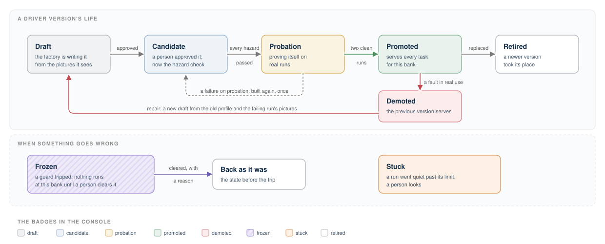
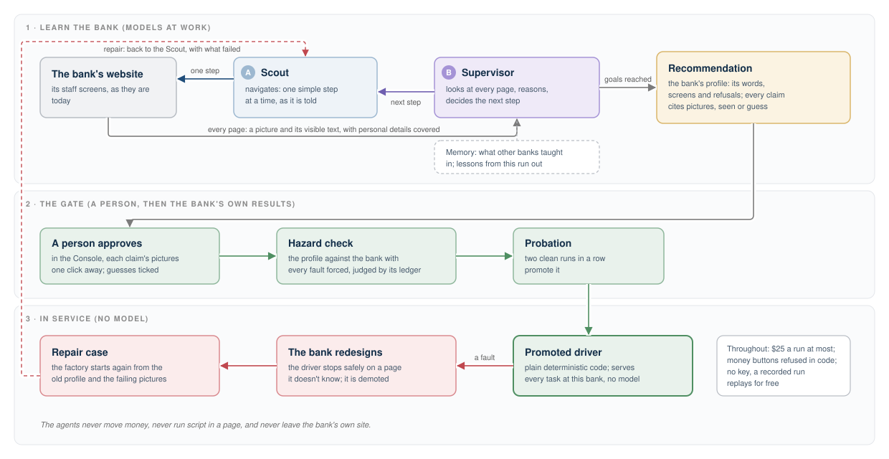

# Generic Bank Architecture

> **The boxes:** box A runs the application (Task API, Console, workflows, the Runner). Box B
> holds everything that lasts (Postgres, object storage, Memory). Box D is the software factory;
> it's created for a session and destroyed after. The four banks are the outside world.

---

## Overview

An AI agent asks for a typed task (check a balance, prepare a transfer, fetch statements) at a
bank whose staff website has no API. The system works the website the way a person would and
hands back a typed result. When it can't go on safely, it stops and passes the work to a person,
with pictures of what it saw.

**Models build, runs stay deterministic, and people move money.** A customer's task runs
reviewed TypeScript: a driver someone approved, with no model in it. Models only work in the
software factory. Nothing presses a money button until a person approves that exact transfer,
once. When in doubt, a run stops.

- **The page is read the way a person reads it.** A driver asks for "the field labeled Amount",
  never a selector.
- **One vendor, many banks.** One driver per vendor product, and each bank on that product is a
  profile.
- **Small.** One Postgres, a workflow library and AdminJS, all on an 8 GB laptop.

---

## System Architecture

Box A holds no data of its own and can be rebuilt any time. Box B holds everything but can't
reach out to anything. Box D runs code a model wrote and calls the model live. That's why it lasts
one session and its sandbox has no way out at all. Only people and tests can read the fake staff
inbox, so a sign-in code is always a human step.

---

## Generic Bank (the target)

The target is **CoreLink Branch Console**, a staff console from the made-up vendor Acme Core
Systems, and it's unfriendly on purpose. It runs as four banks: one product, each with its own
words, look and quirks. The crawler signs in as staff, with one service account per bank. It never
signs in as a member.

Each bank has a real double-entry ledger, staff with roles and one-time sign-in codes, and
statements built from the ledger. It also has a hazard engine that throws the faults real banks
throw: slow pages, script errors, outages, dialogs, expired sessions, and a submit that seems to
vanish. Hazards strike at random, or a test forces exactly the ones it wants with a signed header.
The bank logs every hazard on its side. Tests judge what really happened from that log, the ledger
and a counter of state changes. A redesign switch (`BANK_REDESIGN`) gives a bank a new look and new
words, so we can show the factory's repair at work.

Appendix A puts the four banks side by side and walks through the screens a staff member sees.

---

## Task API and the workflow engine

One typed task goes in, one durable workflow runs it, and one typed result comes out. Send the
same request twice and you get the same run. The caller never sees the bank's screens, a selector,
a screenshot or any text from the page. It gets one fixed sentence per result code.

Each task is a DBOS workflow stored in Postgres, and every side effect is a recorded step. A run
prepares first: it signs in, asks a person for a code if the bank wants one, finds the accounts and
reads. Then it does the one step that matters and checks the result. When it needs a person, it
waits (durably) until someone answers or the deadline passes. Appendix B lists the endpoints and
every result a run can end in.

---

## The Runner

The Runner is the crawler. It runs two tasks at a time, each in its own Chromium browser, through a
promoted driver and the guardrails. In production, nothing else touches a bank.

The browser runs the bank's own scripts. After every action the Runner waits for the page to be
ready: the expected screen is there, something on it can be pressed, nothing says it's still
loading, and its frames have loaded. Then it reads the page from outside, without injecting any
script. It takes the layout of every frame, the accessibility tree and a screenshot, and builds a
**screen model** from them: the controls and text a person would see. Anything hidden,
transparent or covered is left out.

The Runner uses the screen model for three things. It recognizes which screen it's on; exactly one
must match, or the run stops. It finds what to act on by meaning ("the field labeled Amount", "the
button Submit transfer"). And it covers personal information before anything is saved (see
Evidence and PII removal).

A **driver** is written once per vendor product, as a small state machine over named screens. A
**profile** fills in one bank's words, account format and limits. Steps have time limits, and a
run that takes too many steps without finishing stops as stuck.

---

## Transfers: approval and the one click

Money moves only when a person approves this exact transfer. An unclear submit is never repeated.

The Runner fills in the transfer and holds on the bank's review page. A person sees that page, with
personal details covered, next to the values the Runner read, and approves with a reason. The
approval issues a one-time grant for this run, these accounts, this amount and this memo. It's good
for five minutes. The Runner checks that the screen still matches the grant, writes down that it's
about to press, and presses once. That uses up the grant.

If the bank shows a confirmation number, that's the answer. If it doesn't within 10 seconds, the
Runner never presses again. It searches the account's history for the transfer's memo marker,
reading it again, up to three times, if the bank gets in the way.
Found once, the transfer succeeded; found twice or not at all, a person looks. If a run loses its
browser while waiting, it signs in again and checks the review page against the grant before it
presses.

---

## Guardrails

Every safety rule is code in `packages/guardrails`, which imports nothing from the drivers, the
Runner or the factory. Prompts only repeat the rules.

Before any click or key press, four checks run in order:

1. Is this control one that is never allowed, on any screen?
2. Is this action (the screen, the verb, the control) on the task's list? An unlisted control whose
   name means moving money or changing an account is refused as such.
3. Is a secret typed only into a field the list marks secret, and does plain text never hold the
   stored password?
4. For the one money click, is there a valid grant?

Checking that each request goes to the bank's own site, classing each page as read-only or money,
and catching a confirmation that shouldn't have appeared are Part 2.

Any refusal stops the run, gets written down, freezes that bank until a person clears it, and tells
someone.

Credentials are SOPS secrets, given only to the Runner, the factory and the banks that check them.
They're typed, and they never come back out. Sign-in pacing is Part 2. The guards judge the controls
themselves, so instructions planted in a page's text change nothing. A guard error always stops the
run, and a lint rule forbids catching one.

---

## How failures are handled

Every failure lands in one of four places. **The bank said no** for a reason a member would
understand (no such member, insufficient funds): the run stops and reports it. **Something went
wrong that the run can fix** (a slow page, a dialog, an expired session): it fixes it, up to a
limit, and writes down what it did. **Something broke for good** (the bank is down, the password
is wrong): the run stops cleanly and says whether trying again might help. **The run can't go on
safely** (a screen it doesn't know, an unclear submit): it stops where it is and hands the work
to a person with everything they need.

Three rules always hold. Only reads are retried, at most twice. A run that goes wrong finishes with
a picture of where it stopped. And when a guard, the secret store or the spend meter is missing,
nothing acts.

### Failures in the bank

Sign-in trouble either stops the run or asks for help. A wrong password stops it at once, a locked
operator freezes the bank's sign-ins, and a sign-in code goes to a person. When the bank refuses
something in its own words (no member, a closed member, insufficient funds, a restricted account),
that's the answer the caller gets. If the bank is slow or briefly broken, the run waits or retries
a read, then gives up with a result that says a retry may help. A page the run doesn't recognize
makes it stop and escalate. It never guesses.

### Failures in our own system

A crashed worker or browser picks up at the last finished step. If the crash came between deciding
to press submit and seeing the result, the run goes to the history check, never to a second press.
A stalled run is ended with a final picture. If a person never answers, the deadline ends the run.
When Postgres, object storage or memory is down, the system does what each case calls for: it
refuses new work, stops before signing in, keeps pictures on disk until it can upload them, or
queues memory's records for later.

### Failures in the factory

Model errors are retried within the caps. At a cap, or after the same failure twice, the factory
stops and hands back what it knows. If a role calls a tool it isn't allowed, the call is refused
and recorded.

Appendix C has every case: what notices it, what the system does, and what the caller sees.

---

## Evidence and PII removal

**What the evidence is.** For every page a run reaches, the system keeps a picture of the page
and a record of what was on it: its visible text and controls, as JSON. It also keeps the steps
(which screen, what was done, how it went), a journal of every action it meant to take and what
happened, the answers people gave, and every guard decision. A run keeps its evidence however it
ends, and its last picture shows where it stopped.

**What it's for.** People use it to see what happened. The Frames button on a run in the Console
steps through every page, one at a time. An approver sees the bank's own review page before
approving a transfer, and each of the factory's recommendations comes with the pages that back it
up. The agents use it too. The Supervisor picks the next step by looking at the latest picture and
page record, and every claim it makes about a bank must point at pictures from its own run. A
repair starts from the pictures of the run that failed.

**PII removal.** Nothing personal is saved. Before a picture is stored, every piece of personal
information on it is covered with a white box: names, account numbers, amounts, codes, passwords,
emails, phone numbers and addresses, along with anything typed into a field and any image the system
can't read. The page record gets the same treatment. The system knows the member's details before
the run starts, so it covers them wherever they show up. It also covers anything that looks like an
account number, an amount, an email or a phone number. If it can't be sure a picture is clean, it
keeps only a note saying why, not the picture. Logs aren't scrubbed: they record requests, never
member details. A test suite, the PII scan, runs a balance and a transfer on bank 1, then searches
everything saved (every database row, file and log line) for the seeded personal details. One hit
fails it.

---

## Observability

What gets saved, all of it in Postgres and on this machine:

- **For every task run:** each step (screen, action, outcome, how long), each picture and page
  record, every recovery and the hazard behind it, every guard decision, the journal, and every
  answer a person gave.
- **For every factory run:** every model call (role, model, prompt version, tokens, cost, how
  long), every tool call and refusal, the Supervisor's decisions, the evaluation results, the
  lessons and the spend.
- **Logs:** JSON lines on each container's stdout, read with `just logs`. A log line never
  holds a field value, credential, code, account number, amount or name, and the PII scan checks
  the logs too.

Every row and log line carries the run's id and its step, so either one leads to the other. The
Console's pages read these records. Traces, `just trace` and `just observe` are Part 2.

---

## The Console

The Console is where people step in. It's built on AdminJS over the database models and lists
runs, steps, human tasks, drivers and their versions, factory runs and model calls, repair cases,
freezes and the journal, newest first, with filters and search. Its own pages add the inbox
(answer a code, approve, reject, take over), each run's frames, the hazard lab, the factory's
recommendations and freezes. Clearing a freeze and acting on a task in the inbox each need a
written reason. Buttons to promote, roll back and freeze by hand are Part 2.

There are three roles: viewer, approver and admin. A picture shows only if it passed PII removal;
a withheld one shows its reason instead. If two people answer the same task, the first wins and
the second is told who got there first.

A driver moves through draft, candidate, probation and promoted. Faults in real use demote it,
and the previous version takes over again. A guard trip freezes a bank until a person clears it.

---

## The software factory

Give the factory a bank and a task, and it makes a driver version for a person to approve. It has
two agents running on **pi** ([pi.dev](https://pi.dev)), an open-source harness that can talk to
any model provider. The provider and model for each role are set in configuration. pi reaches the
model only through our metering gateway, and every tool call is checked against the role's list
first. That keeps spend, caps and the allowed tools in our code.

The **Scout** navigates, one simple browser step at a time, as the Supervisor directs. The
**Supervisor** looks at every page the Scout reaches (the picture and the page record) and decides
the next step toward the goal. Once the goals are reached, it drafts the bank's profile. Every
claim in the draft points at the pictures that show it and says whether it was seen there or is a
guess. A person approves the draft in the Console and ticks any guess they accept. The approved
profile then runs against the bank with each hazard forced, then goes on probation; two clean runs
promote it. If a promoted driver later fails because the bank changed, it's demoted, a repair case
opens, and the factory starts again from the old profile and the pictures of the failing run.

Neither agent can move money, run script in a page, send a request of its own or leave the bank's
site. Transfer work stops at the review page, and code refuses the money buttons. Spend is capped
at $25 a run and $150 a rolling week, and each run has limits on turns, sign-ins and hours. With
no API key, the factory replays a recorded run and costs nothing. Appendix E has the roles and the
evaluation ladder.

### Memory: how the factory remembers

Memory is how the factory's agents remember. Without it, every factory job starts from zero and
learns again what the last one already knew. With it, the factory learns from each job (what went
right and what went wrong) and from every crawler it has shipped.

It keeps four kinds of thing:

- **Episodes:** what happened (a run, its attempts, the outcome and evidence). Always trusted,
  because they're records.
- **Hypotheses:** what an agent believes but hasn't proven. Never served as truth.
- **Facts:** typed claims proven by a run that succeeded.
- **Lessons:** advice for future jobs, with their evidence and scope. Trusted once confirmed.

Episodes are episodic memory, facts are semantic memory, and lessons (along with the curated
rules, checks, scenarios and approaches) are procedural memory. A lesson covers one bank, every
bank on the same product, or everywhere. One that covers everywhere is a pattern. Patterns are the
most valuable kind and the most dangerous, so only a person can approve one.

Code writes the episodes and facts. The only thing a model writes is a lesson proposal, and those
come from the Supervisor. Fixed rules, not models, decide what a lesson becomes:

- A near-duplicate merges into the lesson already held.
- A driver's promotion confirms the lessons its probation runs relied on.
- One contradiction disputes a lesson; two retire it.
- A lesson confirmed at two banks of a vendor widens to the vendor.
- A lesson proven across three vendors becomes a pattern candidate, which a person approves.

Every write adds a row to a hash-chained change log.

A factory run starts from a **knowledge pack**. It holds the patterns first, then the vendor's
lessons, then the bank's, then the proposed ones (marked "verify before relying") and the disputed
ones (with the reason). It adds recurring failures and the two nearest working drivers as examples.
So when the factory explores a new bank on a product it knows, the pack carries what the last bank
taught it.

- **Postgres is the store,** in its own `memory` database that only the Memory service opens.
  Code writes episodes, versions and the change log in plain SQL, with no model in the loop.
- **Facts are bi-temporal rows** (`valid_at`, `invalid_at`, `expired_at`). An old fact is closed,
  never deleted, so memory can say what it believed at the time of any past run.
- **Search is hybrid:** full-text ranking plus pgvector similarity, merged by reciprocal rank,
  with embeddings from a local model.
- **Every writer holds a role token,** and writes are signed with a key that only deterministic
  code holds. No agent can promote its own belief into truth.
- **Provenance on every entry** (run, model, prompt versions, evidence hash), **nothing
  overwritten**, and a **privacy screen** on every write.

Agents ask questions mid-run with one tool, `memory_query`. People read memory in the Console,
which uses the same API, so memory has one door. Appendix D has the API and its answers.

---

## Dependencies

Every package and why it was chosen: [techstack.md](techstack.md).

---

## Known Limitations

- **Web only.** Desktop and terminal capture would plug into the same screen-model seam.
- **Two browsers at a time,** so a transfer waiting for approval never holds up other tasks. That
  still fits an 8 GB laptop with Docker at 5 GB; concurrency is a setting.
- **Hazards are ours.** Real vendors will have others.

---

## Appendix A. The four banks

| Bank | URL | Labels | Layout | Account wording | Supervisor over |
|---|---|---|---|---|---|
| Generic Bank (4.2) | `localhost:8081/corelink/` | Operator ID, Member Search, Transfer Funds, Submit transfer | left nav frame; 2003 styling | "Account ending in 7890" | $2,500 |
| Example Credit Union (4.3) | `localhost:8082/` | Username, Find Member, Move Money, Confirm (an image) | top tab frame from another origin | "Share ****3456-S01" | $1,000 |
| Sample Savings Bank (4.3, customized) | `localhost:8083/online/branch/` | Staff number, Member Inquiry, Internal Transfer, Post | bank 2 plus a notices frame; headings as images | "Acct 1234-5678-90" | $500 |
| Placeholder FCU (4.4) | `127.0.0.1:8084/cu/ib/` | User, Search (popup results), Authorize | menu bar, no frameset; cross-origin sign-in iframe; two-page transfer | "··· 7890 (Checking)" | $2,000 |

A staff member's path through a bank starts at a blank "Loading…" page that moves on by itself.
Next comes the sign-in, which can say wrong password, locked or rate-limited. Then a sign-in code
arrives by text or email, and a blank page holds mid-sign-in. After that is the console, with its
banner, menu and main area. From there the staff member runs a member search (no member found,
record in use, member closed) and reaches the member's summary with account tiles. A tile leads to
its activity (rows arrive late), its statements (a PDF in a new window) or a transfer. A transfer
goes to a review page, then to a supervisor's approval if it's over the threshold, and ends with a
confirmation number.

Ambient hazards, per page and never on the transfer pages: up to 150 ms of latency; a harmless
script error at 2%; a confirmation dialog and a promotional page at 1% each; a slow sign-in
handoff at 2%. Rarer, the ones that could stop a run: a 503 at 0.01%, a broken widget at 0.005%,
and a fatal script error, a record in use and an early session expiry at 0.002% each. A run loads
about 20 pages, so about 1 run in 240 meets one of those, before the Runner recovers from any.
These happen only when forced: a swallowed submit or click, late rows,
an injected instruction, an unknown screen, and permission, not-found and validation errors.

## Appendix B. The Task API

| Endpoint | Purpose |
|---|---|
| `GET /tasks` | the catalog: task names and input schemas |
| `POST /tasks/check-balance` | bank, member reference, account |
| `POST /tasks/transfer` | bank, member reference, from, to, amount in cents, memo, idempotency key |
| `POST /tasks/download-statements` | bank, member reference, account, months |
| `GET /tasks/:id?wait=30` | long-poll for the result |
| `GET /statements/:id` | a statement's PDF, by the id a run returned |
| `POST /oauth/token` | a token: client credentials, a one-time code or a refresh token |
| `GET /banks`, `GET /tools` | each bank and the tasks it serves; the tasks as agent tools |
| `POST /human-tasks/:id/{answer,approve,reject,take_over,resume,finish,cancel}` | every inbox action, on the Console (port 8080) |

| Result | Codes |
|---|---|
| `succeeded` | done and verified |
| `business_outcome` | `no_such_member`, `member_closed`, `no_such_account`, `insufficient_funds`, `permission_denied`, `account_restricted`, `limit_exceeded`, `invalid_amount`, `approval_rejected` |
| `needs_human` | `awaiting_staff_code`, `awaiting_approval` |
| `handed_off` | `taken_over`: a person finished it by hand |
| `escalated` | `unknown_screen`, `stuck`, `ambiguous_outcome`, `guard_tripped` |
| `failed` | `app_error`, `unavailable`, `record_in_use`, `operator_locked`, `bad_credentials`, `step_timeout`, `no_driver` (retryable: `app_error`, `unavailable`, `record_in_use`, `step_timeout`) |
| `expired`, `cancelled` | |

## Appendix C. Every failure

### In the bank

| Failure | Detected by | The system | The caller sees |
|---|---|---|---|
| Wrong password | sign-in error screen | stops; never submits again | `failed: bad_credentials`, not retryable |
| Operator locked or rate limited | lock screen | stops; freezes the bank's sign-ins until a person clears them | `failed: operator_locked`, not retryable |
| Staff code needed | code screen, with proof a code was sent | waits; opens a human task | `needs_human: awaiting_staff_code` |
| Code rejected or expired | the bank's wording | one attempt per code; asks for a new one only if the bank offers | `awaiting_staff_code` again; `failed: bad_credentials` after three refused codes |
| No member found, member closed | lookup result | stops | `business_outcome: no_such_member` / `member_closed` |
| Record in use by another operator | lookup result | retries the read twice, then stops | `failed: record_in_use`, retryable |
| Insufficient funds, permission, restricted, limit, validation | the transfer form, in the bank's words | stops; nothing submitted | `business_outcome` with the matching code |
| Slow page, late rows | the ready check | waits up to the step limit | nothing |
| 503 or fatal script error | error screen | retries a read twice, with backoff | nothing, or `failed: unavailable` / `app_error`, retryable |
| A widget failed to draw | a needed control missing | reloads once | nothing, or `escalated: unknown_screen` |
| Session expired | sign-in screen inside the console | signs in again once and re-checks the member | nothing, or `failed: unavailable`, retryable |
| Confirmation dialog, promotional page | its signature | takes the choice that commits to nothing | nothing |
| Control moved before the click | re-read just before acting | finds it again, up to twice | nothing, or `escalated: unknown_screen` |
| Unknown screen, or two matches | recognition | stops where it is | `escalated: unknown_screen` |

### In our own system

| Failure | The system | The caller sees |
|---|---|---|
| Worker or browser crash | resumes at the last finished step; a lost browser signs in fresh; a crash after the decision to submit goes to the history check | nothing, or `escalated: ambiguous_outcome` |
| Stall: too many steps without finishing | saves a final picture and ends the run | `escalated: stuck` |
| Nobody answers a human task | the deadline ends the run | `expired` |
| Postgres down | new calls refused; running workflows pause and resume | HTTP 503 |
| Object storage down | pictures wait on disk and upload later | nothing |
| Memory down | runs continue; their records wait in an outbox; the factory won't start without its pack | nothing for tasks |
| A picture can't be proven clean | the picture isn't kept; the reason is | nothing |
| No promoted driver | refused before a browser opens | `failed: no_driver` |
| Invalid input | refused, naming the field | HTTP 400 |
| Same idempotency key twice | returns the existing run | the same run |

### In the factory

| Failure | The factory |
|---|---|
| Model error or timeout | retries within the caps, then hands back |
| A cap reached | stops and hands back |
| The spend ledger unreadable | refuses the call (a model with no price counts as free) |
| The same failure twice, or three turns without progress | stops and hands back |
| A tool outside the role's list | refused, recorded, and the model told why |
| A review not answered | a reminder at 24 hours; expires at 7 days |
| A regression on probation | builds again once; a second time, hands back |

## Appendix D. Memory's API

| Endpoint | What it does |
|---|---|
| `episodes/runs`, `episodes/attempts` | record a run and its attempts, with any promotion or demotion mark |
| `episodes/search`, `/recent`, `/recurring` | find similar failures, a bank's latest attempts, or a vendor's recurring failures |
| `facts`, `facts/search`, `facts/invalidate` | write a fact at the role's truth level; retrieve served facts; close a fact backed by a failed run |
| `lessons/proposals`, `lessons/relied-on` | propose a lesson (a near-duplicate merges); record which served lessons a run used |
| `lessons/confirm`, `lessons/retire` | confirm or retire a lesson, as a new version |
| `curated`, `curated/approve` | propose a curated version; a person approves it |
| `knowledge/pack` | everything a run starts from |
| `history`, `history/verify` | what changed and when; verify the change log |

| Response | Means |
|---|---|
| `401` | no token, or an unknown one |
| `403 role_forbidden` | a known role, not allowed this write; or an unsigned write |
| `409` | a verified fact with no successful run, an attempt with no run, or an approval that would move a version backward |
| `422` | the privacy screen refused a value |
| `503` | the memory database is down; runs keep going and their records wait in an outbox, but the factory won't start without its knowledge pack |

A change log that fails verification puts Memory into read-only mode until a person looks.

## Appendix E. The factory's roles and evaluations

| Role | Default model (configurable) | Writes | Sees |
|---|---|---|---|
| Scout | `claude-sonnet-5-5`, low effort | browser steps, as the Supervisor directs | the pages it reaches, tool results, the knowledge pack |
| Supervisor | `claude-opus-5-5`, high effort | the next step; the profile, each claim citing pictures, seen or guess; lessons | every picture and page record, never the Scout's reasoning |

| Rung | Proves | Where |
|---|---|---|
| E0 lint | the code follows the rules | Part 2 |
| E1 contract | typed outcomes on recorded screen models | Part 2 |
| E2 hazard matrix | a clean run, then each forced hazard alone, each with its expected result | sandbox, throwaway bank |
| E3 replay | behavior matches recorded runs | Part 2 |
| E4 live verify | fresh and remembered sign-in, ambient hazards on | Part 2 |
| E5 probation | two clean probation runs in a row, at most four | production |
| E6 stability | success rate, recoveries used, typical and slow durations over many runs | Part 2 |

The hazard check (E2) and probation (E5) are built. The eval tool, which prints one JSON object
and exits 0 (passed), 1 (failed) or 2 (couldn't run), is Part 2; "couldn't run" never counts as a
pass.
